# Design diagrams

These diagrams show the app as it is on `main` at commit `a7ba7673` (14 Nov 2026), after the chat-first redraw and the first engine pull requests. They are for the school's design rubric, the first presentation and a new teammate. Each one names the real pages, services, routes, tables and activity event kinds. When the code and a diagram disagree, the code is right and the diagram needs a fix.

The diagrams are drawn from these sources:

- The Portal's pages and rail in `portal/src/shell/routes.tsx`, which follow the chat-first sketch `docs/design/chat-first/prototype.html` and its build plan `docs/design/chat-first/BUILD-PLAN.md` (ADR 0043).
- The engine design in `docs/design/chat-first/ENGINE-PLAN.md` and ADRs 0026, 0027, 0044 and 0045. ENGINE-PLAN section 6 lists which engine pull requests have landed.
- The domain model in `docs/design/rebuild-domain-model.md`, and ADRs 0028 to 0032.
- The migrations in `platform-api/src/platform_api/migrations/`. The ER diagrams were last compared with `\d` of a running database on 31 Oct 2026 (`docs/evidence/diagrams/schema-2026-10-31.txt`). The tables added since then were drawn from the migrations alone.
- The Cosmos DB code in `platform-api/src/platform_api/monitoring/` (P4), and the items in a running emulator (`docs/evidence/diagrams/cosmos-2026-10-31.txt`).
- `deploy/compose.yaml`, `deploy/n8n/Dockerfile`, `infra/envs/dev/main.tf` and the workflows in `.github/workflows/`.
- `contracts/openapi.json`, `contracts/activity-event.schema.json`, `contracts/agent-api.schema.json`, `n8n-node-pack/node-types.json` and the recorded runs in `contracts/fixtures/runs/`.

To check every diagram, run `scripts/render-diagrams.sh`. It renders each Mermaid block with the Mermaid CLI in Docker and writes the PNGs to `docs/evidence/diagrams/`. It checks the routes and event kinds against the contracts, the ER diagrams' tables against the migrations, and the CI/CD diagram's jobs against the workflow files. It also fails on the old themed names, on the names the rebuild retired, and on long dashes. `docs/evidence/diagrams/README.md` says when the PNGs were last rendered.

"Use case" is the code's name for what people see in the app as a workflow (`GLOSSARY.md`). The diagrams use "workflow" for what people see, and "use case" for the code and the tables. "n8n workflow" always means the workflow inside n8n.

**Two engines, for now.** A workflow set up from the chat runs as its own n8n workflow, built from our node pack (`use_cases.engine` is `own`). The Software watchlist and the workflows made before 13 Nov still run through the shared `run` n8n workflow in two legs (`engine` is `shared_run`). Engine pull requests E9 and E10 move them over and then remove `run` and `schedule_tick`. Until then both paths are live, and the diagrams show both where they differ.

## Use case diagram

Two roles use the app, and one person may hold both. Everyone starts in the chat. The Operator asks for a workflow in plain words, sets it up from the set-up card, tests the draft and turns it on. The Operator also looks after the Software watchlist and Settings, and retries a stopped run. The Approver says yes or no to a run's proposal, from the approval view or from its card in Teams, and confirms the risky setup changes. Each use case sits on the screen that does it. The rail leads to Chat, Workflows and Watchlist. Settings, the practice Jira, the run page and the approval page are full pages too, and the Teams button opens the practice Teams panel. Everyone signs in with Entra ID, and the People list gives them their roles.

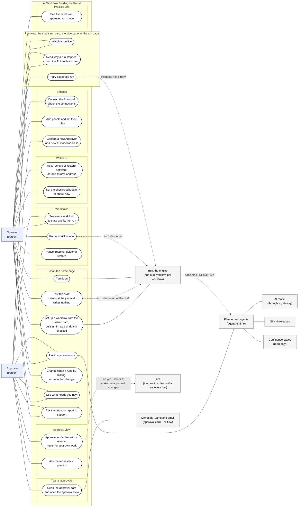

Each use case maps to a screen that exists and to the routes it calls:

| Use case | Screen | Who | Route |
|---|---|---|---|
| Ask in my own words | Chat, `/` | Both | `POST /api/v1/planner/answer`, and `POST /api/v1/planner/check-part` for a part the person changed |
| Set up a workflow from the set-up card | Chat, the set-up card and its build panel | Operator | `POST /api/v1/builder/plan`, then `POST /api/v1/agent-use-cases`, which lays the workflow out in n8n as a draft, grades it and returns the build log |
| Test the draft | Chat, the set-up card | Operator | `POST /api/v1/use-cases/{use_case_id}/runs` on a draft, which starts only a test run (ADR 0044) |
| Turn it on | Chat, the set-up card | Operator | `POST /api/v1/use-cases/{use_case_id}/turn-on`, which publishes version 1 in n8n |
| Change when it runs, or undo | Chat, the edit card | Operator | `PUT /api/v1/use-cases/{use_case_id}/schedule`, `GET /api/v1/use-cases/{use_case_id}/versions`, `POST /api/v1/use-cases/{use_case_id}/versions/{version}/undo` |
| See what needs you now | Chat, the needs strip | Both | `GET /api/v1/home` |
| Ask the team, or report to support | Chat | Both | `POST /api/v1/team-requests`, `GET /api/v1/team-requests/{request_id}`, `POST /api/v1/team-requests/{request_id}/replies` |
| See every workflow | Workflows, `/workflows` and `/workflows/{use_case_id}` | Both | `GET /api/v1/use-cases`, `GET /api/v1/use-cases/{use_case_id}`, `GET /api/v1/runs` |
| Run a workflow now | Workflows | Operator | `POST /api/v1/use-cases/{use_case_id}/runs`, with an `Idempotency-Key` |
| Pause, resume, delete or restore | Workflows | Operator | `POST /api/v1/use-cases/{use_case_id}/pause`, `.../resume`, `DELETE /api/v1/use-cases/{use_case_id}`, `.../restore` |
| Add, remove or restore software | Watchlist, `/software` and `/software/{software_id}` | Operator | `POST /api/v1/watchlist/find`, `POST /api/v1/watchlist/software`, `DELETE /api/v1/watchlist/software/{software_id}`, `.../restore`, `POST /api/v1/watchlist/software/{software_id}/address` |
| Set the check's schedule, or check now | Watchlist | Operator | `PUT /api/v1/watchlist/schedule`, `DELETE /api/v1/watchlist/schedule`, `POST /api/v1/use-cases/{use_case_id}/runs` |
| Watch a run live | Run card in the chat, the side panel, or `/runs/{run_id}` | Both | `GET /api/v1/runs/{run_id}`, `GET /api/v1/runs/{run_id}/events` (server-sent events) |
| Read why a run stopped | Run view | Both | `GET /api/v1/runs/{run_id}/troubleshoot` |
| Retry a stopped run | Run view | Operator | `POST /api/v1/runs/{run_id}/retry` |
| Approve, or decline with a reason | Approval card in the chat, or `/approvals/{approval_id}` | Approver | `GET /api/v1/approvals/{approval_id}`, `POST /api/v1/approvals/{approval_id}/decisions`. Own work is refused with 403 |
| Ask the requester a question | Approval view | Approver | `POST /api/v1/approvals/{approval_id}/questions`. The requester answers with `POST /api/v1/approvals/{approval_id}/questions/{question_id}/answer` |
| Connect the AI model, check the connections | Settings, `/settings` | Operator | `POST /api/v1/settings/model/connect`, `PUT /api/v1/settings/model`, `GET /api/v1/settings/connections`, `POST /api/v1/settings/connections/{connection}/check` |
| Add people and set their roles | Settings | Operator | `POST /api/v1/people`, `PUT /api/v1/people/{person_id}/operator`, `POST /api/v1/people/{person_id}/approver` |
| Confirm a new Approver or a new AI model address | Settings | Approver | `POST /api/v1/confirmations/{confirmation_id}/decisions`, `POST /api/v1/settings/model/address-decision` |
| Read the approval card | Teams approvals, the Teams button, or a real Teams channel | Approver | `GET /api/v1/teams-stub/messages`. With `TEAMS_WEBHOOK_URL` set, the card goes to a real Teams channel and links to the approval view (ADR 0036) |
| See the tickets an approved run made | Practice Jira, `/jira` | Both | `GET /api/v1/mock-jira/tickets` |

Some parts of the sketch wait for later engine pull requests, so they are not in the diagram: Open in n8n, the In n8n tab and n8n access per person (E7, E8), Changed in n8n with Undo and roll back (E6), registering a workflow made in n8n (E15), and n8n's own read and notice nodes (E16). The sponsor's two real use cases, the quarterly access review with two Approvers in turn and patch housekeeping, are Phase 2.

## Logical architecture: functional elements and subsystems

The rubric asks for the functional elements and how they pack into subsystems. There are six subsystems. Four of them are the bounded contexts. The other two are the Portal, which only presents, and n8n with our node pack, which only carries each run from block to block. Each box inside a subsystem is a functional element, and the table below names its code. Arrows are the main calls between subsystems. The next section, the context map, shows the same contexts with their database schemas, ports and contracts.

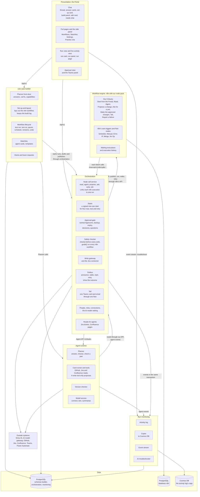

| Subsystem | Functional element | Code |
|---|---|---|
| Presentation | Chat | `portal/src/screens/home/` (`ChatView.tsx`, `AnswerCards.tsx`, `SetupCard.tsx`, `BuildPanel.tsx`, `EditCard.tsx`, `NeedsSection.tsx`) |
| Presentation | Full pages and the side panel | `portal/src/screens/workflows/`, `software/`, `settings/`, `jira/`, `home/SidePanel.tsx`, `portal/src/shell/Rail.tsx` |
| Presentation | Run view and live activity view | `portal/src/screens/run/` (`RunPage.tsx`, `RunPanel.tsx`, `liveRun.ts`), `home/RunCard.tsx`, `portal/src/stream/` |
| Presentation | Approval view and the Teams panel | `portal/src/screens/run/`, `home/ApprovalCards.tsx`, `portal/src/shell/TeamsPanel.tsx` |
| Use case builder | Planner front door | `builder/planner.py`, `planner_http.py`, `planner_facts.py` |
| Use case builder | Set-up and layout | `builder/layout.py` (`lay_out`), `n8n_draft.py` (`check_draft`, the build log), `service.py` |
| Use case builder | Workflow lifecycle | `builder/lifecycle.py`, `lifecycle_http.py` |
| Use case builder | Watchlist, agent cards, templates | `builder/watchlist.py`, `cards.py`, `card_store.py`, `templates.py` |
| Use case builder | Home and team requests | `builder/home.py`, `team_requests.py` |
| Orchestration | Node call service | `orchestration/n8n_calls.py`, `n8n_call_service.py`, `n8n_calls_http.py`, `n8n_call_book.py` |
| Orchestration | Starts | `orchestration/n8n_starts.py` |
| Orchestration | Approval gate | `orchestration/approvals.py`, `decisions_http.py`, `questions.py`, `confirmations.py` |
| Orchestration | Safety checker | `orchestration/write_actions.py` (`check()`), `workflow_check.py` (`grade()`, `add_yes()`) |
| Orchestration | Write gateway and the Jira connector | `orchestration/write_actions.py` (`WriteGateway`), `jira.py`, `jira_rest.py` |
| Orchestration | Outbox | `orchestration/dispatch.py`, `store.py` |
| Orchestration | Tell | `orchestration/tell.py` |
| Orchestration | People, roles, connections, the AI model setting | `orchestration/people.py`, `connections.py`, `model_settings.py`, `settings_http.py` |
| Orchestration | Reads for agents | `orchestration/jira_reads_http.py`, `confluence_reads_http.py`, `confluence_rest.py` |
| Run monitoring | Activity log, copier, event stream, troubleshooter | `monitoring/log.py`, `copier.py`, `cosmos_log.py`, `http.py`, `troubleshooter.py` |
| Agent runtime | Planner, card runner, tools, Version checker, model access | `agent_runtime/planner.py`, `card_runner.py`, `tools.py`, `confluence.py`, `version_checker.py`, `model_access.py`, `summary.py` |
| Workflow engine | Our 8 blocks | `n8n-node-pack/src/`, listed in `n8n-node-pack/node-types.json`, built into our n8n image by `deploy/n8n/Dockerfile` |
| Workflow engine | The shared `run` and `schedule_tick` n8n workflows, for `shared_run` workflows until E10 | `orchestration/workflows/*.n8n.json` |

Paths under `builder/`, `orchestration/` and `monitoring/` are in `platform-api/src/platform_api/`. Paths under `agent_runtime/` are in `agent-runtime/src/`.

Three rules hold across the subsystems. The Portal reads only our API. n8n reaches nothing but our API, because our blocks have no address field and no credential of their own, and read the address and key from the container. Every write goes through the write gateway, which checks our own records at the moment it writes (ADR 0026). The node allow list that leaves n8n no other node is built and tested in CI by `scripts/pack-smoke.sh`, but the deployed n8n does not switch it on until engine pull request E11. Until then the deployed n8n turns off Execute Command, the Local File Trigger and community packages, and blocks `$env` in expressions.

## Bounded contexts (DDD context map)

There are four contexts. Three of them ship in one container, `platform-api` (ADR 0010), and each has its own PostgreSQL schema and database role. The agent runtime is a separate Python project and container, so platform-api cannot import it. Solid arrows are code dependencies, pointing from the context that imports to the one it imports. `import-linter` enforces them in CI, and a context may import another only through its package `__init__`. Dashed arrows are calls over the network.

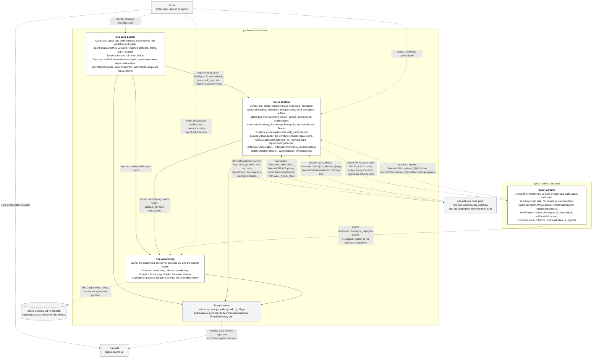

Each context reaches the outside world through ports that it owns. The adapters in the table run today. The right-hand column names what replaces each one later.

| Context | Port | Adapter now | Later |
|---|---|---|---|
| Use case builder | `RunStarter` (owned by orchestration) | `Orchestrator` | none needed |
| Use case builder | `N8nDrafts` (owned by orchestration) | `N8nWorkflows`, which saves a draft in n8n, publishes it and reads its versions | none needed |
| Use case builder | `CardPlanner` | `CardPlanning`, which sends the connected AI model's settings to the agent runtime | none needed |
| Orchestration | `RunStarts` | `N8nStarts`, which signs a one-use start and posts it to the workflow's Start from the Portal block | none needed |
| Orchestration | `Waker` | `N8nWaker`, which wakes a waiting execution with the decision and its `mac` | none needed |
| Orchestration | `WorkflowEngine` | `N8nWebhooks`, for `shared_run` workflows only | removed in E10 |
| Orchestration | `AgentRuntime` | `HttpAgentRuntime` | none needed |
| Orchestration | `ApprovalChannel` | `TeamsStub`, the practice Teams, or `TeamsWorkflowsWebhook` for a real channel when `TEAMS_WEBHOOK_URL` is set (ADR 0036) | Approve buttons inside Teams |
| Orchestration | `TellOutlet` | `TellFlow`, the team's Power Automate flow, when `TEAMS_TELL_WEBHOOK_URL` is set, else `TellPractice` | none needed |
| Orchestration | `WriteConnector` | `JiraWriteConnector` over `JiraRestAdapter`, which speaks to the practice Jira, or to a real Jira when `JIRA_BASE_URL` is set (ADR 0035) | more systems, each with its own ADR |
| Orchestration | `ActivityLogPort` | run monitoring's `ActivityLog` | none needed |
| Run monitoring | `EventReader` | `CosmosEvents` when `ACTIVITY_READER` is `cosmos`, else `PostgresEvents` | a DynamoDB adapter for AWS (ADR 0031) |
| Run monitoring | `EventCopy` | `CosmosEvents`, filled by the `Copier` | none needed |
| Shared kernel | `Authenticator` | `DevAuth`, which reads `X-Dev-User` on localhost only, or `OidcAuthenticator` for Entra ID | none needed |
| Shared kernel | `PeopleDirectory` | `People`, the People list in PostgreSQL (ADR 0029) | none needed |
| Agent runtime | `Planner` | `FixedPlanner`, which brings in the Version checker for a watchlist check and each saved agent for a workflow. Answering in the chat asks the AI model | a model for every run |
| Agent runtime | `ReleaseSource` | `GitHubReleaseSource`, or a fake GitHub in tests | the package registries (ADR 0025) |
| Agent runtime | `ConfluenceReader` | `PlatformConfluence`, which reads through platform-api, so the runtime holds no Confluence key | none needed |
| Agent runtime | `Summarizer` | `TemplateSummarizer`, or `ModelSummarizer` when a model is set | the model the eval picks (ADR 0032) |

The database holds the same boundaries as the code. Each role has grants on its own schema only. The one exception is that `wab_orchestration` may read and insert into `monitoring.run_events`, so a run's state change and its activity events commit in one transaction. n8n has its own database, `n8n`, and its own role, with no access to `platform`.

Three published contracts cross process boundaries. CI makes each one again from its owner's models and fails on any difference.

| Contract | Owner | Readers |
|---|---|---|
| `contracts/openapi.json` | platform-api (all three contexts) | the Portal's typed client, the DAST scan |
| `contracts/activity-event.schema.json` | run monitoring | the live activity view, the AI troubleshooter |
| `contracts/agent-api.schema.json` | agent runtime | orchestration's `HttpAgentRuntime`, NCS's agent hub later |

## Class diagram: the domain model

These are the things the app keeps, from the domain model's tables. Each class names its context. A class marked Phase 2 is designed but not built. The diagram shows meaning, not storage: the ER diagrams below show the tables.

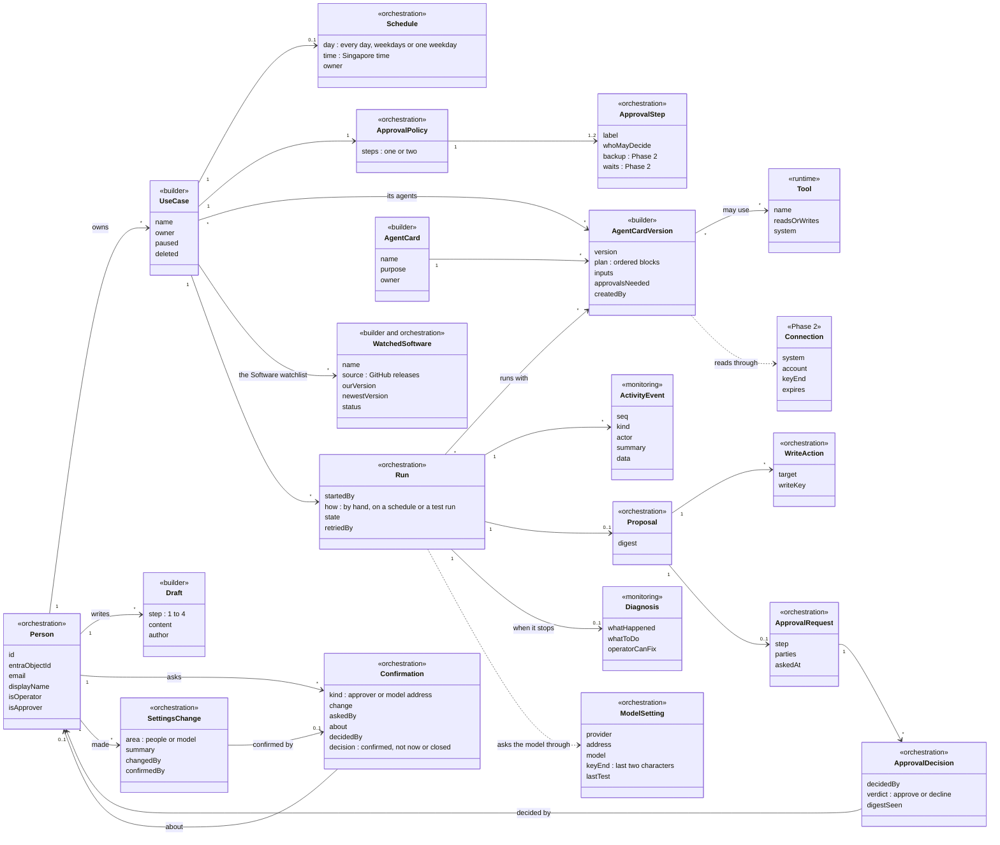

Three rules sit on these classes. Nobody approves their own work: the parties of a run are the person who started it, the workflow's owner and anyone who retried it, and none of them may decide. Nothing is written without a yes: a write action runs only after the last step of its approval request says approve, for the digest the Approver saw. And a confirmation is decided by an Approver who is neither the person who asked nor the person it is about.

A diagnosis is worked out from the run's latest `run_failed` event. It is not stored. A use case's agents are stored as the card version each one was saved with, so a later change to a card does not change a workflow that is already on.

## Class diagram: deciding on a proposal

This is the design of the key use case, an Approver's yes on the run page, at class level. It shows how the Portal, platform-api and n8n carry it out. The Portal's `ApprovalGate` calls the API through `useDecide`. orchestration's `decide` route hands the request to `Orchestrator`, which checks the pure rules in `approvals.py` and writes the decision, the run's new state and its activity events in one transaction. The act leg then goes through the safety checker and the write gateway.

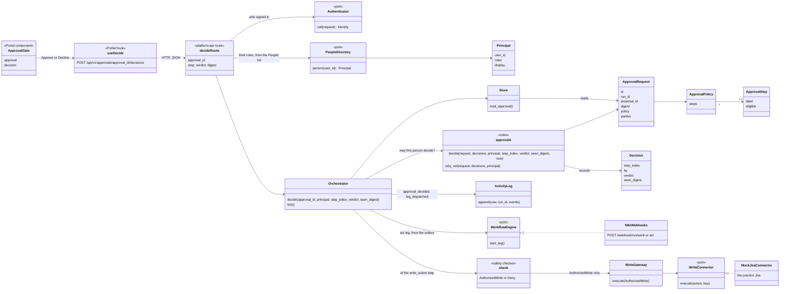

`approvals.decide` refuses a person without the Approver role, a party to the run, a step out of order, a step already decided and a digest that is not the current proposal's. The route answers 403 with the reason. `check` builds an `AuthorizedWrite` only for a run in `Acting`, whose approval folds to approved for the same digest, with a registered connector and operation. Anything else is a `Deny` and the event `write_action_denied`.

## ER diagram: the builder schema

The use case builder's tables, from its migrations. PK is a primary key, FK a foreign key and UK part of a unique key. A solid line is a foreign key. A dashed line is a reference by id that has no foreign key.

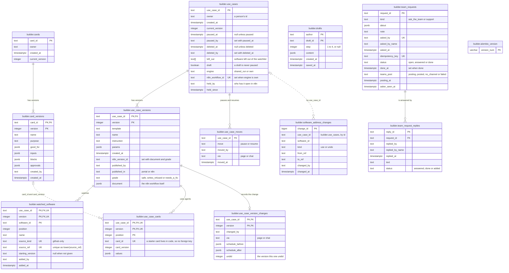

`builder.use_cases` keeps `deleted_at` instead of deleting a row, and `wab_builder` has no right to delete from it, so a deleted workflow's past runs stay readable and Restore can bring it back. `builder.watched_software` also has the unique index `watched_software_one_source_per_version` on `(use_case_id, version, source_kind, lower(source_ref))`, so one version of the watchlist names each GitHub project once.

## ER diagram: orchestration's runs and approvals

The tables that carry a run from start to the write. `runs.use_case_id` names a row in `builder.use_cases`, by id, with no foreign key across schemas. Every column that ends in `_by`, and `started_by` and `asked_by`, holds a person's id from `orchestration.people`, also with no foreign key, so a person who leaves keeps their name on past runs.

```mermaid
erDiagram
    runs["orchestration.runs"] {
        text run_id PK
        text use_case_id UK "builder.use_cases, by id"
        text idempotency_key UK
        jsonb spec
        text started_by
        timestamptz started_at
        timestamptz updated_at
        integer version "optimistic lock"
        text state
        jsonb state_data
        timestamptz deadline_at
        jsonb retried_by
        text carry_forward
        jsonb joined_by "who joined the run in n8n"
    }
    leg_attempts["orchestration.leg_attempts"] {
        text run_id PK, FK
        text leg PK "work or act"
        integer attempt PK
        text n8n_execution_id
        timestamptz recorded_at
    }
    proposals["orchestration.proposals"] {
        text proposal_id PK
        text run_id FK
        jsonb actions
        text digest
        timestamptz created_at
    }
    approval_requests["orchestration.approval_requests"] {
        text approval_id PK
        text run_id FK
        text proposal_id FK
        text digest
        jsonb policy
        jsonb parties "who may not decide"
        timestamptz created_at
        timestamptz expires_at "null before the expiry was kept"
        text ended "expired or cancelled"
        timestamptz ended_at "set with ended"
        text execution_id "the waiting n8n execution"
        text resume_url "sealed, set with execution_id"
    }
    approval_decisions["orchestration.approval_decisions"] {
        text approval_id PK, FK
        integer step_index PK
        text decided_by
        text verdict
        text seen_digest
        timestamptz decided_at
        text reason "a decline only, 1 to 200 characters"
    }
    approval_messages["orchestration.approval_messages"] {
        text approval_id PK, FK
        text channel
        text message_id
        timestamptz posted_at
        text identity "which channel posted it"
    }
    approval_questions["orchestration.approval_questions"] {
        text question_id PK
        text approval_id FK, UK
        text asked_by UK
        timestamptz asked_at
        text text
        text idempotency_key UK
        text answer "null until answered"
        text answered_by
        timestamptz answered_at
    }
    write_executions["orchestration.write_executions"] {
        text proposal_id PK, FK
        integer action_index PK
        text run_id
        text idempotency_key UK
        text status "started or done"
        timestamptz started_at
        timestamptz done_at
        text external_reference
    }
    outbox["orchestration.outbox"] {
        bigint id PK
        text run_id FK
        text kind
        jsonb payload
        integer attempt
        timestamptz next_at
        text status "pending, sent, cancelled or given_up"
        text last_error
        timestamptz created_at
        timestamptz leased_until "a tick leases the rows it takes"
        text idempotency_key UK "one wake for each request"
    }
    starts["orchestration.starts"] {
        text nonce PK
        text run_id FK
        text kind "run_now, test or retry"
        text n8n_workflow_id
        timestamptz issued_at
        timestamptz expires_at
        timestamptz used_at "set with used_by"
        text used_by
    }
    executions["orchestration.executions"] {
        text execution_id PK
        text run_id FK
        text n8n_workflow_id
        text mode
        text retry_of
        text version_id
        timestamptz linked_at
    }
    node_calls["orchestration.node_calls"] {
        text execution_id PK
        text node_name PK
        text run_id FK "empty on a refusal"
        text kind "read, agent, propose, ask, write or tell"
        text content_hash
        integer attempts
        text outcome "working, answered or refused"
        text call_id UK
        timestamptz claimed_at
        integer status "400 to 499, on a refusal only"
        jsonb answer
        jsonb actions
        timestamptz answered_at
    }
    jira_writes["orchestration.jira_writes"] {
        text idempotency_key PK
        timestamptz started_at
        text ticket_key "set once Jira answered"
        timestamptz claimed_at "which try holds it"
    }
    engine_status["orchestration.engine_status"] {
        integer id PK "always 1"
        timestamptz loaded_at
        boolean ready
        text detail
        jsonb workflows
    }
    mock_jira_tickets["orchestration.mock_jira_tickets"] {
        text key PK
        integer number UK
        text project
        text title
        text body
        timestamptz created_at
        text run_id "empty for a ticket made through the API"
        text proposal_id
        text idempotency_key UK
        text status "To Do or Done"
        timestamptz done_at
        text[] labels
        text issue_type
        text creator
        timestamptz updated_at
        text assignee
    }
    teams_stub_messages["orchestration.teams_stub_messages"] {
        text id PK
        timestamptz ts
        text channel
        text text
        text link "the run page"
        text run_id
        text approval_id UK
        jsonb card "the Adaptive Card"
        jsonb outcome "edited onto the card"
    }
    tell_practice_messages["orchestration.tell_practice_messages"] {
        text id PK
        timestamptz ts
        text run_id FK, UK
        text block UK
        jsonb body
    }

    runs ||--o{ leg_attempts : "tried in legs"
    runs ||--o{ proposals : "proposes"
    runs ||--o{ approval_requests : "asks"
    proposals ||--o{ approval_requests : "covered by"
    approval_requests ||--o{ approval_decisions : "decided in steps"
    proposals ||--o{ write_executions : "written as"
    runs ||--o{ outbox : "queues"
    runs ||--o{ starts : "started by"
    runs ||--o{ executions : "carried by"
    runs |o--o{ node_calls : "called in"
    runs ||--o{ tell_practice_messages : "told once per block"
    executions |o..o{ node_calls : "same execution_id"
    approval_requests ||--o| approval_messages : "posted as"
    approval_requests ||--o{ approval_questions : "questioned in"
    write_executions |o..o| jira_writes : "same idempotency_key"
    approval_requests |o..o| teams_stub_messages : "announced as"
    proposals |o..o{ mock_jira_tickets : "practice Jira tickets"
```

`mock_jira_tickets` and `teams_stub_messages` are the practice Jira and the practice Teams. Their `run_id`, `proposal_id` and `approval_id` are copies, with no foreign keys, as a real Jira or Teams would hold them. A ticket made through the practice Jira's API has no run, so its `run_id`, `proposal_id` and `idempotency_key` may be empty.

`starts`, `executions` and `node_calls` record how n8n carries a run. A start is a one-use nonce. An execution joins one run on its first node call. Each block's first answer or refusal is kept by execution and block, so a retried call gets the same answer. `jira_writes` is the Jira connector's record of each write key.

## ER diagram: orchestration's watchlist, schedules, people and settings

```mermaid
erDiagram
    software_checks["orchestration.software_checks"] {
        text use_case_id PK
        text software_id PK
        text run_id FK
        timestamptz checked_at
        text newest_version "or a problem"
        text problem
        timestamptz newest_at "set with newest_version"
        text full_name "the owner and name GitHub answered for"
        boolean not_found "GitHub gave a 404"
    }
    our_versions["orchestration.our_versions"] {
        text use_case_id PK
        text software_id PK
        text version
        text source "first_check or ticket_done"
        timestamptz learned_at
        text ticket_key "set when the ticket is done"
        text site "the Jira site, empty before it was kept"
    }
    proposed_tickets["orchestration.proposed_tickets"] {
        text proposal_id PK, FK
        integer action_index PK
        text run_id FK
        text use_case_id
        text software_id
        text version
        text status "proposed, written, done or dropped"
        text ticket_key
        timestamptz done_at
        text site "the Jira site it was proposed for"
    }
    schedules["orchestration.schedules"] {
        text use_case_id PK "builder.use_cases, by id"
        text day "every_day, weekdays or a weekday"
        text at "HH:MM, on a 5 minute step"
        text time_zone
        text owner_id "the schedule owner"
        text owner_name
        timestamptz saved_at
        timestamptz last_slot_started
    }
    people["orchestration.people"] {
        text id PK
        text entra_oid UK "set at the first sign-in"
        text email UK "unique as lower(email)"
        text display
        boolean is_operator
        boolean is_approver
        text added_by
        timestamptz added_at
        timestamptz bound_at
        timestamptz removed_at
    }
    confirmations["orchestration.confirmations"] {
        text id PK
        text kind UK "approver or model_address"
        text about FK, UK
        jsonb change
        text digest
        text asked_by
        timestamptz asked_at
        text decided_by
        text decision "confirmed, not_now or closed"
        timestamptz decided_at
    }
    settings_changes["orchestration.settings_changes"] {
        bigint id PK
        timestamptz changed_at
        text area "people or model"
        text changed_by
        text confirmed_by
        text confirmation_id FK
        text summary
    }
    model_setting["orchestration.model_setting"] {
        text slot PK "active or pending"
        text provider
        text style
        text base_url
        text model
        text sealed_key "encrypted"
        text key_hint "last two characters"
        real test_seconds
        text saved_by
        text saved_by_name
        timestamptz saved_at
    }
    model_hosts["orchestration.model_hosts"] {
        text host PK "a confirmed model address"
        text confirmed_by
        timestamptz confirmed_at
    }
    connection_checks["orchestration.connection_checks"] {
        text connection PK "jira, github, teams, model or confluence"
        text identity PK "the practice copy, or a fingerprint"
        text state "working, needs_attention, not_answering or not_set_up"
        text problem
        timestamptz checked_at
        timestamptz last_ok_at
        timestamptz expires_at
        text key_ends_in
        text unconfirmed_state "waits until a second check agrees"
    }
    orchestrationVersions["orchestration.alembic_version"] {
        varchar version_num PK
    }
    runsAgain["orchestration.runs"] {
        text run_id PK
    }
    proposalsAgain["orchestration.proposals"] {
        text proposal_id PK
    }

    runsAgain ||--o{ software_checks : "last read by"
    runsAgain ||--o{ proposed_tickets : "proposed in"
    proposalsAgain ||--o{ proposed_tickets : "one per write action"
    people |o--o{ confirmations : "about"
    confirmations |o--o{ settings_changes : "confirmed by"
    software_checks |o..o| our_versions : "same use_case_id and software_id"
```

The two `orchestration.runs` and `orchestration.proposals` boxes repeat the tables of the diagram above, to show their foreign keys. Two more unique indexes hold rules: `people_email_key` on `lower(email)`, so one email is one person, and `confirmations_one_open_key` on `(kind, coalesce(about, ''))` while `decided_at` is null, so only one confirmation of each kind waits for each person, and one for the AI model address.

## ER diagram: the monitoring schema

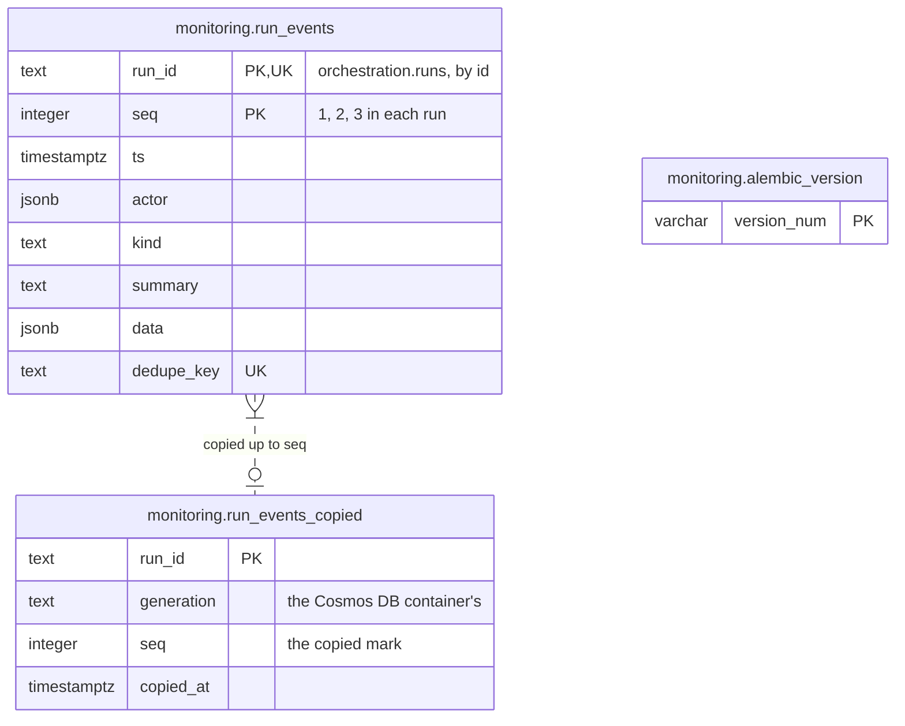

`monitoring.run_events` only grows. Both roles that may write it, `wab_orchestration` and `wab_monitoring`, have `SELECT` and `INSERT` and nothing else. The unique `(run_id, dedupe_key)` drops a repeated callback. PostgreSQL keeps every event even though the readers use Cosmos DB, because the next `seq` and the repeat check both read these rows (ADR 0031).

## NoSQL design: the activity log in Cosmos DB

ADR 0031 keeps a copy of the activity log in Azure Cosmos DB for NoSQL. PostgreSQL writes each event and sets its order. The copier in run monitoring copies each run's new events, in order, to one container. The live activity view, its replay, the events page and the AI troubleshooter read that container.

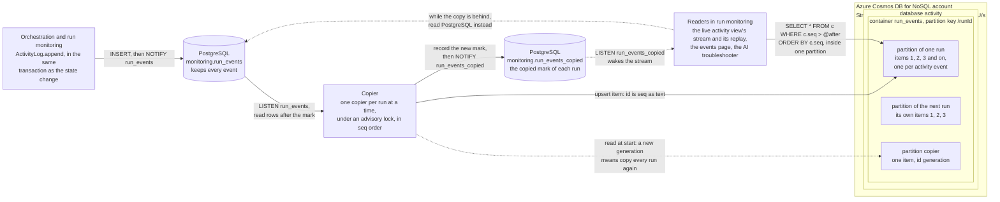

The item shapes, from `CosmosEvents.put` and `CosmosEvents.ensure`:

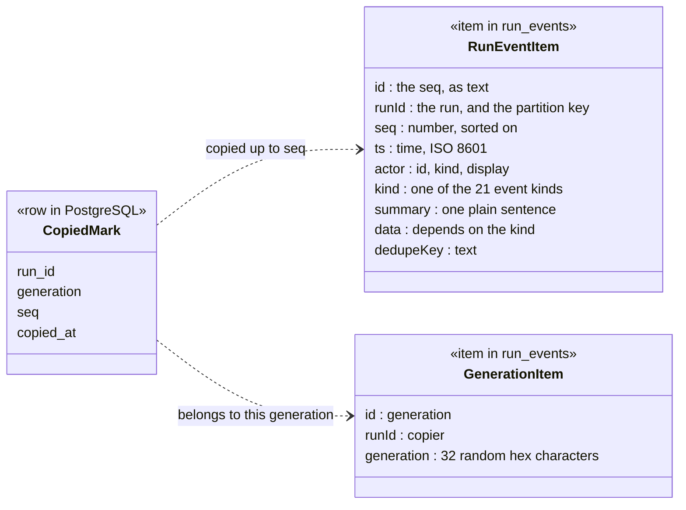

| Part | Value |
|---|---|
| Account | Azure Cosmos DB for NoSQL, Strong consistency, one region. Free tier with a 1000 RU/s cap, or serverless when the subscription refuses the free tier (`COSMOS_SERVERLESS`) |
| Database | `activity` |
| Container | `run_events`, 1000 RU/s on the free tier |
| Partition key | `/runId`, hash, version 2 |
| Item id | The event's `seq` in its run, as text. Copying the same event twice writes the same item twice and changes nothing |
| Main query | `SELECT * FROM c WHERE c.seq > @after ORDER BY c.seq`, with the run's id as the partition key. A reader stops before a gap and waits for the next copied notice |
| Other item | `id` `generation` in the partition `copier`. The copier writes a random generation into each new container. When the generation changes, every run is copied again from the start |
| Time to live | None. The log keeps every event |
| Who writes | Only the copier in platform-api. On Azure it signs in with the account key, read from Key Vault. That key may read and write items but may not create, change or delete a database or a container. platform-api's managed identity already holds the Cosmos DB Data Contributor role on `activity`, ready for when the key is turned off (CKV_AZURE_140 in `docs/evidence/iac/README.md`). Locally it uses the emulator's fixed key |

An item from the 31 Oct scan's run, as the emulator returned it, without Cosmos DB's own `_` fields:

```json
{
  "id": "13",
  "runId": "run_01M67WVHRG63X24F90AYT2GFZD",
  "seq": 13,
  "ts": "2026-10-31T02:33:10.301314+00:00",
  "actor": { "id": "platform", "kind": "platform", "display": "Platform" },
  "kind": "approval_requested",
  "summary": "Approval requested. Waiting for the Team approver.",
  "data": {
    "link": "/approvals/apr_01M67WVHWXETCD5ES3A31JGSHM",
    "steps": [{ "index": 0, "label": "Team approver", "status": "open", "decided_at": null, "decided_by": null }],
    "approval_id": "apr_01M67WVHWXETCD5ES3A31JGSHM"
  },
  "dedupeKey": "once:171dc915e723eb044af9ea29a0c2049c"
}
```

## Deployment now: Docker Compose

One command starts the whole stack: `scripts/up.sh`, which runs `docker compose -f deploy/compose.yaml up --build`. Only the Portal, platform-api and the n8n editor are published on the host. PostgreSQL, the Cosmos DB emulator and the agent runtime are reachable only inside the Compose network. Secrets never live in git. `deploy/make-env.sh` writes random values to `deploy/.env` (mode 600), and Compose passes them to each service as environment variables. For tests, `deploy/compose.e2e.yaml` adds a fake GitHub and a fake AI model, and `deploy/compose.scan.yaml` takes every published port away for the scans.

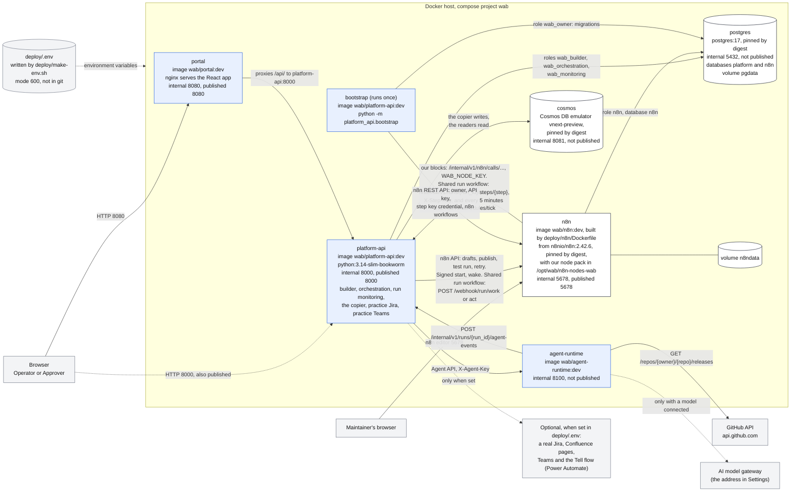

Services start in this order. postgres becomes healthy, then n8n becomes ready, then bootstrap runs to completion. bootstrap runs the migrations, sets up n8n, lints the n8n workflow files and loads them, the error workflow first. platform-api starts after bootstrap succeeds and the agent runtime is healthy. The Portal starts last. The Cosmos DB emulator starts alongside them, and nothing waits for it. Until it answers, platform-api's copier marks the copy as behind and keeps retrying.

| Secret in `deploy/.env` | Read by |
|---|---|
| `POSTGRES_PASSWORD`, `N8N_DB_PASSWORD`, `WAB_*_PASSWORD` | postgres (to create the roles), n8n, bootstrap, platform-api |
| `N8N_ENCRYPTION_KEY` | n8n. Never change it while the `n8ndata` volume is kept |
| `N8N_OWNER_EMAIL`, `N8N_OWNER_PASSWORD` | bootstrap |
| `STEP_KEY` | bootstrap stores it in n8n as a credential for the shared `run` workflow. platform-api checks it on the step and tick routes |
| `WAB_NODE_KEY` | n8n, where our blocks send it on every call, and platform-api, which checks it. It also signs the wake's `mac` |
| `WAB_START_SECRET` | n8n's Start from the Portal block and platform-api, to sign and check each start |
| `TEAMS_TELL_WEBHOOK_URL`, `TELL_EMAIL_TO` | platform-api, for Tell. Empty means the practice copy records what would be sent |
| `CONFLUENCE_BASE_URL`, `CONFLUENCE_EMAIL`, `CONFLUENCE_API_TOKEN`, `CONFLUENCE_PAGES` | platform-api only. The runtime reads a page through platform-api, and only the pages in `CONFLUENCE_PAGES` |
| `AGENT_API_KEY` | platform-api sends it, and the agent runtime checks it |
| `CALLBACK_SIGNING_KEY` | platform-api, to sign the agent's callback tokens |
| `SETTINGS_ENCRYPTION_KEY` | platform-api, to encrypt the AI model's key (ADR 0022) |

## Deployment on Azure

This is the shape that `infra/envs/dev/main.tf` builds and `.github/workflows/deploy.yml` deploys (P14). Each Compose service becomes one Container App, with the same images. The code does not change, because every cloud service sits behind a port, and secrets arrive as environment variables as they do in Compose.

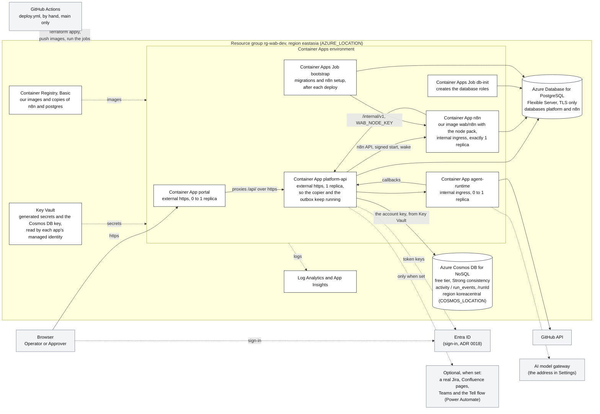

**Regions.** Terraform puts every resource in `location`, which is `southeastasia` unless the deploy workflow's `AZURE_LOCATION` variable sets another region. The Cosmos DB account goes in `cosmos_location`, from `COSMOS_LOCATION`, or in `location` when that is empty. The diagram shows what is set for the deploy of 31 Oct 2026. `AZURE_LOCATION` is `eastasia`, because the subscription's policy refuses `southeastasia`. `COSMOS_LOCATION` is `koreacentral`, because East Asia refused the Cosmos DB account for lack of capacity. This is what is configured, not proof of a working deploy: when this was written, that deploy had not finished. ADR 0031 should record the region choice. That is a follow-up for the team.

The Azure shape keeps three rules from the design.

- n8n holds no write key. The practice Jira lives inside platform-api, and a real Jira key would reach platform-api only, from Key Vault. Our blocks in n8n hold only `WAB_NODE_KEY` and `WAB_START_SECRET`, from Key Vault, and they call only platform-api.
- Our code never calls a Key Vault SDK. Secrets arrive as Container Apps secrets that point at Key Vault.
- There is no virtual network yet, so PostgreSQL, Cosmos DB and Key Vault keep public endpoints behind keys, TLS and roles. Private endpoints come with the move to DevNet (ADR 0005, `docs/design/devnet-move.md`). `docs/evidence/iac/README.md` lists each accepted finding.

## CI/CD pipeline

Every job in `.github/workflows/`, in each file's order, with its steps in order. Each step runs in a container pinned by digest, or in the runner's own tools, so the jobs can move to GitLab CI. A person starts the deploy by hand, and the `azure-dev` environment accepts only `main`.

```mermaid
---
config:
  flowchart:
    wrappingWidth: 420
---
flowchart TB
    pr["A pull request,<br/>or a push to main"]
    hand["By hand, on main"]
    daily["Every pull request, every push to main,<br/>and daily at 01:00 UTC"]

    subgraph ci["ci.yml"]
        direction LR
        checks["<b>job checks</b><br/>matrix: platform-api, agent-runtime, e2e<br/>1. uv sync<br/>2. ruff check and ruff format<br/>3. pyright<br/>4. lint-imports, platform-api only<br/>5. contracts are current<br/>6. unit tests in the image, with PostgreSQL<br/>and, for platform-api, the Cosmos DB emulator<br/>7. the emulator kept its pinned packages<br/>8. build the runtime image<br/>9. mock GitHub, mock model and mock Confluence tests, e2e only"]
        portaljob["<b>job portal</b><br/>1. npm ci<br/>2. typecheck<br/>3. lint<br/>4. unit tests<br/>5. build<br/>6. nginx render test"]
        n8npack["<b>job n8n-node-pack</b><br/>1. npm ci, without install scripts<br/>2. typecheck<br/>3. lint<br/>4. unit tests<br/>5. the image builds on the n8n pin<br/>6. pack smoke: n8n loads our blocks and the allow list holds"]
        scans["<b>job scans</b><br/>1. SAST with Semgrep<br/>2. keep the Semgrep report<br/>3. secret scan with gitleaks"]
        e2e["<b>job e2e</b>, on a push to main or by hand only<br/>1. scripts/e2e.sh: API tests, then the browser suite<br/>2. keep the logs, screenshots and video<br/>3. DAST: scripts/dast.sh, OWASP ZAP<br/>4. keep the ZAP reports<br/>5. load test: scripts/load.sh, k6<br/>6. keep the k6 summary"]
        %% Invisible links keep the jobs in the file's order, left to right.
        checks ~~~ portaljob ~~~ n8npack ~~~ scans ~~~ e2e
    end

    subgraph deploywf["deploy.yml"]
        direction LR
        deploy["<b>job deploy</b>, environment azure-dev<br/>1. Terraform 1.16.5 and Azure sign-in with OIDC<br/>2. connect to the remote state<br/>3. create the registry<br/>4. copy the public images, build and push ours<br/>5. create the database roles: the db-init job<br/>6. migrate the database: the migrate job<br/>7. check that n8n may open<br/>8. plan, check and apply everything, guarded<br/>9. run the bootstrap job<br/>10. say where the Portal is"]
    end

    subgraph evalswf["evals.yml"]
        direction LR
        evals["<b>job evals</b>, environment evals<br/>1. score the configured AI models<br/>on the golden set: scripts/evals.sh<br/>2. keep the results"]
    end

    subgraph infrawf["infra.yml, only when infra/ or a deploy file changes"]
        direction LR
        infra["<b>job infra</b><br/>1. infra/scripts/check.sh: terraform fmt,<br/>validate under Terraform and OpenTofu,<br/>the variable cases, tflint, Checkov<br/>2. actionlint on every workflow<br/>3. keep the check output"]
    end

    subgraph pstackwf["pstack-playbooks.yml"]
        direction LR
        pstack["<b>job pstack-playbooks</b><br/>1. read the locked pstack version<br/>2. fetch it and check it is the reviewed commit<br/>3. check the team's playbooks against it"]
    end

    azure[("Azure: rg-wab-dev")]
    artifacts[("Run artifacts: Semgrep report, e2e logs,<br/>ZAP reports, k6 summary, infra checks, eval results")]

    pr --> ci
    pr --> infra
    hand --> deploy
    hand --> evals
    daily --> pstack
    deploy --> azure
    ci -.-> artifacts
    infra -.-> artifacts
    evals -.-> artifacts

    classDef job fill:#ffffff,stroke:#111827,color:#111
    classDef trigger fill:#e8f0fe,stroke:#1a56db,color:#111
    classDef ext fill:#f3f4f6,stroke:#6b7280,color:#111
    class checks,portaljob,n8npack,scans,e2e,deploy,evals,infra,pstack job
    class pr,hand,daily trigger
    class azure,artifacts ext
```

The private repository is billed per job, rounded up to a whole minute, so the stages of `ci.yml` are steps inside five jobs, not one job each. The jobs of `ci.yml` run side by side, and `e2e` runs only on a push to `main` or by hand. The pipeline's results for the rebuilt app are in `docs/evidence/dast/2026-11-rebuild/`, `docs/evidence/load-test/2026-11-rebuild/` and `docs/evidence/unit-tests/2026-11-rebuild/`.

## Sequence: set up a workflow in the chat, test it and turn it on

How a request in plain words becomes an n8n workflow that is on. The Planner reads the request with the AI model and answers with a set-up card. Set up lays the workflow out as n8n blocks, the safety checker grades it, and n8n keeps it as a draft. The test run runs the draft for real up to Ask for a yes, then stops: it asks nobody and writes nothing (ADR 0044). Turn it on publishes version 1 and answers only when n8n says every trigger is live.

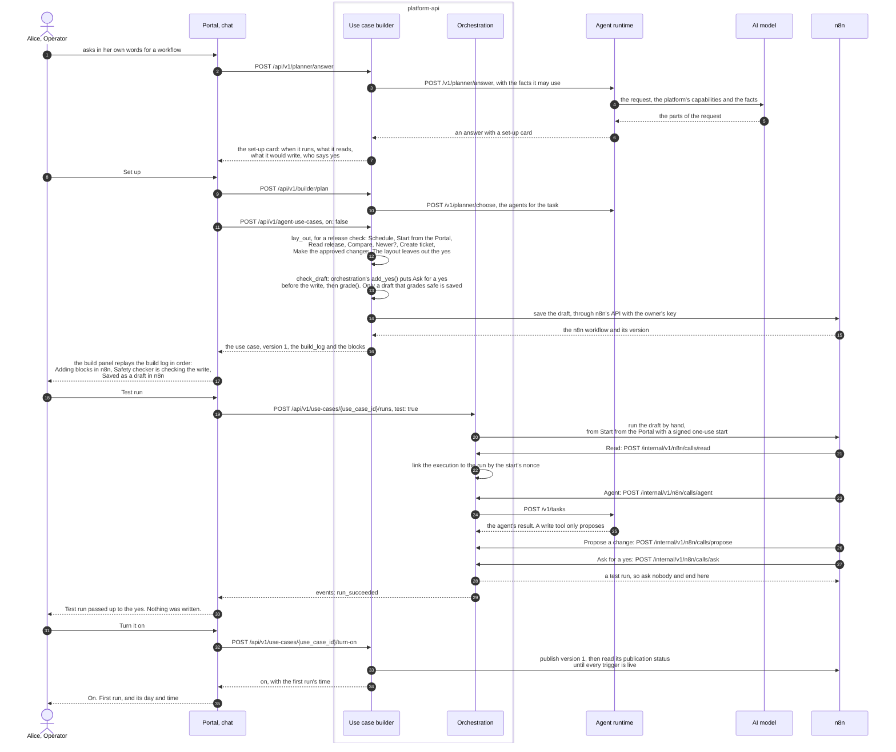

A layout that does not grade `safe` is refused with the checker's findings, and nothing is saved in n8n. Every node call is stored by execution and block, so a call n8n retries gets the first answer again. The gateway would refuse a test run's write anyway, with the `TEST_RUN` rule in `check()`.

## Sequence: a run waits for a yes in n8n, then the approved change is made

The key use case at run time, on the new engine (ADR 0026). n8n holds the wait as a waiting execution, but n8n never decides. Our records decide. The wake carries the decision with a `mac`, and the write gateway checks our records again at the moment of the write, so a wake on its own cannot make a write happen. The class diagram "deciding on a proposal" above shows the same decision at class level.

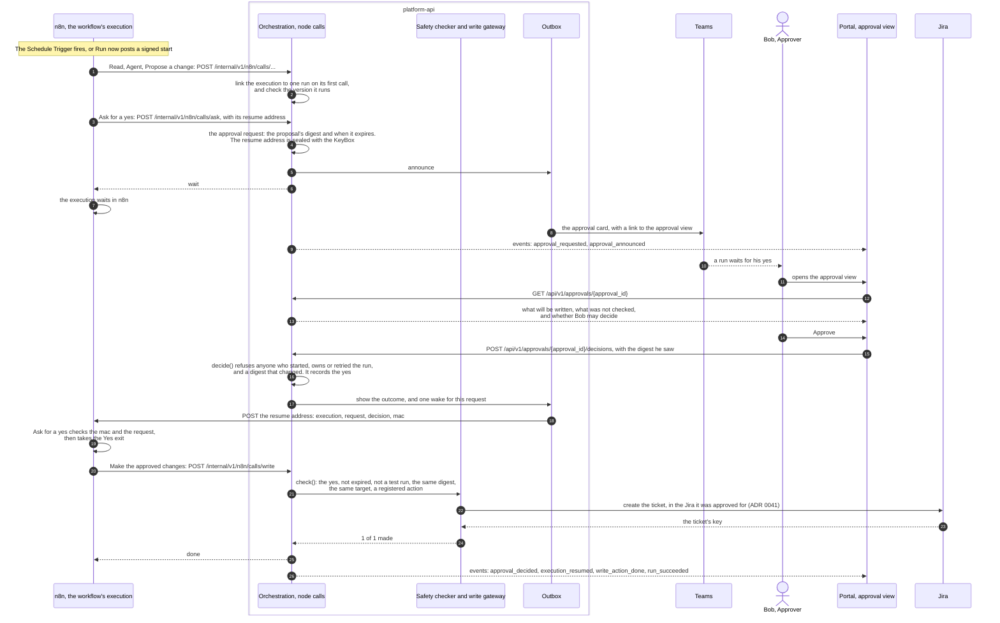

Ask for a yes has four exits, in this order: No answer, Yes, No and Nothing to change. Any error in n8n takes the first, so it ends the run without a write.

- **No.** The same wake carries `no`. The run ends rejected, with nothing written.
- **No answer.** Our own clock, not n8n's, ends the request when it expires (ADR 0024). It wakes n8n with `no_answer`, and the run ends expired, with nothing written. Every step is "any Approver" today. The backup Approver of ADR 0024 is not built yet.
- **n8n cannot be reached.** The outbox keeps trying the wake every 5 minutes for 24 hours, then marks the run lost. A 409 on the wake marks it lost at once.
- **A write with no yes.** If a person removed Ask for a yes in n8n, the gateway finds no yes for the run and refuses, so nothing is written.
- **The Software watchlist** still runs on the shared `run` n8n workflow until E9. Its approval is the same request, decision route and Teams card, and its write goes through the same `check()` and gateway. Only the two n8n legs differ.

## Sequence: the live activity view

How an activity event gets from the transaction that writes it to the run page. PostgreSQL sets the order and keeps every event. The copier copies to Cosmos DB, then wakes the stream. The stream reads Cosmos DB up to the copied mark and sends each event once, in order.

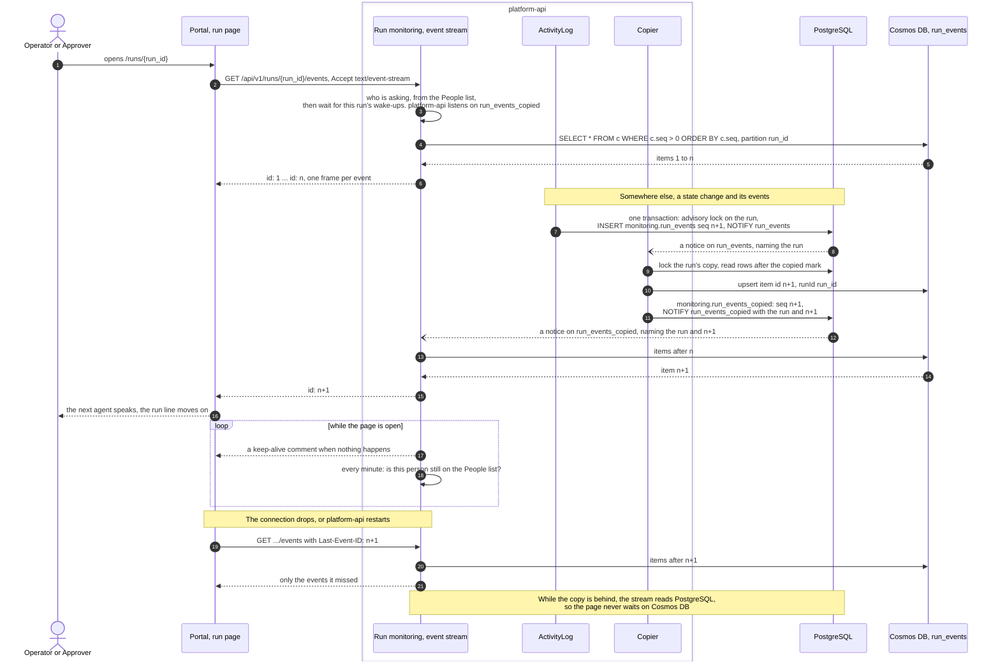

The run card in the chat and the side panel read the same stream as the run page. The events page, `GET /api/v1/runs/{run_id}/events` with `Accept: application/json`, and the AI troubleshooter read the same way, once. With `ACTIVITY_READER=postgres`, for a place without Cosmos DB, every reader reads `monitoring.run_events` and wakes on `run_events` instead.

## Sequence: a run stops, then the Operator retries

A block fails, for example the agent runtime is down for all three tries. The execution ends in an error in n8n. platform-api learns of it from the error workflow's report or from its own sweep, which reads every 5 seconds how each open run's execution ended. It marks the run failed with the block's own reason. The AI troubleshooter turns that reason into plain words. Retry asks n8n to retry the failed execution, which starts again at the block that failed, on the version that ran.

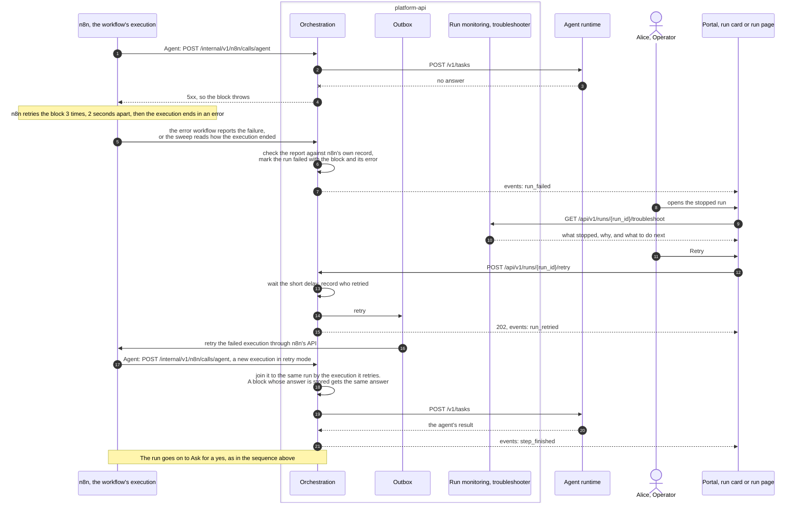

The person who retried joins the run's parties, so they cannot approve it. A retry after a yes keeps the yes, and the gateway's write keys stop a second write. For a `shared_run` workflow, Retry starts the failed leg again through the shared `run` n8n workflow, as before.
