# Design diagrams

These diagrams show the rebuilt app as it is on `main` at commit `8ee417d`, after the rebuild plan's P1 to P14. They are for the school's design rubric, the first presentation and a new teammate. Each one names the real pages, services, routes, tables and activity event kinds. When the code and a diagram disagree, the code is right and the diagram needs a fix.

The diagrams are drawn from these sources:

- The Portal's pages and menu in `portal/src/shell/routes.tsx`, which follow the prototype `docs/design/portal-routines/prototype.html` and its design note `docs/design/portal-routines.md`.
- The domain model in `docs/design/rebuild-domain-model.md`, and ADRs 0028 to 0032.
- The migrations in `platform-api/src/platform_api/migrations/`, checked against `\d` of a running database on 31 Oct 2026 (`docs/evidence/diagrams/schema-2026-10-31.txt`).
- The Cosmos DB code in `platform-api/src/platform_api/monitoring/` (P4), and the items in a running emulator (`docs/evidence/diagrams/cosmos-2026-10-31.txt`).
- `deploy/compose.yaml`, `infra/envs/dev/main.tf` and the workflows in `.github/workflows/`.
- `contracts/openapi.json`, `contracts/activity-event.schema.json`, `contracts/agent-api.schema.json` and the recorded runs in `contracts/fixtures/runs/`.

To check every diagram, run `scripts/render-diagrams.sh`. It renders each Mermaid block with the Mermaid CLI in Docker and writes the PNGs to `docs/evidence/diagrams/`. It checks the routes and event kinds against the contracts, the ER diagrams' tables against the migrations, and the CI/CD diagram's jobs against the workflow files. It also fails on the old themed names, on the names the rebuild retired, and on long dashes.

"Use case" is the code's name for what people see in the app as a workflow (`GLOSSARY.md`). The diagrams use "workflow" for what people see, and "use case" for the code and the tables.

## Use case diagram

Two roles use the app, and one person may hold both. The Operator sets up workflows, looks after the Software watchlist and Settings, and retries a stopped workflow. The Approver says yes or no to a run's proposal and confirms the risky setup changes. Each use case sits on the page that does it. The pages are the Portal's menu (Home, Workflows, Software watchlist, Agent library and New workflow), the run page, Settings (the gear) and the practice Teams panel (the Teams button). Everyone signs in with Entra ID, and the People list gives them their roles.

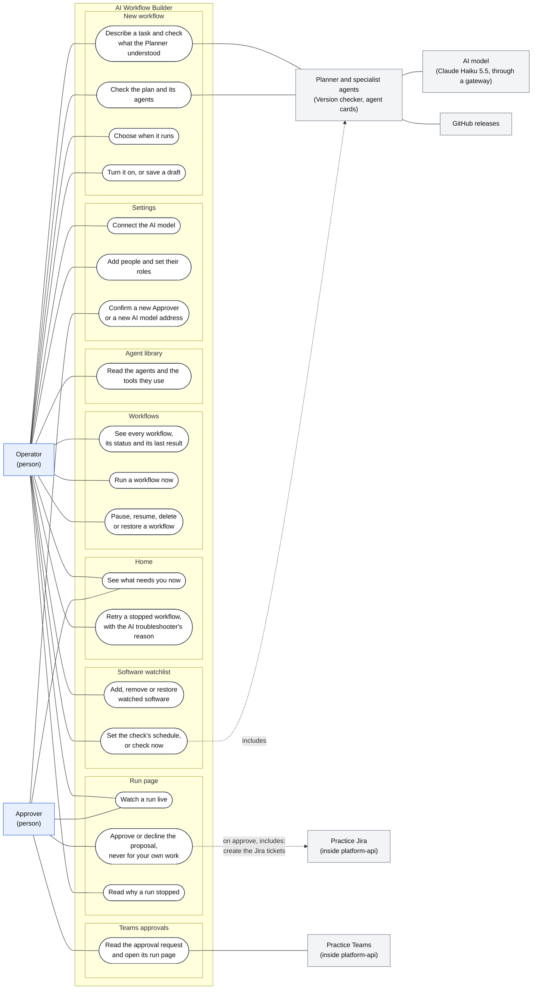

Each use case maps to a page that exists and to the routes it calls:

| Use case | Page | Who | Route |
|---|---|---|---|
| See what needs you now | Home, `/` | Both | `GET /api/v1/home` |
| Retry a stopped workflow | Home, `/` | Operator | `GET /api/v1/home` gives the reason, then `POST /api/v1/runs/{run_id}/retry` |
| See every workflow | Workflows, `/workflows` and `/workflows/{use_case_id}` | Both | `GET /api/v1/use-cases`, `GET /api/v1/use-cases/{use_case_id}`, `GET /api/v1/runs` |
| Run a workflow now | Workflows | Operator | `POST /api/v1/use-cases/{use_case_id}/runs`, with an `Idempotency-Key` |
| Pause, resume, delete or restore | Workflows | Operator | `POST /api/v1/use-cases/{use_case_id}/pause`, `.../resume`, `DELETE /api/v1/use-cases/{use_case_id}`, `.../restore` |
| Describe a task and check what the Planner understood | New workflow, `/new` | Operator | `POST /api/v1/builder/understand` |
| Check the plan and its agents | New workflow | Operator | `POST /api/v1/builder/plan`, and `POST /api/v1/agent-cards` when the Planner drafted a new agent |
| Choose when it runs, and turn it on | New workflow, then `/new/done/{use_case_id}` | Operator | `POST /api/v1/agent-use-cases`, with its schedule |
| Save a draft | New workflow | Operator | `PUT /api/v1/drafts/{draft_id}`, `GET /api/v1/drafts`, `DELETE /api/v1/drafts/{draft_id}` |
| Add, remove or restore watched software | Software watchlist, `/software` | Operator | `POST /api/v1/watchlist/software`, `DELETE /api/v1/watchlist/software/{software_id}`, `.../restore` |
| Set the check's schedule, or check now | Software watchlist | Operator | `PUT /api/v1/watchlist/schedule`, `DELETE /api/v1/watchlist/schedule`, `POST /api/v1/use-cases/{use_case_id}/runs` |
| Read the agents and their tools | Agent library, `/agents` | Both | `GET /api/v1/agent-cards`, `GET /api/v1/tools` |
| Watch a run live | Run page, `/runs/{run_id}` | Both | `GET /api/v1/runs/{run_id}`, `GET /api/v1/runs/{run_id}/events` (server-sent events) |
| Approve or decline the proposal | Run page, or `/approvals/{approval_id}` | Approver | `GET /api/v1/approvals/{approval_id}`, `POST /api/v1/approvals/{approval_id}/decisions`. Own work is refused with 403 |
| Read why a run stopped | Run page | Both | `GET /api/v1/runs/{run_id}/troubleshoot` |
| Connect the AI model | Settings, `/settings` | Operator | `POST /api/v1/settings/model/connect`, `PUT /api/v1/settings/model` |
| Add people and set their roles | Settings | Operator | `POST /api/v1/people`, `PUT /api/v1/people/{person_id}/operator`, `POST /api/v1/people/{person_id}/approver` |
| Confirm a new Approver or a new AI model address | Settings | Approver | `POST /api/v1/confirmations/{confirmation_id}/decisions`, `POST /api/v1/settings/model/address-decision` |
| Read the approval request and open its run page | Teams approvals, the Teams button | Approver | `GET /api/v1/teams-stub/messages` |

Some parts of the prototype wait for Phase 2, each with its own decision first. They have no page yet, so they are not in the diagram: Connections and AI usage in Settings, named Approvers with a backup and an expiry (ADR 0024), Approve buttons inside a Teams message, Report to support, Open in n8n (ADRs 0026 and 0027), the Vulnerability checker and the package registries (ADR 0025), and the sponsor's two real use cases, the quarterly access review with two Approvers in turn and patch housekeeping.

## Bounded contexts (DDD context map)

There are four contexts. Three of them ship in one container, `platform-api` (ADR 0010), and each has its own PostgreSQL schema and database role. The agent runtime is a separate Python project and container, so platform-api cannot import it. Solid arrows are code dependencies, pointing from the context that imports to the one it imports. `import-linter` enforces them in CI, and a context may import another only through its package `__init__`. Dashed arrows are calls over the network.

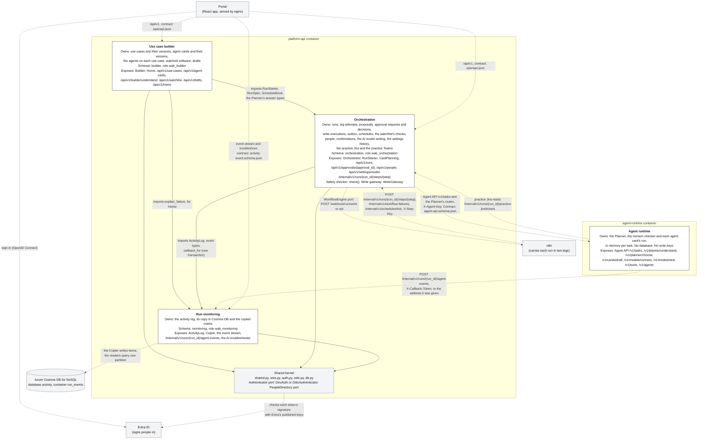

Each context reaches the outside world through ports that it owns. The adapters in the table run today. The right-hand column names what replaces each one later.

| Context | Port | Adapter now | Later |
|---|---|---|---|
| Use case builder | `RunStarter` (owned by orchestration) | `Orchestrator` | none needed |
| Use case builder | `Planning` (owned by orchestration) | `CardPlanning`, which sends the connected AI model's settings to the agent runtime. Without a model, New workflow answers with the starter workflows | none needed |
| Orchestration | `WorkflowEngine` | `N8nWebhooks` | the node pack (ADRs 0026 and 0027) |
| Orchestration | `AgentRuntime` | `HttpAgentRuntime` | none needed |
| Orchestration | `ApprovalChannel` | `TeamsStub`, the practice Teams | a Teams message with a link, then Approve buttons in Teams |
| Orchestration | `WriteConnector` | `MockJiraConnector`, the practice Jira | a real Jira adapter |
| Orchestration | `ActivityLogPort` | run monitoring's `ActivityLog` | none needed |
| Run monitoring | `EventReader` | `CosmosEvents` when `ACTIVITY_READER` is `cosmos`, else `PostgresEvents` | a DynamoDB adapter for AWS (ADR 0031) |
| Run monitoring | `EventCopy` | `CosmosEvents`, filled by the `Copier` | none needed |
| Shared kernel | `Authenticator` | `DevAuth`, which reads `X-Dev-User` on localhost only, or `OidcAuthenticator` for Entra ID | none needed |
| Shared kernel | `PeopleDirectory` | `People`, the People list in PostgreSQL (ADR 0029) | none needed |
| Agent runtime | `Planner` | `FixedPlanner`, which brings in the Version checker for a watchlist check and each saved agent for a workflow. Reading a task in New workflow asks the AI model | a model for every run |
| Agent runtime | `ReleaseSource` | `GitHubReleaseSource`, or a fake GitHub in tests | the package registries (ADR 0025) |
| Agent runtime | `Summarizer` | `TemplateSummarizer`, or `ModelSummarizer` when a model is set | the model the eval picks (ADR 0032) |

The database holds the same boundaries as the code. Each role has grants on its own schema only. The one exception is that `wab_orchestration` may read and insert into `monitoring.run_events`, so a run's state change and its activity events commit in one transaction. n8n has its own database, `n8n`, and its own role, with no access to `platform`.

Three published contracts cross process boundaries. CI makes each one again from its owner's models and fails on any difference.

| Contract | Owner | Readers |
|---|---|---|
| `contracts/openapi.json` | platform-api (all three contexts) | the Portal's typed client, the DAST scan |
| `contracts/activity-event.schema.json` | run monitoring | the live activity view, the AI troubleshooter |
| `contracts/agent-api.schema.json` | agent runtime | orchestration's `HttpAgentRuntime`, NCS's agent hub later |

## Class diagram: the domain model

These are the things the app keeps, from the domain model's tables. Each class names its context. A class marked Phase 2 is designed but not built. The diagram shows meaning, not storage: the ER diagrams below show the tables.

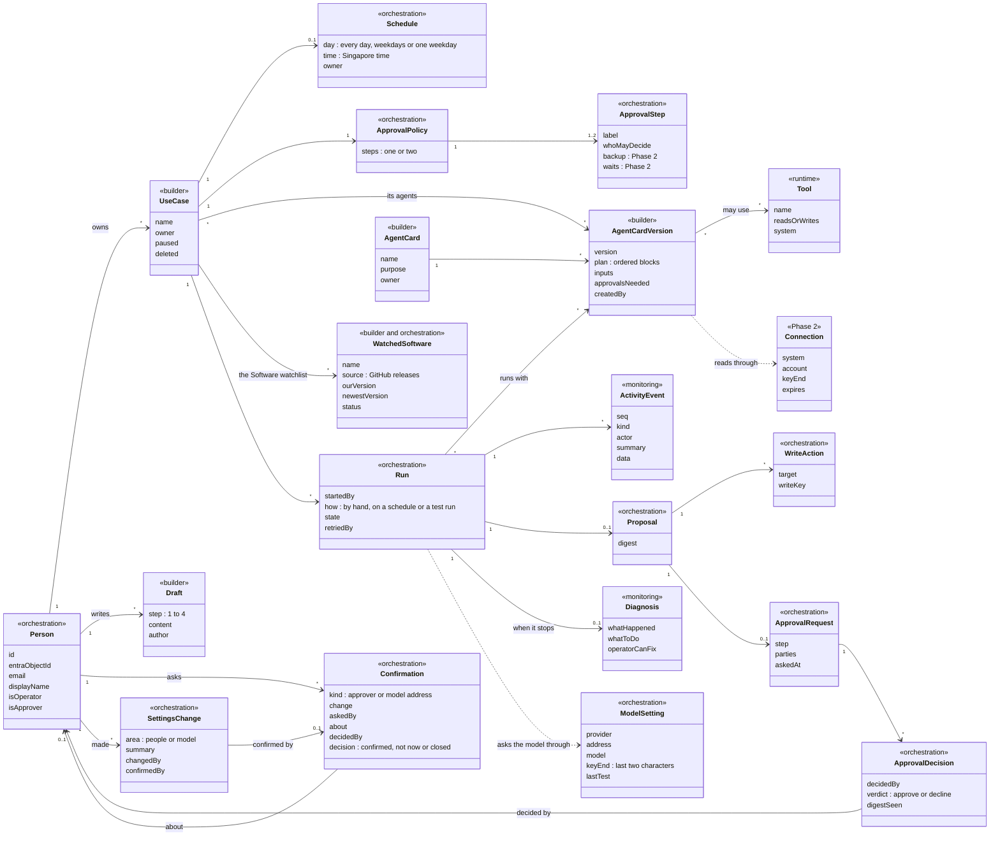

Three rules sit on these classes. Nobody approves their own work: the parties of a run are the person who started it, the workflow's owner and anyone who retried it, and none of them may decide. Nothing is written without a yes: a write action runs only after the last step of its approval request says approve, for the digest the Approver saw. And a confirmation is decided by an Approver who is neither the person who asked nor the person it is about.

A diagnosis is worked out from the run's latest `run_failed` event. It is not stored. A use case's agents are stored as the card version each one was saved with, so a later change to a card does not change a workflow that is already on.

## Class diagram: deciding on a proposal

This is the design of the key use case, an Approver's yes on the run page, at class level. It shows how the Portal, platform-api and n8n carry it out. The Portal's `ApprovalGate` calls the API through `useDecide`. orchestration's `decide` route hands the request to `Orchestrator`, which checks the pure rules in `approvals.py` and writes the decision, the run's new state and its activity events in one transaction. The act leg then goes through the safety checker and the write gateway.

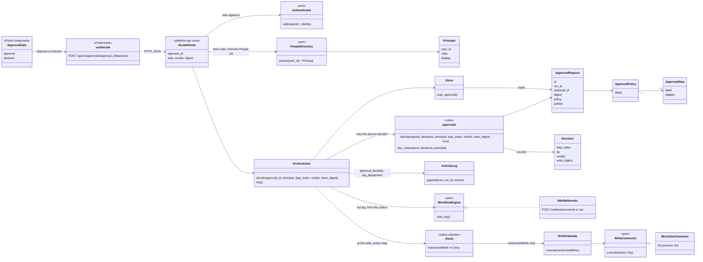

`approvals.decide` refuses a person without the Approver role, a party to the run, a step out of order, a step already decided and a digest that is not the current proposal's. The route answers 403 with the reason. `check` builds an `AuthorizedWrite` only for a run in `Acting`, whose approval folds to approved for the same digest, with a registered connector and operation. Anything else is a `Deny` and the event `write_action_denied`.

## ER diagram: the builder schema

The use case builder's tables, from its migrations. PK is a primary key, FK a foreign key and UK part of a unique key. A solid line is a foreign key. A dashed line is a reference by id that has no foreign key.

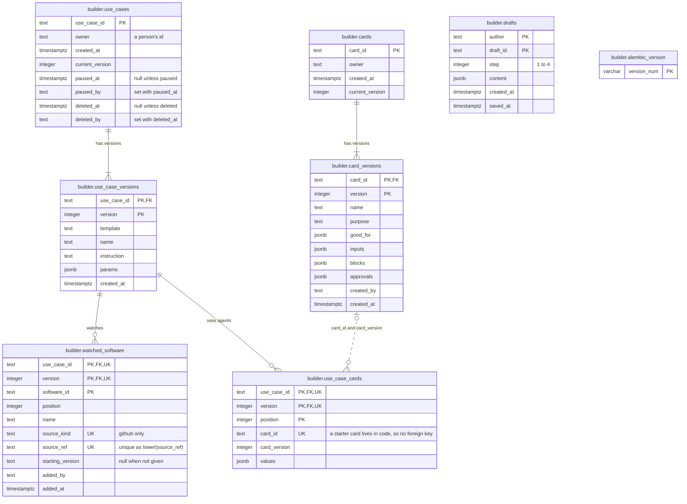

`builder.use_cases` keeps `deleted_at` instead of deleting a row, and `wab_builder` has no right to delete from it, so a deleted workflow's past runs stay readable and Restore can bring it back. `builder.watched_software` also has the unique index `watched_software_one_source_per_version` on `(use_case_id, version, source_kind, lower(source_ref))`, so one version of the watchlist names each GitHub project once.

## ER diagram: orchestration's runs and approvals

The tables that carry a run from start to the write. `runs.use_case_id` names a row in `builder.use_cases`, by id, with no foreign key across schemas. Every column that ends in `_by`, and `started_by` and `asked_by`, holds a person's id from `orchestration.people`, also with no foreign key, so a person who leaves keeps their name on past runs.

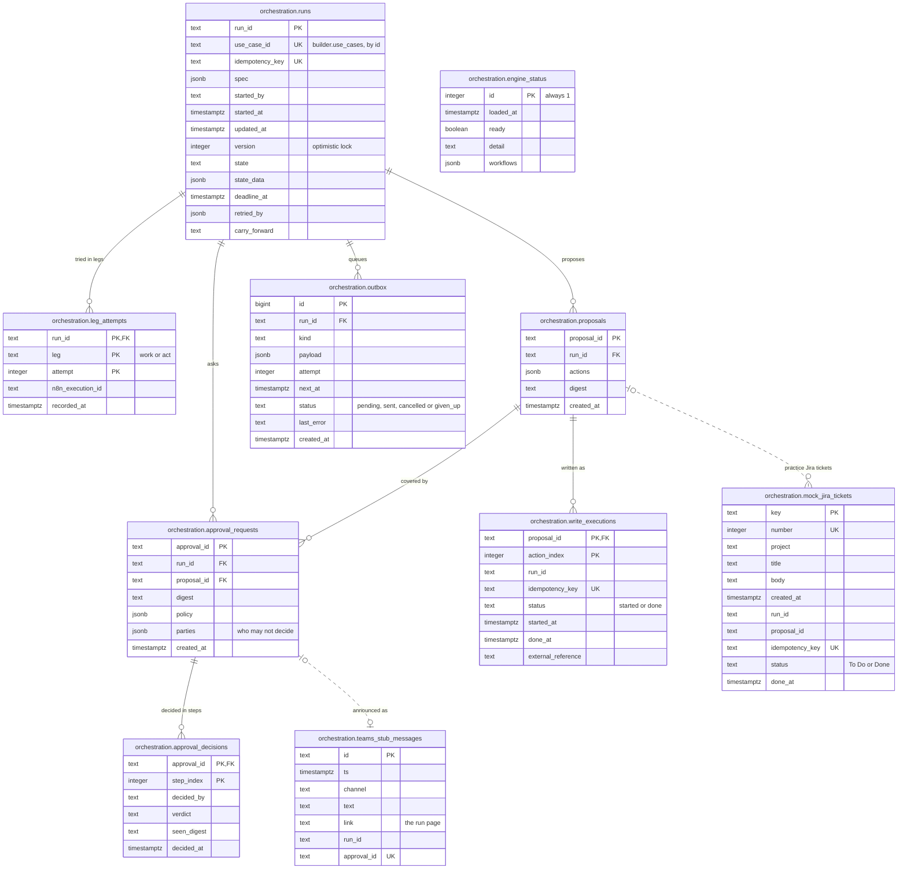

`mock_jira_tickets` and `teams_stub_messages` are the practice Jira and the practice Teams. Their `run_id`, `proposal_id` and `approval_id` are copies, with no foreign keys, as a real Jira or Teams would hold them.

## ER diagram: orchestration's watchlist, schedules, people and settings

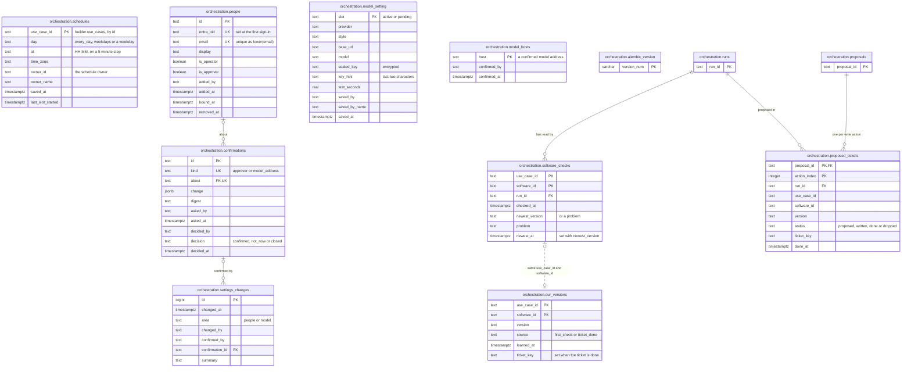

The two `orchestration.runs` and `orchestration.proposals` boxes repeat the tables of the diagram above, to show their foreign keys. Two more unique indexes hold rules: `people_email_key` on `lower(email)`, so one email is one person, and `confirmations_one_open_key` on `(kind, coalesce(about, ''))` while `decided_at` is null, so only one confirmation of each kind waits for each person, and one for the AI model address.

## ER diagram: the monitoring schema

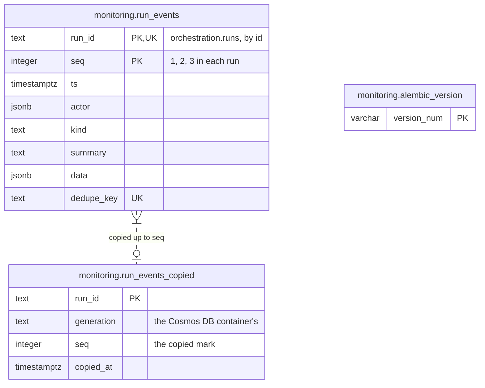

`monitoring.run_events` only grows. Both roles that may write it, `wab_orchestration` and `wab_monitoring`, have `SELECT` and `INSERT` and nothing else. The unique `(run_id, dedupe_key)` drops a repeated callback. PostgreSQL keeps every event even though the readers use Cosmos DB, because the next `seq` and the repeat check both read these rows (ADR 0031).

## NoSQL design: the activity log in Cosmos DB

ADR 0031 keeps a copy of the activity log in Azure Cosmos DB for NoSQL. PostgreSQL writes each event and sets its order. The copier in run monitoring copies each run's new events, in order, to one container. The live activity view, its replay, the events page and the AI troubleshooter read that container.

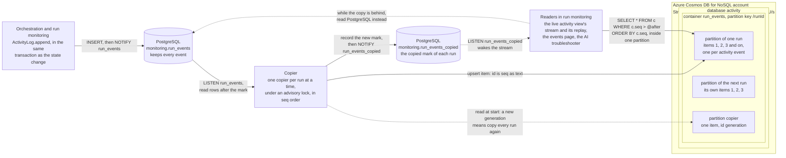

The item shapes, from `CosmosEvents.put` and `CosmosEvents.ensure`:

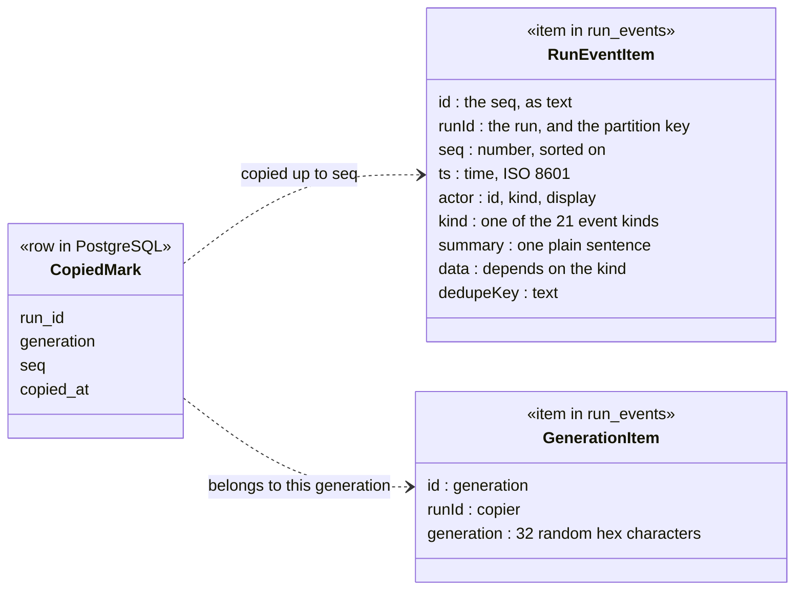

| Part | Value |
|---|---|
| Account | Azure Cosmos DB for NoSQL, Strong consistency, one region. Free tier with a 1000 RU/s cap, or serverless when the subscription refuses the free tier (`COSMOS_SERVERLESS`) |
| Database | `activity` |
| Container | `run_events`, 1000 RU/s on the free tier |
| Partition key | `/runId`, hash, version 2 |
| Item id | The event's `seq` in its run, as text. Copying the same event twice writes the same item twice and changes nothing |
| Main query | `SELECT * FROM c WHERE c.seq > @after ORDER BY c.seq`, with the run's id as the partition key. A reader stops before a gap and waits for the next copied notice |
| Other item | `id` `generation` in the partition `copier`. The copier writes a random generation into each new container. When the generation changes, every run is copied again from the start |
| Time to live | None. The log keeps every event |
| Who writes | Only the copier in platform-api. On Azure it signs in with the account key, read from Key Vault. That key may read and write items but may not create, change or delete a database or a container. platform-api's managed identity already holds the Cosmos DB Data Contributor role on `activity`, ready for when the key is turned off (CKV_AZURE_140 in `docs/evidence/iac/README.md`). Locally it uses the emulator's fixed key |

An item from the 31 Oct scan's run, as the emulator returned it, without Cosmos DB's own `_` fields:

```json
{
  "id": "13",
  "runId": "run_01M67WVHRG63X24F90AYT2GFZD",
  "seq": 13,
  "ts": "2026-10-31T02:33:10.301314+00:00",
  "actor": { "id": "platform", "kind": "platform", "display": "Platform" },
  "kind": "approval_requested",
  "summary": "Approval requested. Waiting for the Team approver.",
  "data": {
    "link": "/approvals/apr_01M67WVHWXETCD5ES3A31JGSHM",
    "steps": [{ "index": 0, "label": "Team approver", "status": "open", "decided_at": null, "decided_by": null }],
    "approval_id": "apr_01M67WVHWXETCD5ES3A31JGSHM"
  },
  "dedupeKey": "once:171dc915e723eb044af9ea29a0c2049c"
}
```

## Deployment now: Docker Compose

One command starts the whole stack: `scripts/up.sh`, which runs `docker compose -f deploy/compose.yaml up --build`. Only the Portal, platform-api and the n8n editor are published on the host. PostgreSQL, the Cosmos DB emulator and the agent runtime are reachable only inside the Compose network. Secrets never live in git. `deploy/make-env.sh` writes random values to `deploy/.env` (mode 600), and Compose passes them to each service as environment variables. For tests, `deploy/compose.e2e.yaml` adds a fake GitHub and a fake AI model, and `deploy/compose.scan.yaml` takes every published port away for the scans.

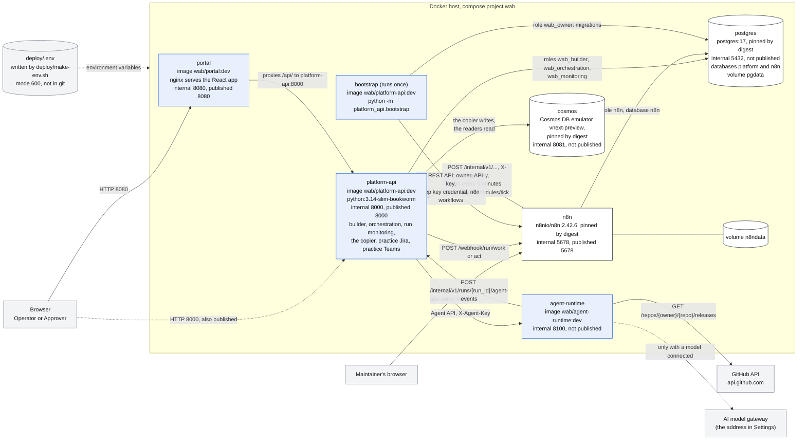

Services start in this order. postgres and the Cosmos DB emulator become healthy, then n8n becomes ready, then bootstrap runs to completion. bootstrap runs the migrations, sets up n8n, lints the n8n workflow files and loads them, the error workflow first. platform-api starts after bootstrap succeeds and the agent runtime is healthy. The Portal starts last.

| Secret in `deploy/.env` | Read by |
|---|---|
| `POSTGRES_PASSWORD`, `N8N_DB_PASSWORD`, `WAB_*_PASSWORD` | postgres (to create the roles), n8n, bootstrap, platform-api |
| `N8N_ENCRYPTION_KEY` | n8n. Never change it while the `n8ndata` volume is kept |
| `N8N_OWNER_EMAIL`, `N8N_OWNER_PASSWORD` | bootstrap |
| `STEP_KEY` | bootstrap stores it in n8n as a credential. platform-api checks it on `/internal/v1` |
| `AGENT_API_KEY` | platform-api sends it, and the agent runtime checks it |
| `CALLBACK_SIGNING_KEY` | platform-api, to sign the agent's callback tokens |
| `SETTINGS_ENCRYPTION_KEY` | platform-api, to encrypt the AI model's key (ADR 0022) |

## Deployment on Azure

This is the shape that `infra/envs/dev/main.tf` builds and `.github/workflows/deploy.yml` deploys (P14). Each Compose service becomes one Container App, with the same images. The code does not change, because every cloud service sits behind a port, and secrets arrive as environment variables as they do in Compose.

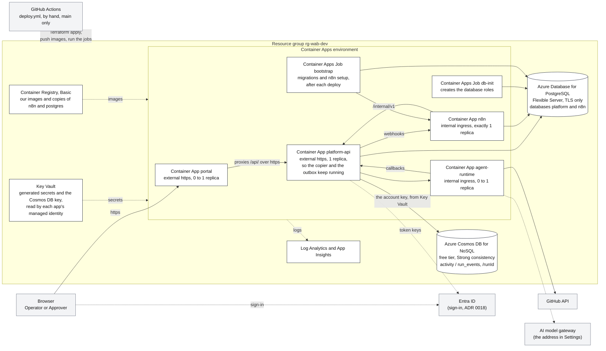

The Azure shape keeps three rules from the design.

- n8n holds no write key. The practice Jira lives inside platform-api, and a real Jira key would reach platform-api only, from Key Vault.
- Our code never calls a Key Vault SDK. Secrets arrive as Container Apps secrets that point at Key Vault.
- There is no virtual network yet, so PostgreSQL, Cosmos DB and Key Vault keep public endpoints behind keys, TLS and roles. Private endpoints come with the move to DevNet (ADR 0005, `docs/design/devnet-move.md`). `docs/evidence/iac/README.md` lists each accepted finding.

## CI/CD pipeline

Every job in `.github/workflows/`, in each file's order, with its steps in order. Each step runs in a container pinned by digest, or in the runner's own tools, so the jobs can move to GitLab CI. A person starts the deploy by hand, and the `azure-dev` environment accepts only `main`.

```mermaid
---
config:
  flowchart:
    wrappingWidth: 420
---
flowchart TB
    pr["A pull request,<br/>or a push to main"]
    push["A push to main, or by hand"]
    hand["By hand, on main"]
    daily["Every pull request, every push to main,<br/>and daily at 01:00 UTC"]

    subgraph ci["ci.yml"]
        direction LR
        checks["<b>job checks</b><br/>matrix: platform-api, agent-runtime, e2e<br/>1. uv sync<br/>2. ruff check and ruff format<br/>3. pyright<br/>4. lint-imports, platform-api only<br/>5. contracts are current<br/>6. unit tests in the image, with PostgreSQL<br/>and, for platform-api, the Cosmos DB emulator<br/>7. the emulator kept its pinned packages<br/>8. build the runtime image<br/>9. mock GitHub and mock model tests, e2e only"]
        portaljob["<b>job portal</b><br/>1. npm ci<br/>2. typecheck<br/>3. lint<br/>4. unit tests<br/>5. build<br/>6. nginx render test"]
        scans["<b>job scans</b><br/>1. SAST with Semgrep<br/>2. keep the Semgrep report<br/>3. secret scan with gitleaks"]
        e2e["<b>job e2e</b>, push or by hand only<br/>1. scripts/e2e.sh: API tests, then the browser suite<br/>2. keep the logs, screenshots and video<br/>3. DAST: scripts/dast.sh, OWASP ZAP<br/>4. keep the ZAP reports<br/>5. load test: scripts/load.sh, k6<br/>6. keep the k6 summary"]
    end

    subgraph deploywf["deploy.yml"]
        direction LR
        deploy["<b>job deploy</b>, environment azure-dev<br/>1. Terraform 1.16.5 and Azure sign-in with OIDC<br/>2. connect to the remote state<br/>3. create the registry<br/>4. copy the public images, build and push ours<br/>5. create the database roles: the db-init job<br/>6. plan, check and apply everything, guarded<br/>7. run the bootstrap job<br/>8. say where the Portal is"]
    end

    subgraph evalswf["evals.yml"]
        direction LR
        evals["<b>job evals</b>, environment evals<br/>1. score the configured AI models<br/>on the golden set: scripts/evals.sh<br/>2. keep the results"]
    end

    subgraph infrawf["infra.yml, only when infra/ or a deploy file changes"]
        direction LR
        infra["<b>job infra</b><br/>1. infra/scripts/check.sh: terraform fmt,<br/>validate under Terraform and OpenTofu,<br/>the variable cases, tflint, Checkov<br/>2. actionlint on every workflow<br/>3. keep the check output"]
    end

    subgraph pstackwf["pstack-playbooks.yml"]
        direction LR
        pstack["<b>job pstack-playbooks</b><br/>1. read the locked pstack version<br/>2. fetch it and check it is the reviewed commit<br/>3. check the team's playbooks against it"]
    end

    azure[("Azure: rg-wab-dev")]
    artifacts[("Run artifacts: Semgrep report, e2e logs,<br/>ZAP reports, k6 summary, infra checks, eval results")]

    pr --> checks
    pr --> portaljob
    pr --> scans
    push --> e2e
    pr --> infra
    hand --> deploy
    hand --> evals
    daily --> pstack
    deploy --> azure
    scans -.-> artifacts
    e2e -.-> artifacts
    infra -.-> artifacts
    evals -.-> artifacts

    classDef job fill:#ffffff,stroke:#111827,color:#111
    classDef trigger fill:#e8f0fe,stroke:#1a56db,color:#111
    classDef ext fill:#f3f4f6,stroke:#6b7280,color:#111
    class checks,portaljob,scans,e2e,deploy,evals,infra,pstack job
    class pr,push,hand,daily trigger
    class azure,artifacts ext
```

The private repository is billed per job, rounded up to a whole minute, so the stages of `ci.yml` are steps inside four jobs, not one job each. The four jobs of `ci.yml` run side by side. The pipeline's results for the rebuilt app are in `docs/evidence/dast/2026-11-rebuild/`, `docs/evidence/load-test/2026-11-rebuild/` and `docs/evidence/unit-tests/2026-11-rebuild/`.

## Sequence: set up a workflow

An Operator uses New workflow's four steps: describe it, check what the Planner understood, choose when it runs, and turn it on. The Planner reads the task through the AI model connected in Settings. Nothing is saved until Turn it on, except a draft the Operator chooses to keep.

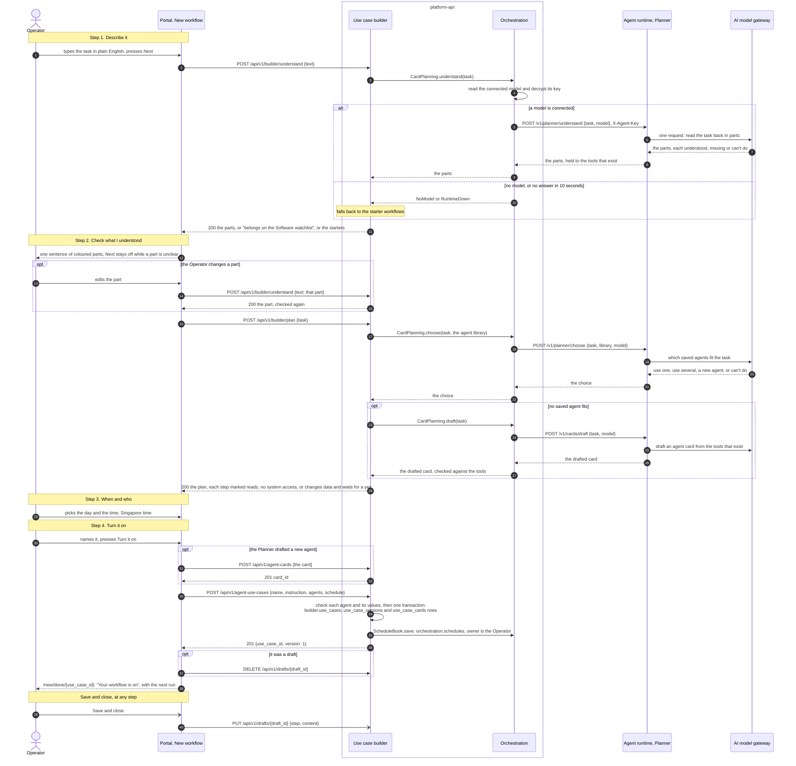

When the Planner reads a release check in step 1, it answers "belongs on the Software watchlist", and the page offers to open the Software watchlist instead of making a look-alike workflow (design note, section 4).

## Sequence: a watchlist check runs to the approval gate in Teams

This is the recorded run in `contracts/fixtures/runs/watchlist.json`, drawn against the real routes. n8n carries the run in two legs. The work leg ends when the approval request opens, and the act leg starts only after the Approver approves (ADR 0007). Each `events:` line names the activity events written in that transaction. The live activity view receives them in `seq` order, as the next diagram shows.

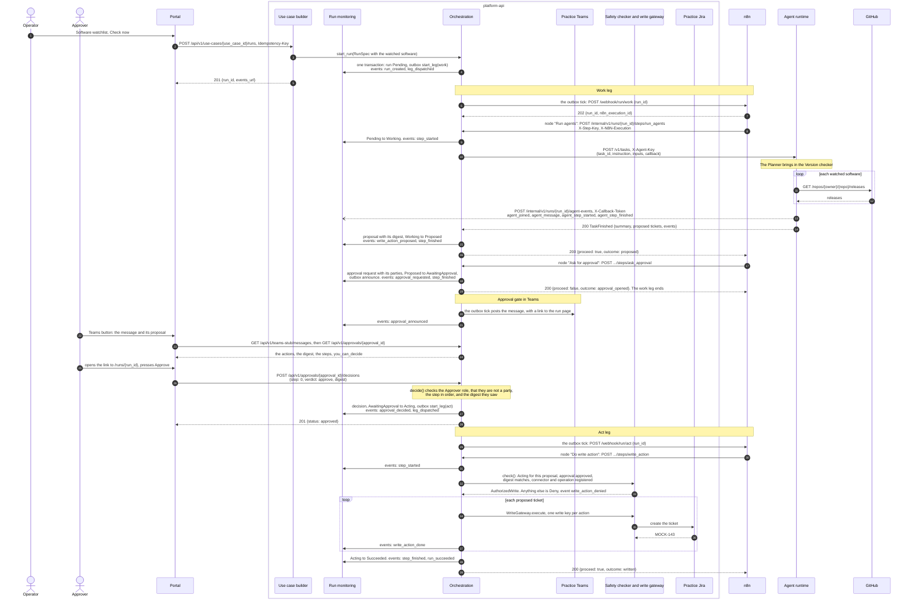

If the Approver started the run, owns the workflow or retried it, the run page shows a lock and the decision route answers 403. If an Approver declines, the run ends with nothing written, and the event is `run_rejected`.

## Sequence: the live activity view

How an activity event gets from the transaction that writes it to the run page. PostgreSQL sets the order and keeps every event. The copier copies to Cosmos DB, then wakes the stream. The stream reads Cosmos DB up to the copied mark and sends each event once, in order.

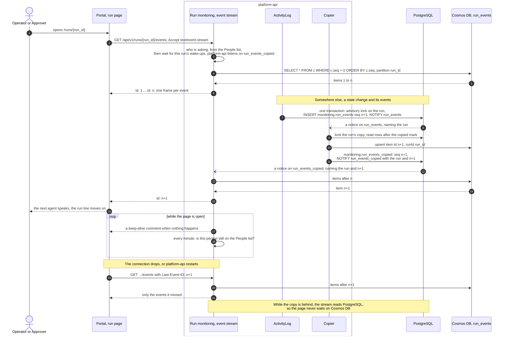

The events page, `GET /api/v1/runs/{run_id}/events` with `Accept: application/json`, and the AI troubleshooter read the same way, once. With `ACTIVITY_READER=postgres`, for a place without Cosmos DB, every reader reads `monitoring.run_events` and wakes on `run_events` instead.

## Sequence: a run stops, then the Operator retries

This is the recorded run in `contracts/fixtures/runs/failure.json`. GitHub answers 503 three times, so the Version checker gives up and the run fails with a reason marked retryable. The agent runtime reports the failure, and platform-api fails the run and still answers n8n with `200 {proceed: false}`, so n8n's error workflow does not fire for an agent failure. The second branch shows the other path, where an n8n node fails and the error workflow reports it.

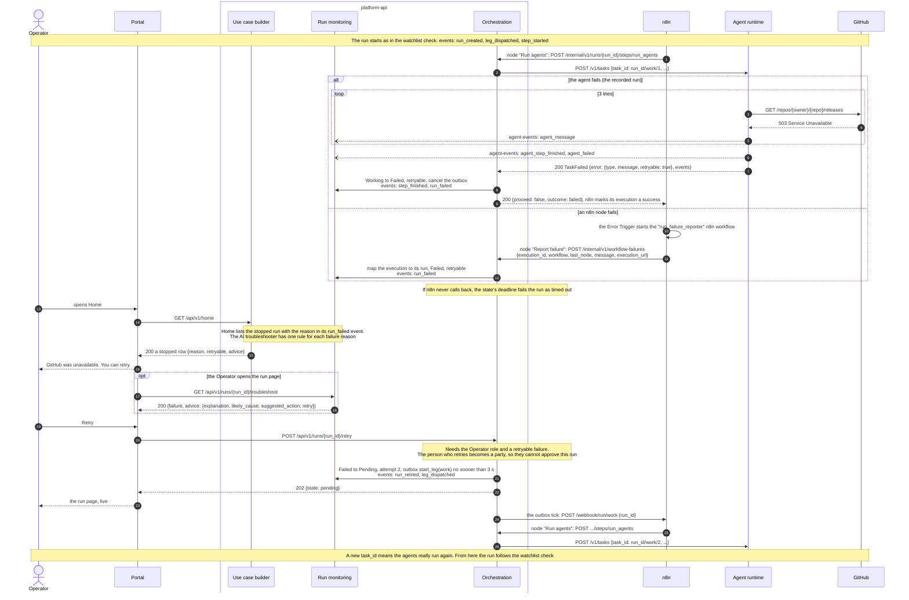

A failure in the act leg retries differently. The run goes back to `Acting`, not `Pending`, so nobody has to approve again. The write gateway finds any write it already recorded as `done` and returns it instead of creating the ticket a second time.
