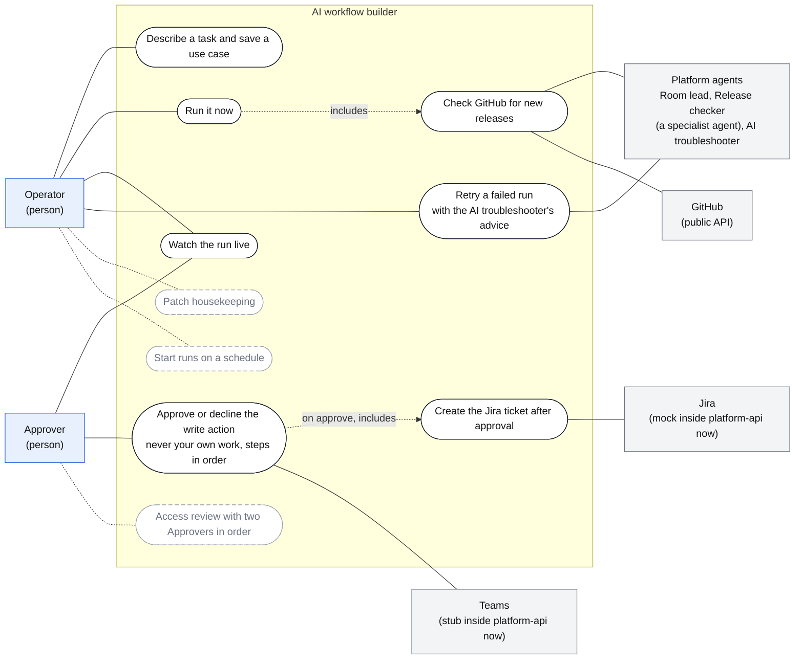
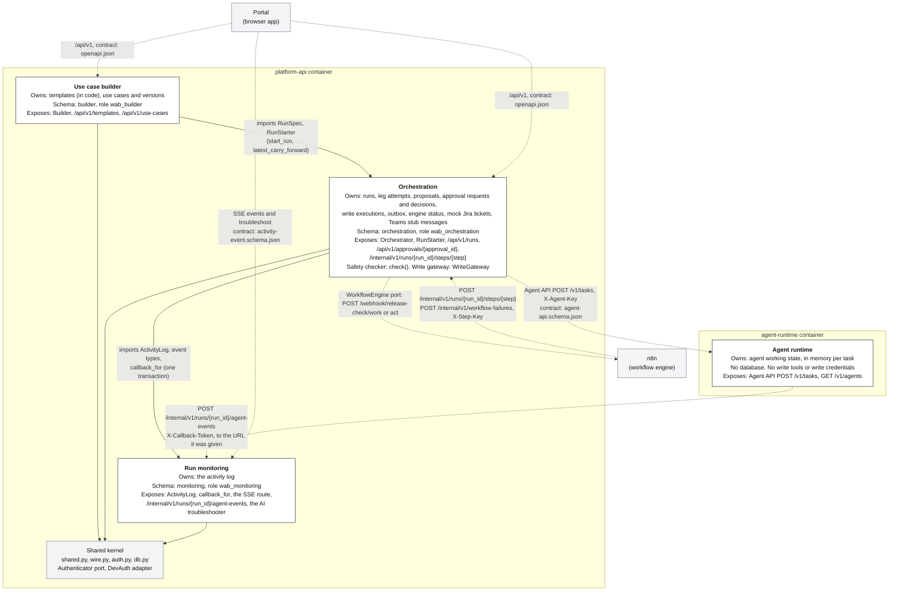
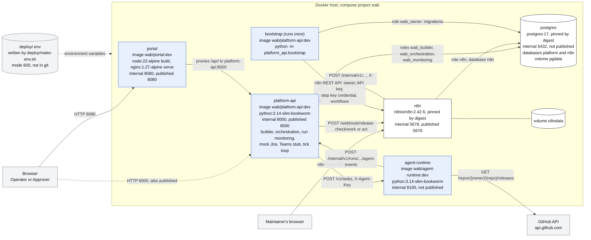
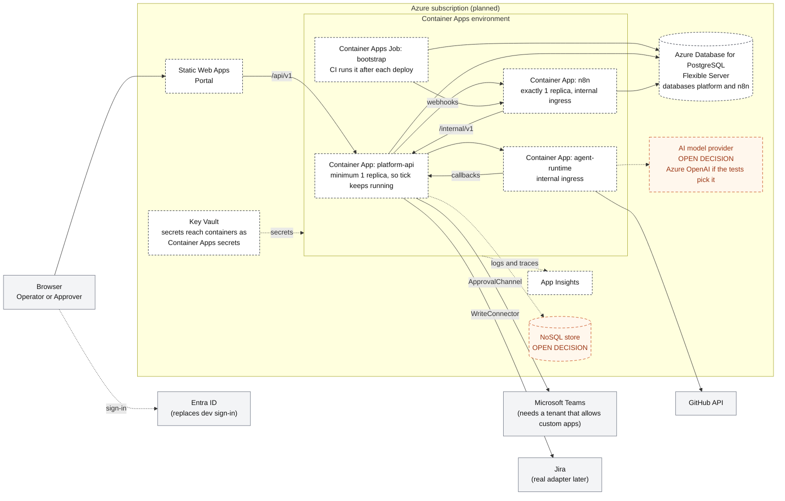
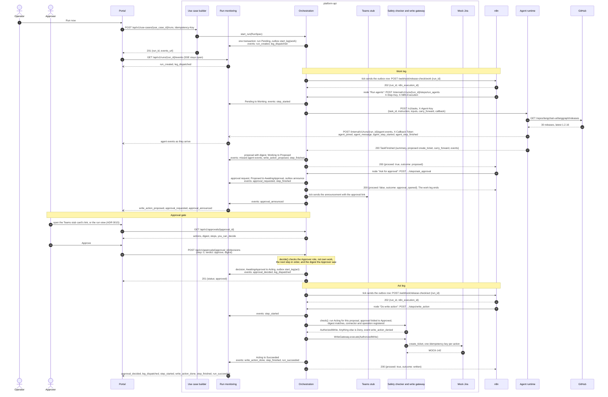
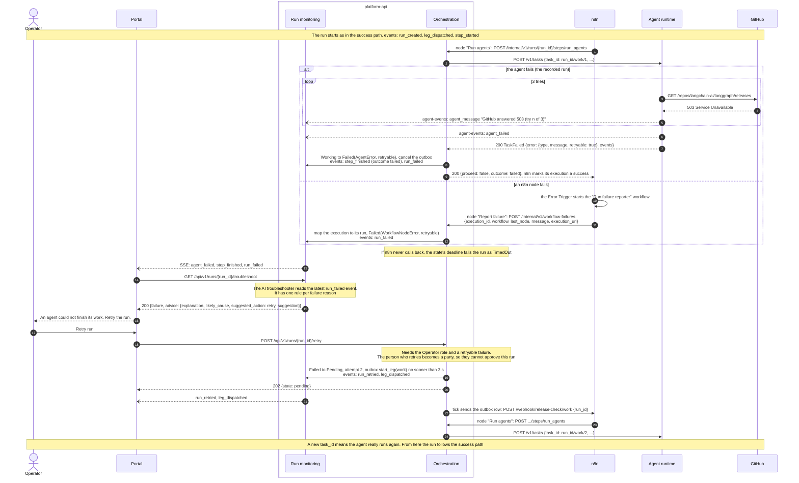

# Design diagrams

These diagrams show the platform as built at commit `b07646d` (branch `ci/dast-and-load`), for the school's design rubric and for a new teammate. Each one names the real services, routes, database schemas and activity event kinds. When the code and a diagram disagree, the code is right and the diagram needs a fix.

The diagrams are drawn from these sources:

- The walking skeleton design, `docs/design/walking-skeleton.md`, and its implementation reconciliation table. This file and ADRs 0002 to 0013 come from the open docs pull requests, so they are not on this branch yet.
- ADRs 0014 and 0015 in `docs/adr/`.
- `deploy/compose.yaml`, `deploy/make-env.sh` and `deploy/postgres/init.sh`.
- `platform-api/src/`, `agent-runtime/src/`, `portal/src/` and the n8n workflow files in `platform-api/src/platform_api/orchestration/workflows/`.
- `contracts/openapi.json`, `contracts/activity-event.schema.json`, `contracts/agent-api.schema.json` and the recorded runs in `contracts/fixtures/runs/`.

To check that every diagram still parses, run `scripts/render-diagrams.sh`. It renders each Mermaid block in this file with the Mermaid CLI in Docker, writes the PNGs to `docs/evidence/diagrams/`, and checks the routes and event kinds against the contracts. It also fails on any of the old themed names and on long dashes.

## Use case diagram

Two people use the platform. The Operator saves a use case, starts runs, watches them and retries a failed run. The Approver decides on the write action. Solid boxes exist now. Dashed boxes are Phase 2. Jira and Teams are a mock and a stub inside platform-api today, so the diagram marks them that way.

Each use case maps to code that exists now:

| Use case | Who | Route or code |
|---|---|---|
| Describe a task and save a use case | Operator | `POST /api/v1/use-cases/suggest` picks a template from the words, `POST /api/v1/use-cases` saves it |
| Run it now | Operator | `POST /api/v1/use-cases/{use_case_id}/runs` with an `Idempotency-Key` |
| Watch the run live | Operator, Approver | `GET /api/v1/runs/{run_id}/events` (server-sent events) |
| Approve or decline | Approver | `GET /api/v1/approvals/{approval_id}`, `POST /api/v1/approvals/{approval_id}/decisions`. A refusal for own work is `403 own_work` |
| Retry a failed run | Operator | `GET /api/v1/runs/{run_id}/troubleshoot`, then `POST /api/v1/runs/{run_id}/retry` |

The Phase 2 use cases need no new approval model. `ApprovalPolicy` already holds an ordered list of steps, and `decide()` already refuses a person who decided an earlier step. A schedule is one more caller of `Orchestrator.start_run`.

## Bounded contexts (DDD context map)

There are four contexts. Three of them ship in one container, `platform-api` (ADR 0010), and each has its own PostgreSQL schema and database role. The agent runtime is a separate Python project and container, so platform-api cannot import it. Solid arrows are code dependencies, pointing from the context that imports to the context it imports. `import-linter` enforces them in CI, and a context may import another only through its package `__init__`. Dashed arrows are HTTP calls.

Each context reaches the outside world through ports that it owns. The adapters in the table run today. The right-hand column names what replaces each one later.

| Context | Port | Adapter now | Later |
|---|---|---|---|
| Use case builder | `RunStarter` (owned by orchestration) | `Orchestrator` | none needed |
| Orchestration | `WorkflowEngine` | `N8nWebhooks` | none needed |
| Orchestration | `AgentRuntime` | `HttpAgentRuntime`, which parses replies into `TaskFinished`, `TaskFailed`, `AgentRejected` or `AgentUnavailable` | none needed |
| Orchestration | `ApprovalChannel` | `TeamsStub` | a Teams message, later a Teams bot |
| Orchestration | `WriteConnector` | `MockJiraConnector` | a real Jira adapter |
| Orchestration | `ActivityLogPort` | run monitoring's `ActivityLog` | none needed |
| Run monitoring | `ActivityLog` | PostgreSQL table `monitoring.run_events`, with LISTEN and NOTIFY for the live activity view | an adapter for the NoSQL store, once the team picks one (ADR 0011) |
| Shared kernel | `Authenticator` | `DevAuth`, which reads `X-Dev-User` | Entra ID |
| Agent runtime | `RoomLead` | `FixedRoomLead`, which always brings in the Release checker | an LLM planner |
| Agent runtime | `ReleaseSource` | `GitHubReleaseSource`, or a fake GitHub in tests | none needed |
| Agent runtime | `Summarizer` | `TemplateSummarizer`, or `ModelSummarizer` when `AGENT_SUMMARY_MODEL` is set | the model the team picks |

The database holds the same boundaries as the code. Each role has grants on its own schema only. The one exception is that `wab_orchestration` may read and insert into `monitoring.run_events`, so a run's state change and its activity events commit in one transaction. n8n has its own database, `n8n`, and its own role, with no access to `platform`.

Three published contracts cross process boundaries. CI regenerates each one from the owner's models and fails on any difference.

| Contract | Owner | Readers |
|---|---|---|
| `contracts/openapi.json` | platform-api (all three contexts) | the Portal's typed client, the DAST scan |
| `contracts/activity-event.schema.json` | run monitoring | the Portal's live activity view, the AI troubleshooter |
| `contracts/agent-api.schema.json` | agent runtime | orchestration's `HttpAgentRuntime`, NCS's agent hub later |

## Deployment now: Docker Compose

One command starts the whole stack: `docker compose -f deploy/compose.yaml up --build`. Look at the published ports first. Only the Portal, platform-api and the n8n editor are reachable from the host, and PostgreSQL and the agent runtime are reachable only inside the Compose network. Secrets never live in git. `deploy/make-env.sh` writes random values to `deploy/.env` (mode 600), and Compose passes them to each service as environment variables.

Services start in this order. postgres becomes healthy, then n8n becomes ready, then bootstrap runs to completion. bootstrap runs the migrations, sets up n8n, lints the workflow files and loads them, error workflow first. platform-api starts after bootstrap succeeds and the agent runtime is healthy. The Portal starts last.

| Secret in `deploy/.env` | Read by |
|---|---|
| `POSTGRES_PASSWORD`, `N8N_DB_PASSWORD`, `WAB_*_PASSWORD` | postgres (to create the roles), n8n, bootstrap, platform-api |
| `N8N_ENCRYPTION_KEY` | n8n. Never change it while the `n8ndata` volume is kept |
| `N8N_OWNER_EMAIL`, `N8N_OWNER_PASSWORD` | bootstrap |
| `STEP_KEY` | bootstrap stores it in n8n as a credential. platform-api checks it on `/internal/v1` |
| `AGENT_API_KEY` | platform-api sends it, and the agent runtime checks it |
| `CALLBACK_SIGNING_KEY` | platform-api, to sign the agent's callback tokens |
| `GITHUB_TOKEN` (optional) | the agent runtime |

## Deployment planned: Azure

> **Planned. Nothing here is deployed yet.** The infrastructure-as-code tool is still an open decision, so this diagram does not name one.

This is the Azure shape from ADR 0004 and the walking skeleton design. Each Compose service becomes one Azure resource, and the code does not change, because every cloud service sits behind a port. Two slots are open on purpose. The team has not picked the NoSQL store or the AI model provider. Azure OpenAI is the candidate only if the model tests pick it.

The Azure shape keeps three rules from the design.

- n8n holds no write credential. Real Jira credentials reach platform-api only, from Key Vault.
- Our code never calls a Key Vault SDK. Secrets arrive as environment variables, as they do in Compose.
- If the NoSQL store is picked, it replaces the activity log's PostgreSQL adapter behind `ActivityLog`. Orchestration then needs an outbox for its events (ADR 0011).

## Sequence: the release check succeeds

This is the recorded run in `contracts/fixtures/runs/success.json`, drawn against the real routes. n8n carries the run in two legs. The work leg ends when the approval opens, and the act leg starts only after the Approver approves (ADR 0007). Each `events:` line names the activity events written in that transaction, and the live activity view receives them in `seq` order over server-sent events. The walking skeleton design has the same flow, with the declined branch, in "Sequence: an approved run, with the rejected branch". This diagram adds what the build added: `agent_message`, the Teams stub and the steps inside the write.

## Sequence: the run fails, then the Operator retries

This is the recorded run in `contracts/fixtures/runs/failure.json`. GitHub answers 503 three times, so the Release checker gives up and the run fails with reason `AgentError`, marked retryable. Look at where the failure is decided. The agent runtime reports it, and platform-api fails the run and still answers n8n with `200 {proceed: false}`, so n8n's error workflow does not fire for an agent failure. The second branch shows the other path, where an n8n node fails and the error workflow reports it.

A failure in the act leg retries differently. `Failed.retry` sends the run back to `Acting`, not `Pending`, so nobody has to approve again. The write gateway then finds any write it already recorded as `done` and returns that write instead of calling Jira a second time.
