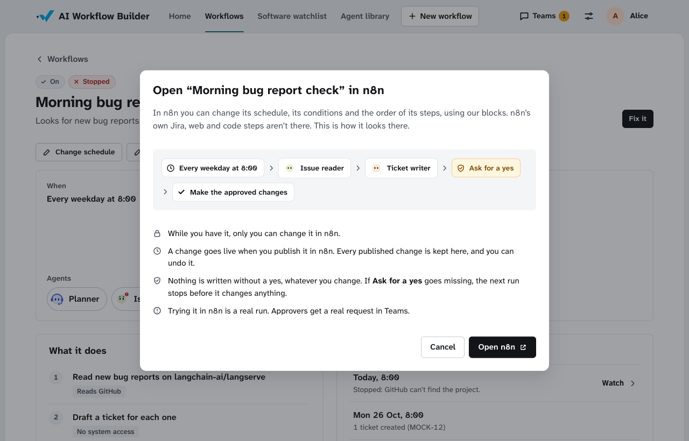
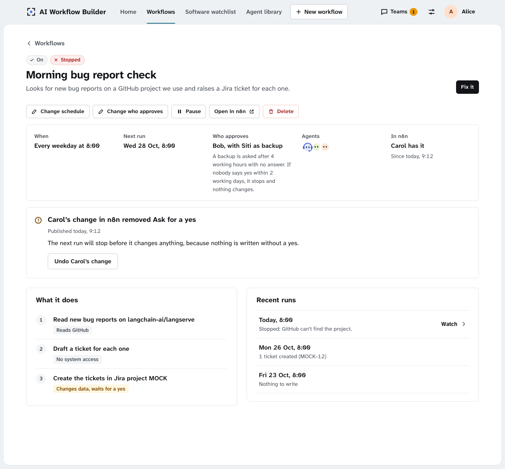
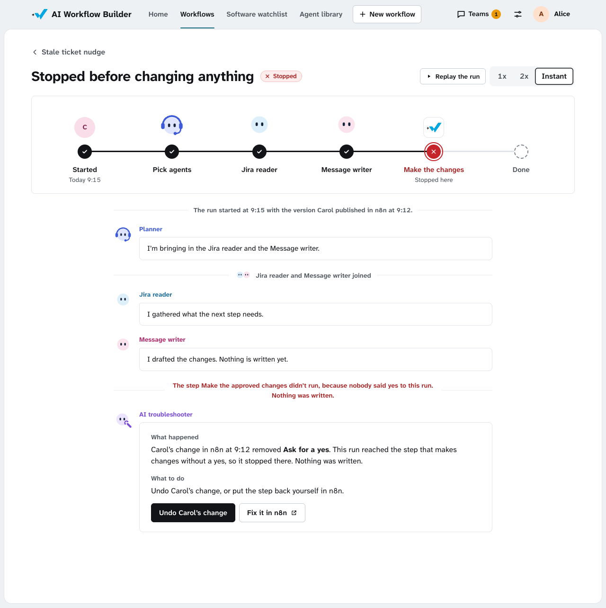
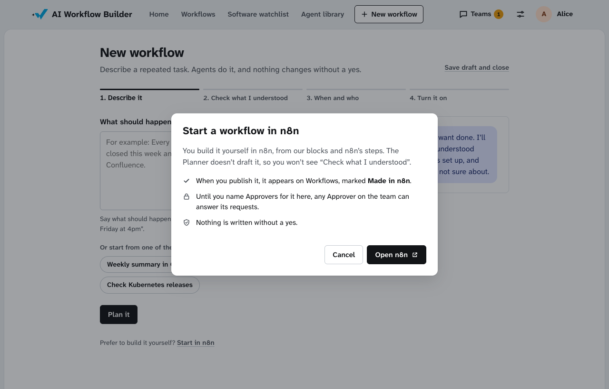

# Staff maintain workflows in n8n

This page proposes letting CODESparks staff maintain their workflows in n8n after handover, without weakening any safety rule. Nothing in the code changes until the team agrees.

**Status:** proposal for team review, 28 Oct 2026. Prototype P6 tested it on n8n's free Community edition the same day. The decisions are in [ADR 0026](../adr/0026-every-write-is-checked-when-it-is-made-so-n8n-may-hold-the-wait.md) and [ADR 0027](../adr/0027-staff-maintain-each-workflow-in-n8n-and-the-portal-keeps-every-published-version.md), and the evidence is in [P6's findings](../evidence/prototypes/p6-n8n-node-pack/findings.md). An [n8n workflow patterns review](../evidence/usability/2026-10-28-design-skill-audits.md#n8n-design-proposals-now-drafted-into-adrs-0026-and-0027) on 28 Oct made 11 proposals. They are now part of both ADRs and of this page.

## Why change

The sponsor's biggest concern is maintenance after we hand over, and he is set on using n8n for it. He wants his staff to do three things in n8n:

1. Change how a workflow runs, for example a step, a schedule or a message.
2. Build new workflows.
3. See the agents.

Today n8n is deliberately thin (ADRs 0002, 0007, 0012 and 0020).

- Every n8n node calls our API, and our API holds the run state, the approvals and the safety rules.
- One generic n8n workflow serves every use case of a template. It is a file in git, and each deploy reloads it, so an edit made in n8n's editor is lost.
- ADR 0012 left one question open: "Whether the sponsor accepts that the editor is read-only in practice is an open question for him." The answer is no.

If the sponsor opened n8n today, he would see short n8n workflows that each call one endpoint, with nothing in them his staff could usefully change.

## The idea

> **n8n holds the steps. Our platform holds the keys and the rules. Staff can change any step in n8n, but nothing can be written without a yes.**

## The Portal keeps everything, and n8n is an extra place to work

Nothing in the [Portal redesign](portal-routines.md) goes away:
- describing a task and letting the Planner build the workflow;
- agent cards, and changing an agent in plain English;
- the AI troubleshooter and its one-click fixes;
- Report to support, where coding agents write a fix;
- new tools drafted from a system's API.

Staff who never open n8n lose nothing. Opening n8n is a choice.

In n8n, staff can rearrange steps, change schedules, add conditions and use our blocks, but not n8n's own connectors or code (see [The node pack](#the-node-pack)). When they need something n8n doesn't load, such as posting to Slack, they ask for it in the Portal. It becomes a tool or a block, and it goes through approvals like every other change.

The team chose this limit on 28 Oct 2026 over two other options:
- **A second, practice n8n with everything, connected only to the practice copies of Jira and Teams.** There would be one more thing to run.
- **Full n8n, with unprotected workflows flagged.** Those workflows could write without a yes.

## Who owns what

| Part | What it owns | Where staff change it |
|---|---|---|
| **n8n** | Each n8n workflow's steps and their order, triggers and schedules, retries, error alerts, and waiting for a yes | n8n's editor. A change goes live when it is published |
| **Our API** | Every key for Jira, Confluence, GitHub and Teams, the approval rules, carrying out approved changes, the activity log, and a copy of every published version | Nowhere in n8n. Approvers are named in the Portal (ADR 0024) |
| **Agent runtime** | The Planner and the specialist agents | In plain English, in the Portal (agent cards, ADR 0023) |
| **Portal** | The plain-English builder that drafts the first n8n workflow, the live activity view, approvals, the AI troubleshooter and undo | The Portal |

**The one hard line:** n8n can't reach Jira, Confluence, GitHub, Teams or anywhere else by itself. It loads only our node pack plus a few harmless n8n nodes, so the only way out of n8n is through our API. Posting a Teams message counts as a change.

## The node pack

Staff see these nodes in n8n:

| Node | What it does | What it can never do |
|---|---|---|
| **Agent** | Runs one of our agents, picked from a list (Version checker, Ticket writer…). It shows the agent's name and face, returns the agent's result, and adds any change the agent wants to the run's proposal | Make a change itself |
| **Read** | Reads from Jira, Confluence or GitHub, for a read step without AI, such as "open tickets older than 14 days" | Read from a place outside the team's allowed list |
| **Propose a change** | For workflows without AI. Staff fill in a change by hand, such as "Post this text in CODESparks Support", and it joins the proposal | Make a change itself, or target a place outside the team's allowed list |
| **Ask for a yes** | Sends the proposal to the workflow's Approvers in Teams, then waits. It has four exits: **Yes**, **No**, **No answer**, and **Nothing to change** when nothing was proposed, so nobody is asked | Decide anything. Our API applies every approval rule |
| **Make the approved changes** | Carries out exactly the approved proposal, using keys held by our API. If one change of three fails, it reports "2 of 3 made", and a retry does only the one that failed | Change anything that wasn't approved, or was edited after the yes |
| **Start from the Portal** | A trigger for Run now and test runs. It accepts only calls our API signed | Answer anyone else |
| **Report a failure** | Tells our API that a run failed. Our error workflow uses it | Send anything anywhere else |

Beside them, n8n loads only its Schedule, Manual and Error triggers and simple flow nodes (IF, Merge, No Op, Sticky Note). This is n8n's `NODES_INCLUDE` setting, so n8n itself enforces it for everyone.

n8n's Webhook trigger is left out. It needs no sign-in unless someone sets one, and it can answer a call with the run's data, so Start from the Portal replaces it. Some of n8n's data nodes only reshape data already in the run, such as Filter, Edit Fields and Summarize. They can join the list once prototype P7 shows that none of them can send data out.

The software check would read in n8n as:

**Every Monday 9:00 → Version checker → Vulnerability checker → Ticket writer → Ask for a yes → Make the approved changes**

Three choices keep the pack easy to maintain:

- **One Agent node with a list,** not one node per agent. A new agent card saved in the Portal appears in n8n with no new install. P6 filled the list from our API.
- **The Planner lays out the agents when the workflow is built,** and every run follows them. Staff can see in n8n exactly who runs. The run chat still opens with the Planner stating the plan.
- **Each node only calls our API.** The pack holds no rules, so there is little in it to break.
- **No node has an address field.** Our API's address is set in our n8n image, and each node sends only fixed fields. Our nodes are the only way out of n8n, so an editable address would let staff send data anywhere. P6's throwaway nodes had one, and a security review caught it.

## How the safety rules hold

**The path of one change:**

1. An agent, or a Propose a change node, adds a write action to the run's proposal. Our API stores the proposal under our own run ID, with a digest of its content (ADR 0008).
2. **Ask for a yes** asks our API to send the request to the named Approvers. n8n waits. When someone decides, or the request expires, our API wakes the run.
3. **Make the approved changes** asks the write gateway to carry out the proposal. The gateway checks only our own records:
   - the right people said yes, nobody approved their own work, and two Approvers answered in order where a tool needs two;
   - the digest still matches;
   - it hasn't been done already;
   - the request hasn't expired.
4. The gateway makes the change with keys from Key Vault and logs who approved it.

**What a careless or deliberate edit does.** Every row marked P6 was tested:

| Edit in n8n | Result |
|---|---|
| Deletes Ask for a yes, then publishes | The write refuses: "No yes for this run." The AI troubleshooter says which edit caused it (P6) |
| Wakes a waiting run with its resume link | The run reaches the write, and the write refuses (P6) |
| Uses an old resume link again | n8n refuses: the run has finished (P6) |
| Copies the n8n workflow | Approvals don't carry over. They belong to one run |
| Adds a staff member's own Jira key and n8n's Jira node | n8n doesn't load the Jira node, so the n8n workflow can't be published or run, even by hand (P6) |
| Adds an HTTP Request node to send data elsewhere | Same: n8n doesn't load it (P6) |
| Changes where Propose a change posts | Only places on the team's allowed list work, and the Approver sees the exact target |
| Adds n8n's Webhook trigger, to hand a run's data to an outside caller | n8n doesn't load it. Our own trigger answers only calls our API signed |
| Runs the n8n workflow by hand in n8n | A real run, and Approvers get a real request. It counts as the work of whoever holds the n8n workflow, so they can't approve it |
| Starts a second run, with Run now or by hand, while one is waiting for a yes | The second run stops before it reads anything: "An earlier run is still waiting for a yes". Scheduled runs never overlap, because a request stops before the next run (ADR 0024) |
| Changes the n8n workflow's error workflow or time zone | Our check warns, and runs of that version stop before they read anything |

P6 showed that staff can add their own keys on the free edition. That is why the allow list matters: a key is useless when no node can use it.

The lessons from the October sandbox stay:
- Each day our API sends a test failure through the error workflow and checks that the report arrives.
- Retries wait a short delay first.
- A repeated call for the same run and node gets its first answer, so a retry never runs an agent twice.

## Build, edit, publish and undo

**Building a new workflow (in the Portal):**

1. The Operator describes the task, and step 2 reads it back as a sentence.
2. The Planner drafts an n8n workflow from the nodes n8n loads. It names each node by what it does. It adds a Sticky Note with the workflow's purpose, a link to its page in the Portal, and what is safe to change.
3. Step 3 sets the schedule and the Approvers.
4. **Turn it on** runs our check, then the platform's account creates and publishes the n8n workflow through n8n's API. The Portal waits until n8n reports every trigger as activated. P6 saw a webhook miss its first call when called straight after publishing. The Portal then records who turned it on and keeps a copy of that version.

**Editing (in n8n).** On the free edition, an n8n workflow sits in one person's space, and only n8n's owner account (our platform) sees them all (P6).

- Each workflow's page in the Portal has an **Open in n8n** button. It moves the n8n workflow into that person's space, where they can edit and publish it. The Portal shows who has it, and someone else can take it over the same way.
- On the free edition, whoever can edit an n8n workflow can also publish it (P6). Safety holds either way. What matters is that we see every publish, and we do: n8n records who published each version (P6).
- Our API notices newly published versions within about a minute and runs the same check. If an edit breaks something, the Portal and Teams warn at once, for example "Bob's change removed Ask for a yes".
- A run also checks its version before it reads anything, so no run starts on a version that failed. This covers the minute before our check, and drafts run by hand.
- The Portal rebuilds "What the workflow will do" from the published version, with a line such as "Changed in n8n by Bob, Tue 10:02".
- A copy made in n8n that uses our nodes appears on Workflows, marked **Made in n8n**. Its requests go to any Approver on the team until an Operator names Approvers.

The [Portal prototype](portal-routines/prototype.html) shows this:
1. Open a workflow and press **Open in n8n**.
2. In the test controls, choose "Carol changes it in n8n and publishes".
3. Her change removes Ask for a yes, so the workflow page and Home warn, and you can undo it.
4. In the test controls, choose "The next run starts with Carol's change". The run stops at the change step, and the AI troubleshooter offers **Undo Carol's change** or **Fix it in n8n**.

**Starting in n8n.**
- Step 1 of New workflow has a quiet link: "Prefer to build it yourself? Start in n8n". It opens a new, empty n8n workflow in the person's own space.
- The Planner doesn't draft it.
- When it is published, it appears on Workflows, marked Made in n8n. Any Approver on the team answers its requests until an Operator names Approvers.
- The team chose this on 28 Oct 2026. The builder stays the main way in, and n8n is a choice.
- The "Your workflow is on" screen also links to Open in n8n, for fine-tuning.

**Undo:**

- The Portal keeps every published version, with who published it and when. **Undo this change** publishes the previous version again, and the undo is logged too.
- When a run stops soon after a new version, the AI troubleshooter says so: "This stopped after Bob's change at 10:02. Undo it?"

**Whose work a run is.** None of these people can approve that run:
- **Scheduled run:** the person who published the version it used. This replaces ADR 0020's schedule owner. It needs n8n users to match our users by email.
- **Run by hand in n8n:** also whoever holds the n8n workflow. It may run a draft that nobody published.
- **Run now or a test run in the Portal:** also the person who pressed it.

## Live activity view and AI troubleshooter

The run line is built from the published version's nodes, so it matches what staff see in n8n.

- Our nodes report to our API at each step. That feeds the group chat: the Planner's plan, each agent's message, the proposal, the ask, the yes and the write.
- n8n's own nodes, such as the schedule or an IF, come from n8n's execution history. They show as quiet lines in the chat.

Our error workflow tells our API when a run fails. The AI troubleshooter then reads n8n's error, our activity events and the version history, and sorts the failure into one of three kinds:

1. **You can fix it,** for example a GitHub project that moved.
2. **A recent edit broke it.** It offers Undo. This kind is new.
3. **Only support can fix it.** It offers Report to support.

## Safety rules the design keeps

ADR 0026 changes where the approval gate is enforced: at the write, not along the route. Every rule still holds:

- No write action runs without a yes in Teams. The safety checker still denies by default, and only the write gateway holds keys.
- Nobody approves their own work. Runs from a published version count as the publisher's work. Runs started by hand in n8n also count as the work of whoever holds the n8n workflow.
- The access review still needs two Approvers, one after the other.
- Approval requests key off our own request ID, never n8n's execution ID.
- The error workflow must be active. Each day our API sends a test failure through it.
- A retry waits a short delay first, and never writes twice. Each change carries a key, so a second run never makes the same change again.
- Every change is logged with who approved it.

## Goals

- A CODESparks staff member can change a step or a schedule in n8n, without code and without asking us.
- No edit in n8n can make a write happen without a yes, or send data anywhere except through our API.
- When an edit breaks a workflow, the Portal says which edit, and one click undoes it.

## Non-goals

- Staff writing code in n8n. n8n doesn't load Code or HTTP Request nodes.
- Agents built with n8n's AI Agent node. Agents stay in our runtime so they can go into NCS's agent hub (ADR 0002).
- Choosing agents fresh on every run. The Planner lays them out when a workflow is built.
- n8n's paid features. The design works on the free Community edition. The sponsor can still buy sharing and edit-only roles later.

## What changes in each context

| Context | Change |
|---|---|
| Use case builder | Turn it on creates and publishes an n8n workflow. The Planner drafts its layout from the nodes n8n loads. Workflow pages gain Open in n8n, who has it, the version list and Undo. |
| Agent runtime | No change to agents. The Agent node calls the same runtime through our API. |
| Orchestration | New: the node pack, the allow list in our n8n image, the publish check, and keeping published versions. The write gateway (`WriteGateway` in `orchestration/write_actions.py`) checks approvals itself. The two-leg step API (ADR 0007), `release_check.n8n.json` and `schedule_tick` retire once the new path passes the same end-to-end tests. |
| Run monitoring | The run line comes from the published version. n8n's own nodes come from n8n's execution history. The AI troubleshooter learns "a recent edit broke it". |

## First slice, for the presentation (27 Nov to 5 Dec)

| When | What |
|---|---|
| Done, 28 Oct | Prototype P6 on n8n's free Community edition |
| First week of November | The team reviews ADRs 0026 and 0027. Prototype P7 tests three things: the signed trigger, how a run started, and whether any data node can send data out |
| Next two weeks | The first nodes: Agent, Ask for a yes, Make the approved changes, Start from the Portal and Report a failure. Then the allow list and Singapore time. Move the software check onto them. Today's path keeps running until the new one passes the same end-to-end tests |
| The demo | A staff member opens the software check in n8n, moves a node and changes the schedule. Then they delete Ask for a yes and the write refuses |

## Later

- Read and Propose a change.
- The Portal reading plans back from n8n, Undo, Made in n8n, and showing who has an n8n workflow.

## Risks

| Risk | What we do |
|---|---|
| NCS maintains TypeScript as well as Python | Each node only calls our API, so the pack stays small |
| An n8n upgrade breaks our nodes or the allow list | We pin n8n and bake the pack and the allow list into our own n8n image, which also works offline in DevNet. CI tests both before the pin moves |
| A careless edit stops a workflow | The publish check warns, the AI troubleshooter names the edit, and Undo restores the last version |
| Only one person can edit an n8n workflow at a time | The Portal shows who has it, and anyone can take it over. Paid sharing can come later |
| Staff want n8n nodes we don't load, such as Slack or email | Each one is a decision: add a node to our pack, or put n8n's node on the allow list after checking what it can reach |
| n8n doesn't catch up on schedules it missed while down | The Portal shows a missed run with "Run now" |
| n8n runs schedules on New York time unless told otherwise | Our image sets Singapore time, and our check flags any n8n workflow set to another zone |
| Our error workflow used HTTP Request, which the allow list blocks | It uses our Report a failure node, and a daily test failure proves the path works |

## Open questions

**For the sponsor:**

- Is it acceptable that n8n can only reach other systems through our platform, so his staff use our nodes rather than n8n's hundreds of others?
- Is one editor at a time enough, or would NCS pay for n8n's sharing and edit-only roles?
- Does n8n's licence (the Sustainable Use License) fit NCS? This question was already open.

**For the team:**

- What does n8n do with a waiting execution when its n8n workflow is deleted? P6 left one waiting and didn't check.
