# Portal redesign: one clear flow

This page proposes a new shape for the Portal. The aim is that a new user knows at once what the Portal is for, what to do next, and what they get at the end. Nothing in the code changes until the team agrees.

**Status:** proposal for team review, 27 Oct 2026.

## Try the prototype

The prototype is a clickable mock with sample data. Nothing is connected.

- **In the repo:** open [`portal-routines/prototype.html`](portal-routines/prototype.html) in a browser.
- **Online:** https://claude.ai/artifact/KDxZZkF6BjHmW92YPa2XzU

The **Test controls** button at the bottom left opens the mock controls. They are not part of the app.

- **Show:** *A normal week* (4 workflows running) or *Day one* (a brand-new user).
- **Act as:** Alice (Operator and Approver) or Bob (Approver only). Carol, an Operator, owns the software schedule. Siti and Arun are two more Approvers.
- **Make something happen** acts for someone else, or lets time pass.
- **Start over** resets everything.

Six things to try:

1. On **Home**, open "2 upgrade tickets are waiting for your yes" and approve them. Bob didn't answer in time, so Alice was asked as the backup.
2. Open "Morning bug report check stopped" and fix it with one click.
3. On "Stale ticket nudge stopped", press **Report to support**, then follow the report to "Fixed".
4. In **New workflow**, pick "Weekly summary in Confluence" and press **Plan it**. The Planner drafts a missing tool. Ask for the OK, let Bob OK it from the test controls, then turn the workflow on.
5. In **New workflow**, pick "Check Kubernetes releases". The Planner adds it to the **Software watchlist** instead of making a new workflow.
6. Set up a workflow, choose who is asked first and a backup, and do a test run. From the test controls, let 4 working hours pass, then let nobody answer.

## Why change

Each feature works on its own. The problem is how many places there are, and the order you meet them in.

- The menu has 6 tabs: Runs, Builder, Software, Approvals, Teams and Jira.
- Release checking lives in 3 places: the Software page, the Release checker starter card, and use cases with near-identical names.
- The Builder page mixes a task box, the agent library and a list of use cases with IDs, versions and timestamps.
- The home page shows the latest run, which is often "Nothing to write".
- The Teams and Jira practice copies sit in the main menu, so the app looks like a copy of them.
- The AI troubleshooter only shows on a failed run's page.
- After "Save and run" there is no clear "you're done" moment.

The sponsor asked for four things. The new design puts each one on the first screens a user sees:

| Sponsor asked for | Where the design shows it |
|---|---|
| Automate the boring, repeated work | A workflow is that work, set up once |
| Nothing critical without approval | Approvals come first on Home, with the exact change shown |
| Approvals in Teams | Teams is where you approve. The Portal points you there. |
| Fixable without a technical person | Failures show on Home with the reason, and either a fix or "Report to support" |

## The idea

> **Turn a repetitive chore into a workflow that runs itself. You approve every change in Teams. If it breaks, it tells you why in plain English.**

Users own one thing: a **workflow**. In the code, a workflow is a use case as ADR 0023 defines it: a card, its input values and a schedule. Only the word users see changes. Agent cards still exist, and users see them as "the agents on this workflow".

"Workflow" also means two other things the team works with: n8n's workflows, which carry each run, and Jira's workflows, which are a ticket's statuses. So in the app, "workflow" always means the user's task. In code and docs, always write "n8n workflow" or "Jira workflow" for the other two. `GLOSSARY.md` records this rule.

The app's on-screen name is **AI Workflow Builder**, the project's own name. "Portal" stays as the internal name for the web app in code and ADRs.

The menu becomes:

| Page | What it is for |
|---|---|
| **Home** | What needs you now, what you are waiting on, and what runs next |
| **Workflows** | Every workflow as a card: status, last result, next run, its agents |
| **Software watchlist** | Every piece of software the team runs, and every release check |
| **Agent library** | Two tabs. **Agents:** every agent the Planner can bring in; open one to see how it works and change it in plain English. **Tools:** every tool the agents use, whether it's working, and a way to ask for a new one |
| **New workflow** | Set up a workflow in 4 steps |

On phones and small tablets (under 900 px), the same items sit in a tab bar at the bottom of the screen.

Settings (the gear) has four tabs: AI model, Connections, People and roles, and AI usage. The AI model works as ADR 0022 describes. An Operator picks a provider, pastes the API key and presses Connect, then picks a model and presses Test and save. Only the key's last 2 characters ever show again. A new address needs an Approver to confirm it. The Teams button in the header opens the practice Teams copy.

## The flow

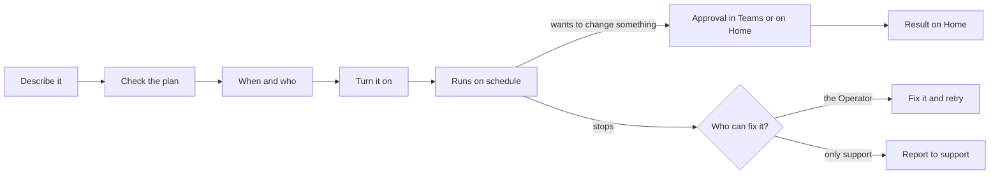

### 1. First visit

A new Operator lands on Home. Instead of an empty page, it shows three ready-made workflows, "Describe your own", and how it works in 4 steps.

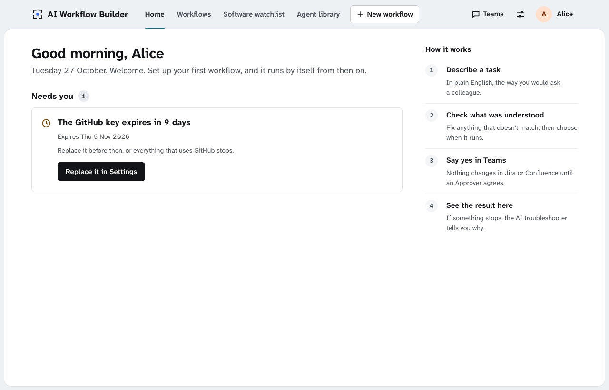

### 2. Every day after that

Home lists what needs you, each with one button. Approvers see only approvals.

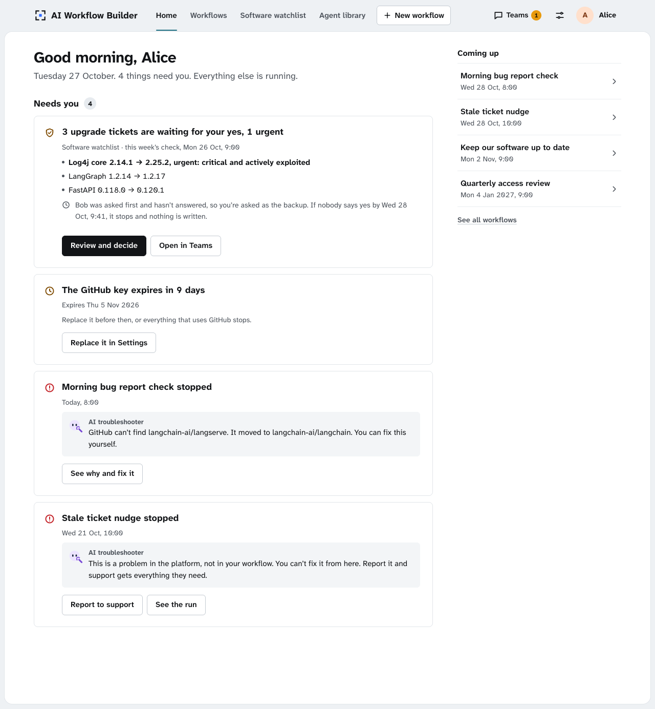

### 3. Set up a workflow

New workflow has 4 steps, and each ends in something you can see.

1. **Describe it** in plain English.
2. **Check what I understood.** The Planner shows how it read the request, line by line: when, which tickets, what it does and where the result goes. Each line is marked *From your words*, *Changed by you*, *Please choose* or *Can't do this yet*, and can be corrected. Next stays disabled until nothing is unclear. It also says when a similar workflow already exists. Below that is the plan, with each step marked *Reads*, *No system access* or *Changes data, waits for a yes*.
3. **When and who.** How often, the day and any time, filled in from the request and never guessed. Then who is asked first, a backup, when to ask the backup and when to stop waiting (see [Who is asked](#6-who-is-asked-and-what-if-nobody-answers)). Then the Teams channel.
4. **Turn it on.** A one-sentence summary and a check against the request that marks anything changed. Then "Your workflow is on", with the next run.

If a step needs a tool we don't have, the Planner drafts a **tool card** (see [Later](#later-each-needs-its-own-decision)).

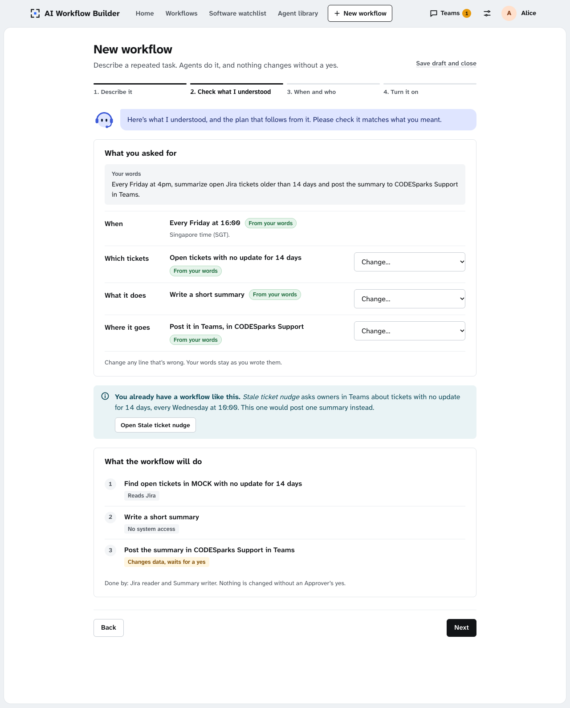

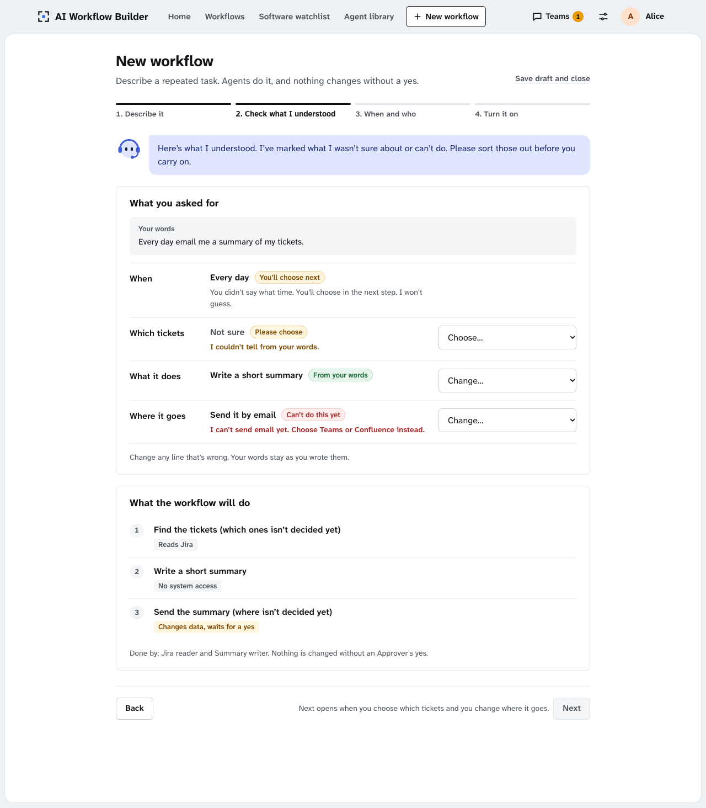

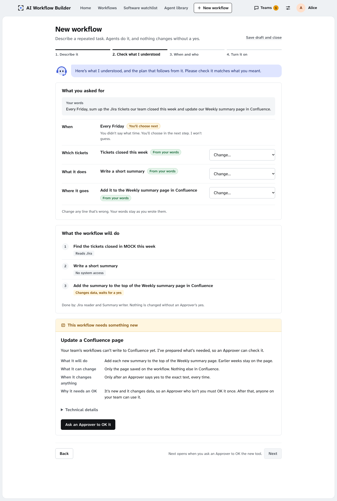

### 4. Software watchlist: one list for every release and vulnerability check

All software versions live on the Software watchlist page. It is checked every Monday, with one approval for all of that week's tickets, as ADR 0019 already works.

Two specialist agents do the checking. The Planner brings them into any workflow about versions or vulnerabilities ([ADR 0025](../adr/0025-cross-check-versions-and-vulnerabilities-across-trusted-sources.md), proposed):

- **Version checker** reads each tool's newest version from the registry the team installs it from: Maven Central, npm, PyPI, NuGet or Docker Hub. It falls back to GitHub releases for anything else. It cross-checks GitHub, and if the two disagree, the registry wins and the difference is shown. It also reads support dates from endoflife.date. When an Operator isn't sure where something is published, it searches the vendor's official site and suggests a source for a person to confirm.
- **Vulnerability checker** looks up known vulnerabilities in the version the team runs. It matches in OSV.dev, reads the official record and severity from NVD, checks the vendor's own advisory, and checks CISA's list of actively exploited vulnerabilities. Each finding shows which sources reported it. A critical or actively exploited one marks the upgrade ticket urgent, and the ticket still waits for a yes.

They use a fixed list of trusted sources, not open web search. Web pages are often out of date, two searches can disagree, and any page an agent reads could carry planted instructions.

On the page:

- Each tool shows where it's published, our version, the newest version and which sources agree, its status, and where our version came from.
- A tool with known vulnerabilities shows how many, which sources found them, and the worst one, linked to NVD. In the sample, Log4j core 2.14.1 has 4, the worst being CVE-2021-44228 (Log4Shell), which CISA lists as actively exploited.
- **Support ending** lists versions whose security fixes end soon, from endoflife.date. In the sample, these are PostgreSQL 14 and Node.js 22.
- **History** shows each tool's changes over time: when it was added, the tickets raised, who approved them, and when our version changed.
- The "Keep our software up to date" card on Workflows opens this page.

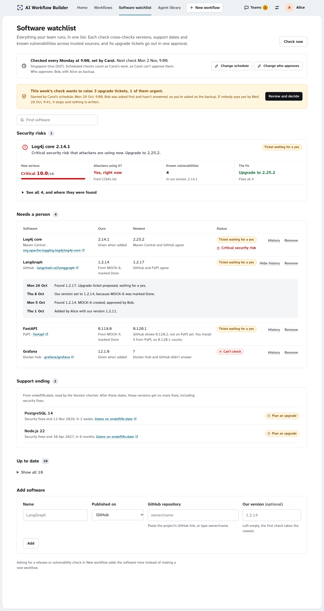

When someone asks for a release check in New workflow, the Planner adds the software to this list instead of making a new workflow. If the software is already on the list, it says so. This stops look-alike release-check use cases from piling up again.

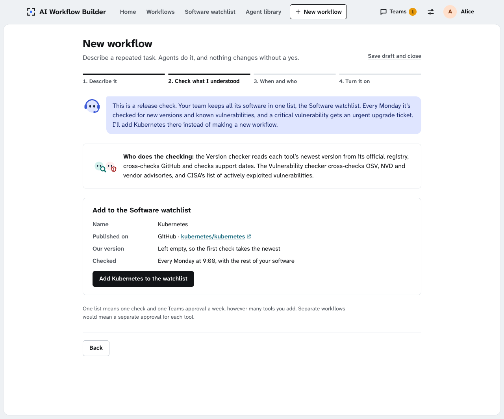

### 5. Watch and approve

The run page is the live activity view: the run line, what each agent said, and the approval gate. It shows exactly what will be written. You reach it from Home, Workflows, Software watchlist or the Teams message, not from the menu. Nobody approves their own work. If you started the run, you see a lock.

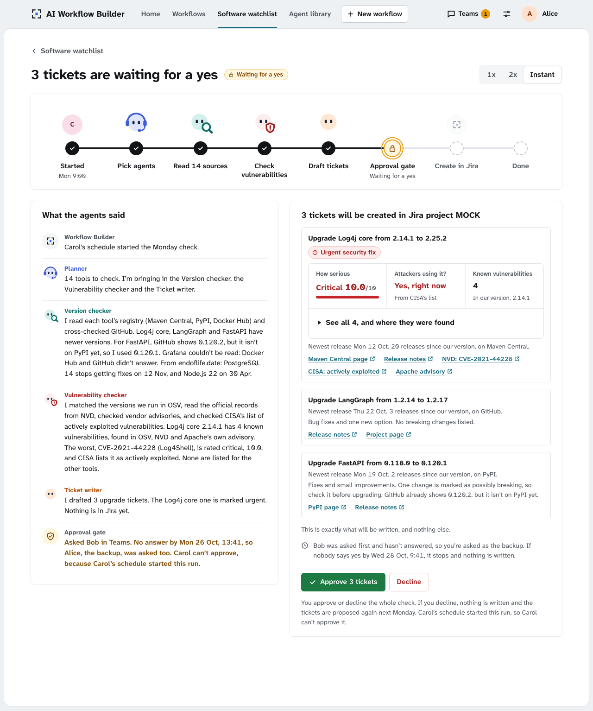

### 6. Who is asked, and what if nobody answers

Each workflow names who is asked first and a backup. Only they can decide. If the first person hasn't answered after a set wait, the backup gets a message too. If nobody answers by a second deadline, the request stops and nothing is written. A request never says yes by itself. The proposed defaults are 4 working hours and 2 working days. This changes the approval gate, so it is proposed in [ADR 0024](../adr/0024-each-use-case-names-its-approvers-and-unanswered-requests-go-to-a-backup-then-expire.md).

- Home, the run page and Teams say who has been asked, and when the next step happens.
- The workflow's owner can't be named, and nobody is named twice in one workflow.
- A workflow that needs 2 Approvers names a first person and a backup for each step.
- Changing who approves starts with the next run. A request that is already waiting keeps the people it was sent to.

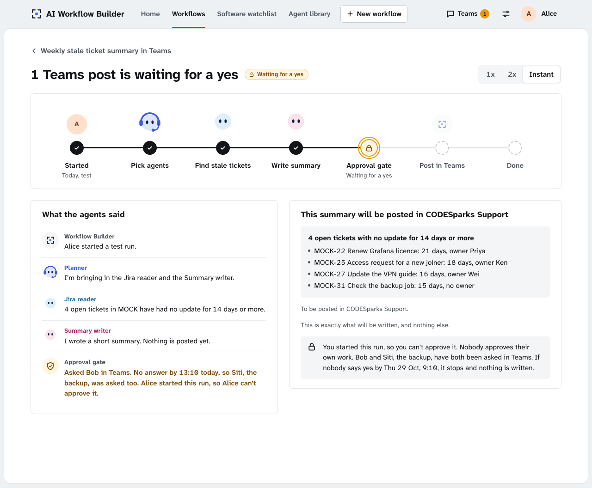

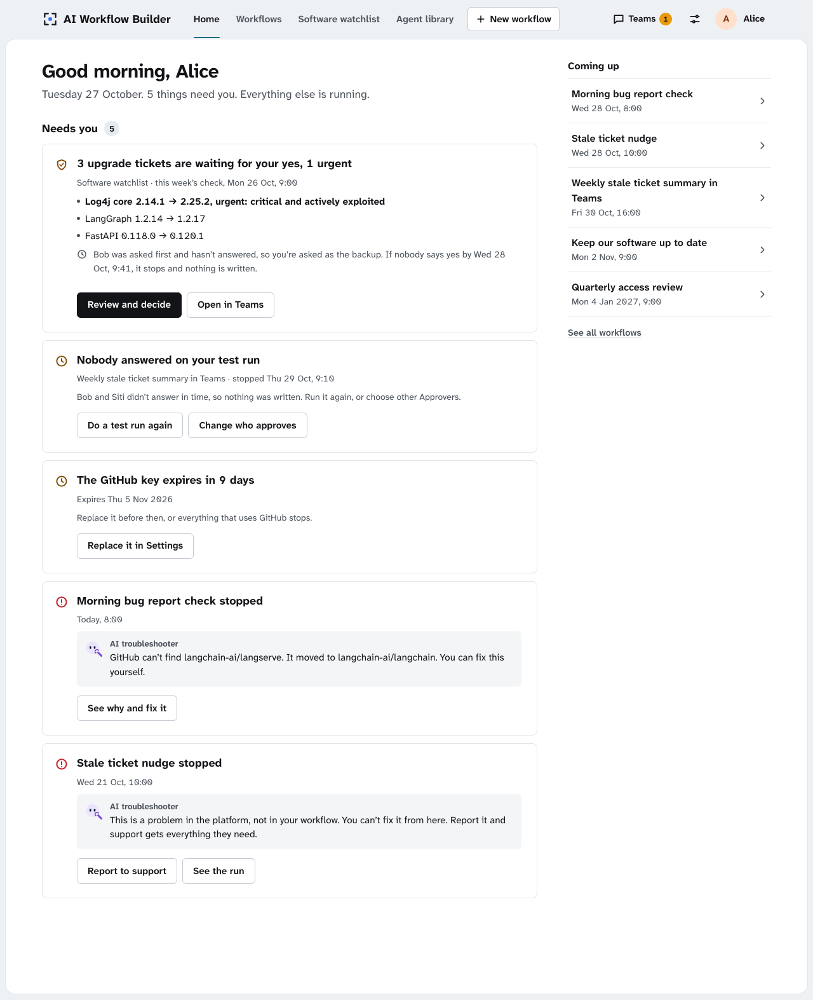

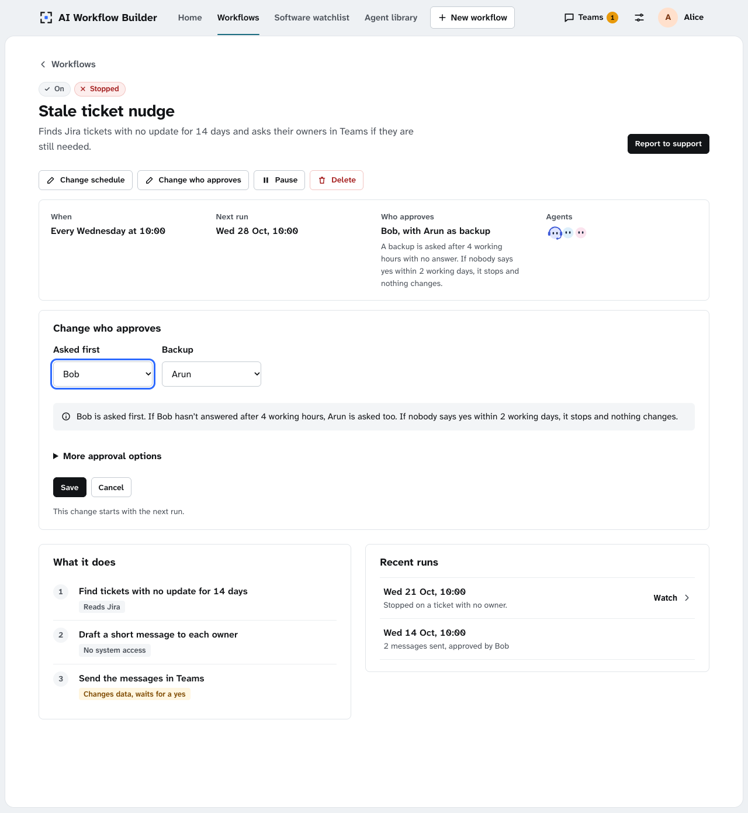

### 7. When something stops

The AI troubleshooter's reason shows on Home. It says which kind of problem it is:

- **You can fix it,** for example a GitHub project that moved. One click fixes it and retries the run.
- **Only support can fix it,** for example a bug in the platform. "Report to support" sends the run and the troubleshooter's notes, and you follow the report on Home.

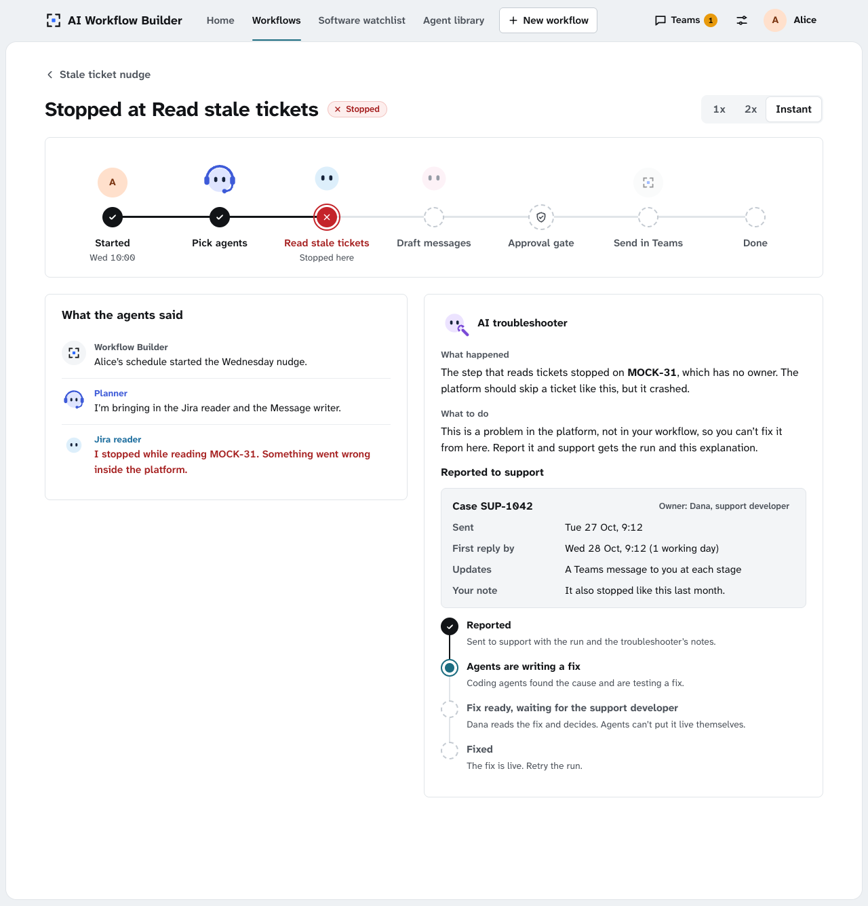

### 8. Keep track

Workflows shows every workflow as a card. Cards that need you come first, with the button on the card.

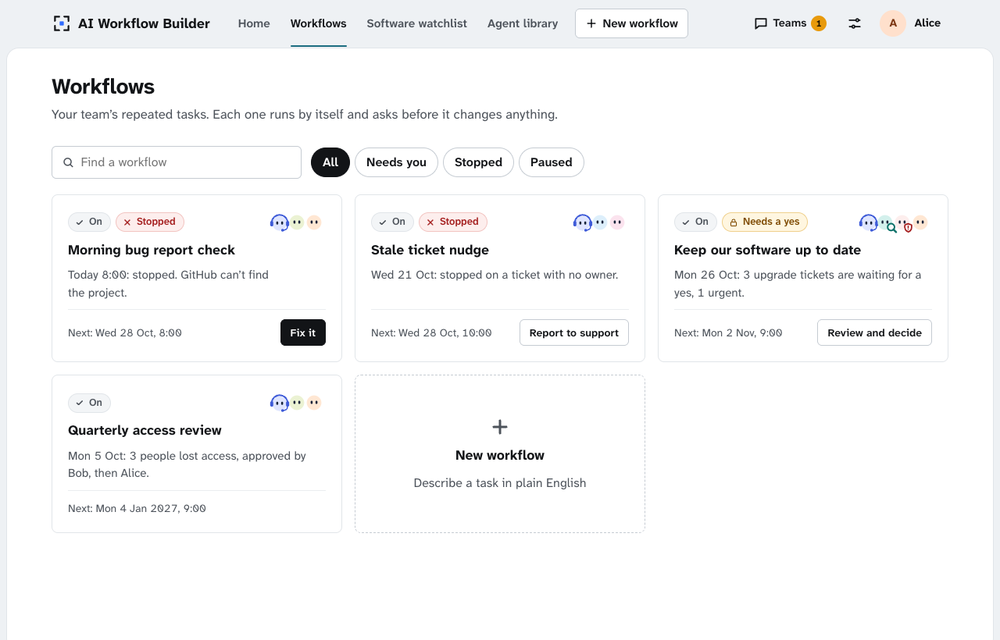

### 9. Change how an agent works, in plain English

Each card in the Agent library says whether the agent only reads or can change data after a yes, and which workflows use it. Opening one shows:

- **How it works:** its steps, numbered.
- **Tools it may use**, and **rules it always follows**, such as "anything that changes data waits for a yes".
- **Where it's used**, and what it did on its last run.
- **Version history**, with "Go back to this version".

To change an agent, an Operator says what should be different, such as "Only flag support that ends within 3 months". Each agent offers 2 or 3 example requests to tap. The Planner redrafts the agent's steps and marks the changed step. The platform then checks the draft: it uses only the tools already on the card, it doesn't change what needs a yes or who approves, and it doesn't reach anything new. The draft also says what would have been different on the agent's last run. Nothing changes until the Operator saves it as a new version. Workflows that use the agent pick up the new version on their next run. A run that's already going keeps the version it started with, as ADR 0023 already says.

Some requests can't be done this way, and the Planner says why instead of guessing:

- **Skipping a yes** ("create the tickets without asking anyone") is refused. It's a platform rule.
- **Needing a new tool** ("put tickets in the Platform component"): the Planner offers to draft the tool, and an Approver must OK it first (see 10).
- **Needing a new system or source** ("also check Go modules") is the team's decision. There's a button to send the request to the team.
- **Reaching somewhere new** ("also read the OPS project") belongs to the workflow, not the agent.

Only Operators can change agents. The Planner and the AI troubleshooter are part of the platform and can't be changed here.

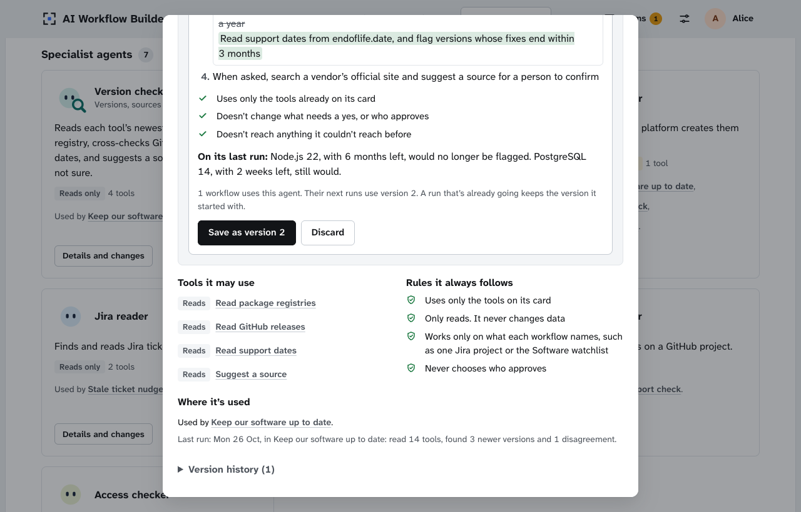

### 10. The tools the agents use

The Agent library has a second tab, **Tools**. A tool is how an agent reaches another system, and an agent can only use the tools on its card. Tools are listed in two groups: those that change data, each with how many Approvers it needs every time, and those that only read. Each row says which agents use it and whether it's working.

Opening a tool shows:

- **Whether it's working.** If it had a problem, it says what happened and what happens next, such as "Docker Hub didn't answer, so Grafana wasn't checked". **Check it works** tries the connection without changing anything. It tells a connection problem apart from a platform bug: Read a Jira ticket still fails on a ticket with no owner, and only support can fix that.
- **What it can change or reach, and what it can't do,** such as "Can't edit, move or delete tickets".
- **Agents that use it**, which open the agent, and the workflows they're in. An agent's tools open the tool, and **Back** returns to where you were.
- **Recent changes, and who said yes,** for tools that change data. For example: "Created MOCK-9 for Keep our software up to date. Alice said yes." This is the log of every agent action with who approved it, shown where people look.

**Need a tool that isn't here?** An Operator says what an agent should be able to do. The Planner checks the tools you already have first. If it's new and the system is already connected, it drafts a tool from that system's published API, and an Approver who isn't the person asking must OK it once, as with the Confluence tool in New workflow. A new system, such as ServiceNow, or anything that deletes data, goes to the team as a request, listed under "Asked the team". Requests to skip a yes are refused.

The whole path connects: the Ticket writer can't set a component, so the Planner drafts the tool. Alice asks for an OK, and Bob OKs it from Home or Teams. Alice is told, and gives the tool to the Ticket writer as a new version, which shows what it adds.

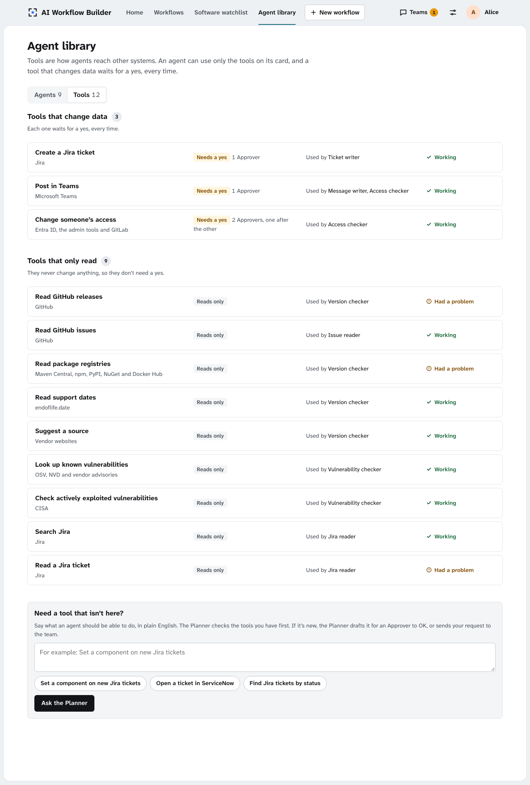

## Changes after usability testing

Version 1 was tested by an independent evaluator (ChatGPT) and in an internal walkthrough on 27 Oct 2026. Version 2 answers their findings. The report is in [`docs/evidence/usability/2026-10-27-chatgpt-v1-evaluation.md`](../evidence/usability/2026-10-27-chatgpt-v1-evaluation.md), and the changes are listed in [`docs/evidence/usability/2026-10-27-v2-changes.md`](../evidence/usability/2026-10-27-v2-changes.md). Version 1 is kept in [`portal-routines/v1/`](portal-routines/v1/).

## Safety rules the design keeps

There is one proposed change to the approval gate: named Approvers, a backup and a stop time ([ADR 0024](../adr/0024-each-use-case-names-its-approvers-and-unanswered-requests-go-to-a-backup-then-expire.md)). It narrows who can decide, and it never lets a request approve itself. There is no change to the safety checker. The design makes the rules visible where they apply:

- Nothing is written without a yes, and the approval shows the exact change.
- Nobody approves their own work, including runs started by their own schedule.
- Only the people named on a workflow can decide its requests.
- A request nobody answers stops, and nothing is written.
- A tool can only touch the target saved on the workflow, such as one Jira project.
- Changing an agent in plain English can only add a tool that's already on the tool list. It never changes what needs a yes, or who approves. A run keeps the agent version it started with.

## Goals

- A new Operator can say what the Portal is for, and set up a workflow, without help.
- Every screen has one obvious next step.
- A release check never creates a new workflow. It adds a row to the Software watchlist.

## Non-goals

- No new service, data store or external dependency.
- No change to how runs or the watchlist work underneath. Approvals change only as ADR 0024 proposes.
- No new brand. The prototype keeps the Portal's font (Atkinson Hyperlegible Next), status colours and agent faces, in a light theme. The look is a "framed sheet": a pale blue-grey header and frame around a white page, flat cards, and one teal accent for the current tab, links and data. Body text is at least 4.5:1 against its background, and secondary text is about 7:1.

## What changes in each context

| Context | Change |
|---|---|
| Use case builder | New workflow as 4 steps with a done screen, reusing today's plan panel and card editor. Release-check use cases and the Release checker starter card stop showing to users. The Agent library becomes its own tab, showing each agent card with its tools and the workflows that use it. |
| Agent runtime | The Planner learns one more answer: "this is about software versions or vulnerabilities, so it belongs on the Software watchlist". Today it doesn't know the watchlist exists. The release checker becomes the Version checker, and a Vulnerability checker card joins it, with read-only tools for the registries, support dates, source suggestions, vulnerability lookups and CISA's list (ADR 0025). |
| Orchestration | None for the first slice. Named Approvers and the timer (ADR 0024) come once the team and the sponsor agree. |
| Run monitoring | Home, the troubleshooter's reason on Home, and the run page reached from where you are instead of the menu. The Approvals page folds into Home. |

The Software page already exists, and the backend already records where each version came from (`Given`, `FromFirstCheck` and `FromTicketDone` in `platform-api/src/platform_api/orchestration/watch.py`). The history view mostly lists what is already stored.

## First slice, for the presentation (27 Nov to 5 Dec)

1. **The menu and Home.** Home, Workflows (cards), Software watchlist, Agent library and New workflow. Teams and Jira move to Settings, and Approvals folds into Home.
2. **Software watchlist.** History for each tool, and release checks redirected from New workflow.
3. **New workflow.** The 4 steps and the done screen.
4. **Failures on Home** with the troubleshooter's reason, and Fix it where the platform allows a retry.

Rough size: 1.5 to 2 sprints, mostly Portal work.

## Later, each needs its own decision

- **Named Approvers and a stop time.** Proposed in ADR 0024. The rule that checks a decision already allows a list of people for each step, so the decision rules don't change. The sponsor needs to agree the default waits and the working hours.
- **Report to support.** Filing an issue is small. Having coding agents write the fix, with a developer reviewing and merging, needs NCS's agreement. Agents never merge or deploy.
- **Settings beyond the AI model.** Connections reuse ADR 0022's pattern for the GitHub, Jira and Teams keys, as that ADR already suggests. Changing roles in the app decides who can approve, so it needs its own ADR, and it has to fit sign-in with NCS accounts (ADR 0018). The usage limit needs the provider's usage numbers, and a decision on what stops when it's reached.
- **Tool cards.** A tool described as data, which the AI drafts from a system's published API and an Approver OKs once. One runner we build and test runs every tool card, so no code the AI wrote ever runs. This changes ADR 0023 ("tools are code we build"), so it needs a new ADR first. The prototype shows it in two places: New workflow (the Confluence tool) and "Need a tool that isn't here?" on Tools.
- **More sources for the Software watchlist.** ADR 0025 proposes a fixed list: the main package registries, GitHub, endoflife.date, OSV, NVD, vendor advisories and CISA's list. Any source beyond that list is another external dependency with its own ADR, as the [watchlist PR/FAQ](software-watchlist-prfaq.md) says.

## Risks

| Risk | What we do |
|---|---|
| It takes time from the weeks before the presentation. | Keep the first slice to Portal changes, and reuse the screens we have. |
| "Workflow" also means n8n workflows and Jira workflows. | In the app it always means the user's task. In code and docs, write "n8n workflow" or "Jira workflow" for the others. The glossary records the rule. |
| It is our judgement, not tested with users. | Give 2 or 3 people who haven't seen it two tasks each, on today's Portal and on the prototype, and note where they stop. |
| Tool cards and coding agents look like they weaken safety. | Neither is in the first slice. Each gets an ADR first. |

## Open questions

1. Is the first slice right for the presentation, or should it be smaller?
2. Should we show the sponsor the prototype before we build?
3. After handover, can someone at CODESparks or NCS review a pull request now and then? This decides whether coding agents can help with fixes later.
4. Are 4 working hours (ask the backup) and 2 working days (stop waiting) the right defaults? Should public holidays count?
5. An agent can be used by other people's workflows. Should any Operator be able to change it, as in the prototype, or only the people whose workflows use it? The prototype shows which workflows use it before saving, and keeps every version.

Decided on 27 Oct: users see **workflow** (not "routine" or "use case"), the app is called **AI Workflow Builder**, the software page is **Software watchlist**, and the Room lead is now the **Planner**. If the team agrees with the rest, we open one issue per item in the first slice.
