# Portal redesign: one clear flow

This page proposes a new shape for the Portal. The aim is that a new user knows at once what the Portal is for, what to do next, and what they get at the end. Nothing in the code changes until the team agrees.

**Status:** proposal for team review, 27 Oct 2026. Updated 6 Nov 2026: Home is now the Planner's chat box, and it replaces New workflow ([ADR 0037](../adr/0037-home-is-the-planners-chat-box-and-replaces-new-workflow.md), proposed).

## Try the prototype

The prototype is a clickable mock with sample data. Nothing is connected, and the Planner's answers are scripted.

- **In the repo:** open [`portal-routines/prototype.html`](portal-routines/prototype.html) in a browser.
- **Online:** https://claude.ai/artifact/KDxZZkF6BjHmW92YPa2XzU. It still shows the 27 Oct version until it is published again.

The **Test controls** button at the bottom left opens the mock controls. They are not part of the app.

- **Show:** *A normal week* (4 workflows running) or *Day one* (a brand-new user).
- **Act as:** Alice (Operator and Approver) or Bob (Approver only). Carol, an Operator, owns the software schedule. Siti and Arun are two more Approvers.
- **Make something happen** acts for someone else, or lets time pass.
- **Start over** resets everything.

Eight things to try:

1. On **Workflows**, open the upgrade tickets waiting for your yes, at the top under **Needs you**, and approve them. Bob didn't answer in time, so Alice was asked as the backup.
2. Open "Morning bug report check stopped" and fix it with one click.
3. On "Stale ticket nudge stopped", press **Report to support**, then follow the report to "Fixed".
4. On **Home**, tap the example "Every Friday, list bug tickets with no update for 10 days". The Planner fills in the workflow and asks only for what it can't know. Answer it and turn the workflow on.
5. On **Home**, ask for "a weekly summary of closed tickets in Confluence". The Planner drafts a missing tool. Ask for the OK, let Bob OK it from the test controls, then turn the workflow on.
6. On **Home**, ask to "keep track of Kubernetes releases". The Planner fills in a **Software watchlist** row instead of making a new workflow.
7. On **Home**, ask to "email me a list of open bugs every Monday". Email isn't connected, so the Planner offers to post the list in Teams instead, and offers **Ask the team**.
8. Open "Morning bug report check" on Workflows and press **Open in n8n**. From the test controls, let Carol change it in n8n, then let the next run start. It stops before changing anything, and the AI troubleshooter offers Undo or Fix it in n8n. The [n8n design note](n8n-maintained-workflows.md) explains this.

A workflow you set up on Home can also do a test run with who is asked first and a backup. From the test controls, let 4 working hours pass, then let nobody answer.

## Why change

Each feature works on its own. The problem is how many places there are, and the order you meet them in.

- The menu has 6 tabs: Runs, Builder, Software, Approvals, Teams and Jira.
- Release checking lives in 3 places: the Software page, the Release checker starter card, and use cases with near-identical names.
- The Builder page mixes a task box, the agent library and a list of use cases with IDs, versions and timestamps.
- The home page shows the latest run, which is often "Nothing to write".
- The Teams and Jira practice copies sit in the main menu, so the app looks like a copy of them.
- The AI troubleshooter only shows on a failed run's page.
- After "Save and run" there is no clear "you're done" moment.

On 6 Nov, after the first reshape, the team still found that a new user didn't know where to start. Home showed ready-made workflows, a list of what needs you, how it works and a New workflow tab, all at once. So Home became one box where you tell the Planner what you want. The Planner already knows what the platform can do, because the code holds it to a fixed list of abilities. It answers with the workflow or watchlist row already filled in. What needs you moved to the top of Workflows. [ADR 0037](../adr/0037-home-is-the-planners-chat-box-and-replaces-new-workflow.md) records the options the team compared.

The sponsor asked for four things. The new design puts each one on the first screens a user sees:

| Sponsor asked for | Where the design shows it |
|---|---|
| Automate the boring, repeated work | Tell the Planner the chore on Home, and it sets it up once |
| Nothing critical without approval | Approvals come first on Workflows, with the exact change shown, and are counted on the Workflows tab |
| Approvals in Teams | Teams is where you approve. The Portal points you there. |
| Fixable without a technical person | Failures show at the top of Workflows with the reason, and either a fix or "Report to support" |

## The idea

> **Turn a repetitive chore into a workflow that runs itself. You approve every change in Teams. If it breaks, it tells you why in plain English.**

Users own one thing: a **workflow**. In the code, a workflow is a use case as ADR 0023 defines it: a card, its input values and a schedule. Only the word users see changes. Agent cards still exist, and users see them as "the agents on this workflow".

"Workflow" also means two other things the team works with: n8n's workflows, which carry each run, and Jira's workflows, which are a ticket's statuses. So in the app, "workflow" always means the user's task. In code and docs, always write "n8n workflow" or "Jira workflow" for the other two. `GLOSSARY.md` records this rule.

The app's on-screen name is **AI Workflow Builder**, the project's own name. "Portal" stays as the internal name for the web app in code and ADRs.

The logo is an AI spark and then a tick, because nothing is written without a yes. The tick is drawn in NCS strokes and NCS blue. Its long arm is the NCS mark's right stroke. Its short arm leans back with the same cut and the same gap as the NCS mark. It shows in the header, on the browser tab, and on a white tile wherever the app itself speaks: in the Teams messages, in the run chat, and on the run line. The tile's square corners set it apart from the round agents and people.

The menu becomes:

| Page | What it is for |
|---|---|
| **Home** | The Planner. Tell it a task in plain English, and it sets up the workflow or the watchlist row |
| **Workflows** | What needs you, what you are waiting on, then every workflow in one list: status, last result, its agents, next run. The tab shows an amber count when something needs you |
| **Software watchlist** | Every piece of software the team runs, and every release check |
| **Agent library** | Two tabs. **Agents:** every agent the Planner can bring in; open one to see how it works and change it in plain English. **Tools:** every tool the agents use, whether it's working, and a way to ask for a new one |

There is no New workflow tab. New things start in the Planner's box on Home. Changes to something that exists happen where it lives: an agent in the Agent library, a workflow's schedule and Approvers on its page, and software on the Software watchlist.

An Approver who can't set up workflows sees Home, Workflows and Software watchlist. Their Home is what waits for their yes, with no box.

On phones and small tablets (under 900 px), the same items sit in a tab bar at the bottom of the screen.

Settings (the gear) has four tabs: AI model, Connections, People and roles, and AI usage. The AI model works as ADR 0022 describes. An Operator picks a provider, pastes the API key and presses Connect, then picks a model and presses Test and save. Only the key's last 2 characters ever show again. A new address needs an Approver to confirm it. The Teams button in the header opens the practice Teams copy.

## The flow

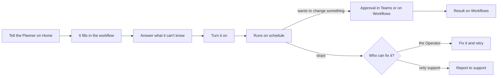

### 1. First visit

A new Operator lands on Home, and Home is only the Planner. Its face sits above one question, "What does your team do again and again?", and a large box. Under the box are three example requests to tap, and two short lists built from the platform's tools: what the Planner can do, and what it can't do yet. Nothing else is on the page.

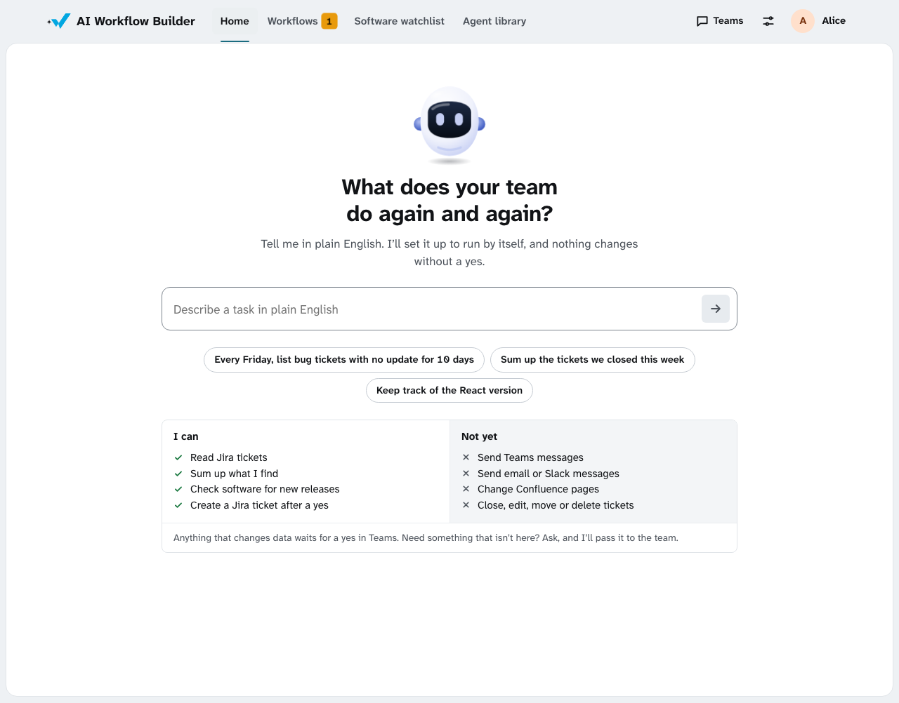

### 2. Every day after that

Home stays the Planner. The question becomes "What else should run by itself?", and the two lists fold into a "What can I ask for?" link. The conversation lasts until you start a new chat. It is never the record, because everything the Planner sets up becomes a workflow or a watchlist row with its own page.

What needs you lives at the top of **Workflows**, and the Workflows tab shows an amber count when something is waiting (see [Keep track](#8-keep-track)). An Approver who can't set up workflows sees their approvals on Home instead of the box.

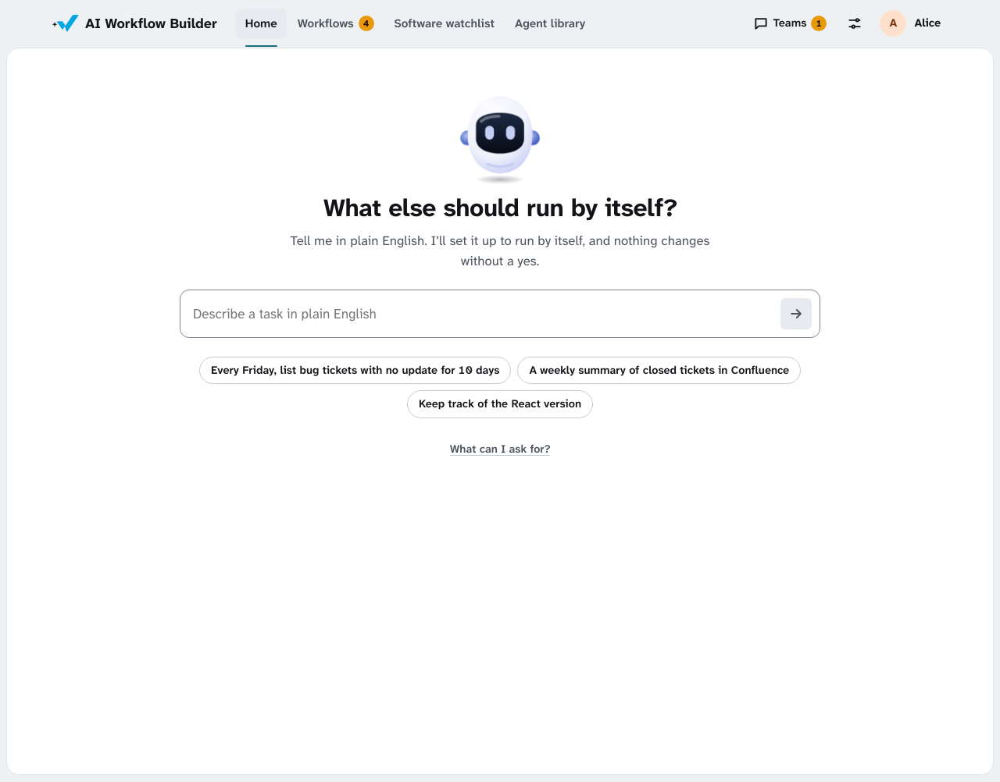

### 3. Ask the Planner

You describe a task in the box, the way you would ask a colleague. The Planner's face listens while you type, thinks, then writes its reply word by word. Every request gets one of five answers.

1. **I can do this.** The reply is a **set-up card**: the whole workflow, filled in.
2. **Another page does this.** A version or release request becomes a filled-in Software watchlist row (see [Software watchlist](#4-software-watchlist-one-list-for-every-release-and-vulnerability-check)).
3. **This needs a new tool.** If the system is already connected, the Planner drafts a **tool card** in the set-up card, and an Approver who isn't the person asking OKs it once (see [Later](#later-each-needs-its-own-decision)).
4. **This needs a new system or source,** such as ServiceNow. **Ask the team** sends the request, and it shows under "Asked the team" on Tools.
5. **Never.** A request to skip a yes is refused, with the reason. It's a platform rule.

Each answer that can't do the request also offers the nearest thing the Planner can do, with **Set that up**. What the Planner says it can do comes from the same list of abilities the code holds it to (`agent-runtime/src/agent_runtime/abilities.py`), so it can't promise what the platform would later refuse. Its face looks sorry for a moment when it can't help.

The set-up card holds what the old New workflow steps held, in one short card. Each thing shows once, and a form opens only for something you are choosing.

- **Its name.** The card's title is the workflow's name, drafted from the request, with **Rename**.
- **What I understood.** One sentence: when it runs, which tickets, which Jira project, what it does and where the result goes, including the Teams channel. Each part carries a mark: green for *From your words*, teal for *Changed by you*, amber for *Please choose*, red for *Can't do this yet* and grey for *Filled in by me*. Pressing a part changes it. When it runs has a small picker for how often, the day and the time, which opens under the sentence. It opens by itself while the time is still a question, and folds back into the part once it's answered, never guessed. A short note explains each part that isn't green, so the colours need no key. The card says in one line when a similar workflow already exists.
- **The plan.** Each step with its agent's face, marked *Reads*, *No system access* or *Changes data, waits for a yes*.
- **Who says yes.** One line: who is asked first, the backup, when the backup is asked and when it stops waiting, with **Change** (see [Who is asked](#6-who-is-asked-and-what-if-nobody-answers)).

The Planner fills in everything it can and asks only for what it can't know, such as the Jira project. It asks at most two questions, and they are the card's amber parts. **Turn it on** stays off until nothing is unclear, and the card says how many choices are left. One yes turns the workflow on. The Planner's face is pleased, it says when the first run is, and the new workflow glides into Workflows. **Do a test run** is offered there.

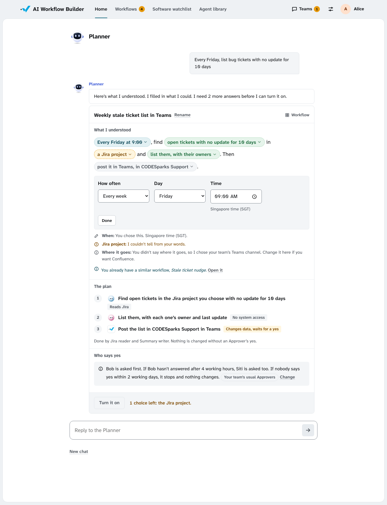

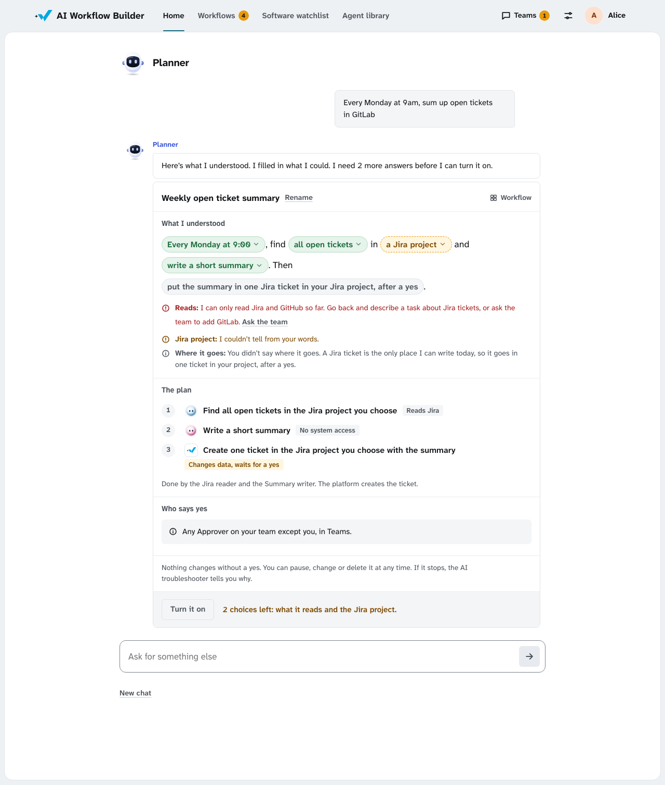

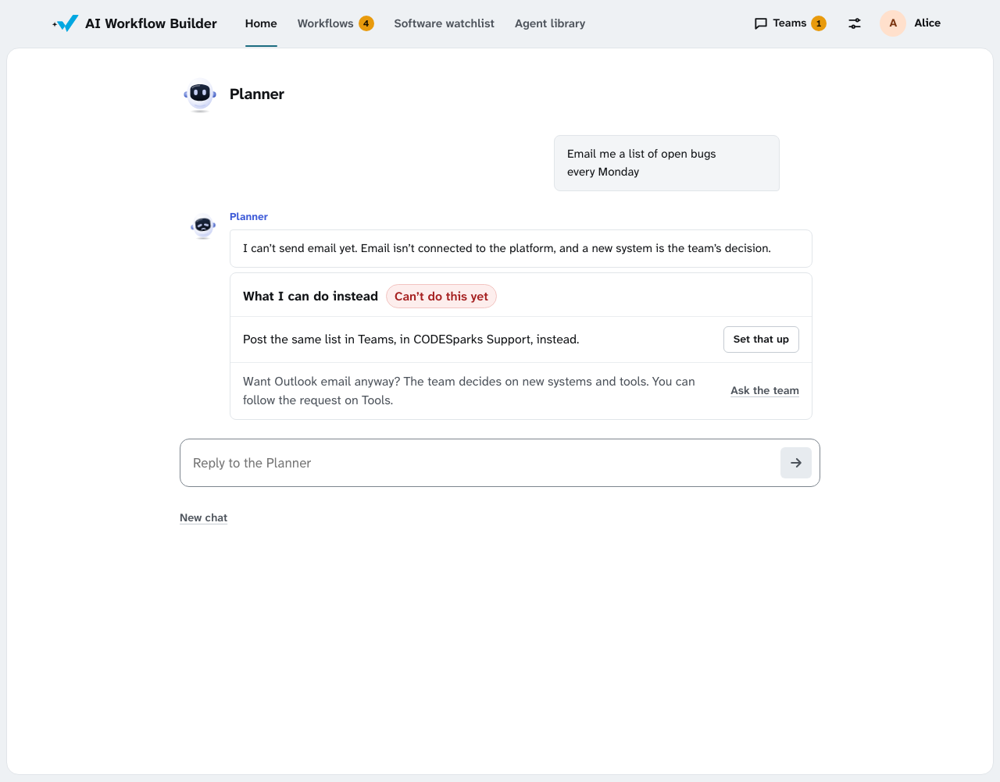

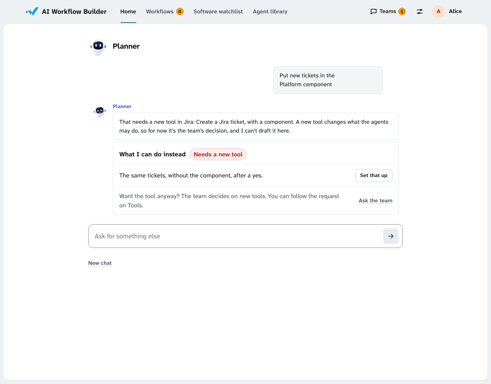

### 4. Software watchlist: one list for every release and vulnerability check

All software versions live on the Software watchlist page. It is checked every Monday, with one approval for all of that week's tickets, as ADR 0019 already works.

Two specialist agents do the checking. The Planner brings them into any workflow about versions or vulnerabilities ([ADR 0025](../adr/0025-cross-check-versions-and-vulnerabilities-across-trusted-sources.md), proposed):

- **Version checker** reads each tool's newest version from the registry the team installs it from: Maven Central, npm, PyPI, NuGet or Docker Hub. It falls back to GitHub releases for anything else. It cross-checks GitHub, and if the two disagree, the registry wins and the difference is shown. It also reads support dates from endoflife.date. When an Operator isn't sure where something is published, it searches the vendor's official site and suggests a source for a person to confirm.
- **Vulnerability checker** looks up known vulnerabilities in the version the team runs. It matches in OSV.dev, reads the official record and severity from NVD, checks the vendor's own advisory, and checks CISA's list of actively exploited vulnerabilities. Each finding shows which sources reported it. A critical or actively exploited one marks the upgrade ticket urgent, and the ticket still waits for a yes.

They use a fixed list of trusted sources, not open web search. Web pages are often out of date, two searches can disagree, and any page an agent reads could carry planted instructions.

On the page:

- Each tool shows where it's published, our version, the newest version and which sources agree, its status, and where our version came from.
- A tool with known vulnerabilities shows how many, which sources found them, and the worst one, linked to NVD. In the sample, Log4j core 2.14.1 has 4, the worst being CVE-2021-44228 (Log4Shell), which CISA lists as actively exploited.
- **Support ending** lists versions whose security fixes end soon, from endoflife.date. In the sample, these are PostgreSQL 14 and Node.js 22.
- **History** shows each tool's changes over time: when it was added, the tickets raised, who approved them, and when our version changed.
- The "Keep our software up to date" row on Workflows opens this page.

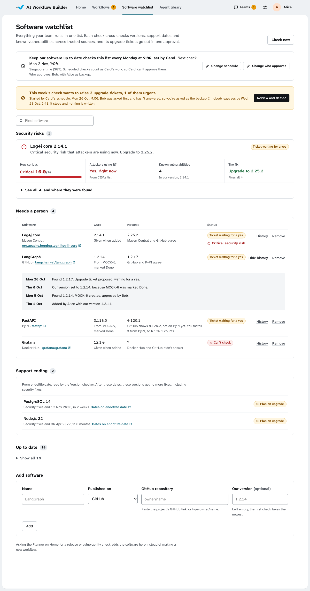

When someone asks the Planner for a release check, it fills in a row for this list instead of making a new workflow. The row has the software's name, where it's published, such as the GitHub project facebook/react marked *I guessed this* with **Looks right** and **Change**, and our version, or **Start from the newest**. One button adds it, and the new row glides into the Software watchlist. If the software is already on the list, the Planner says so and links to it. This stops look-alike release-check use cases from piling up again. The Planner says which word made it think so, for example "You mentioned releases". If it guessed wrong, **No, set it up as a new workflow** carries on as a set-up card.

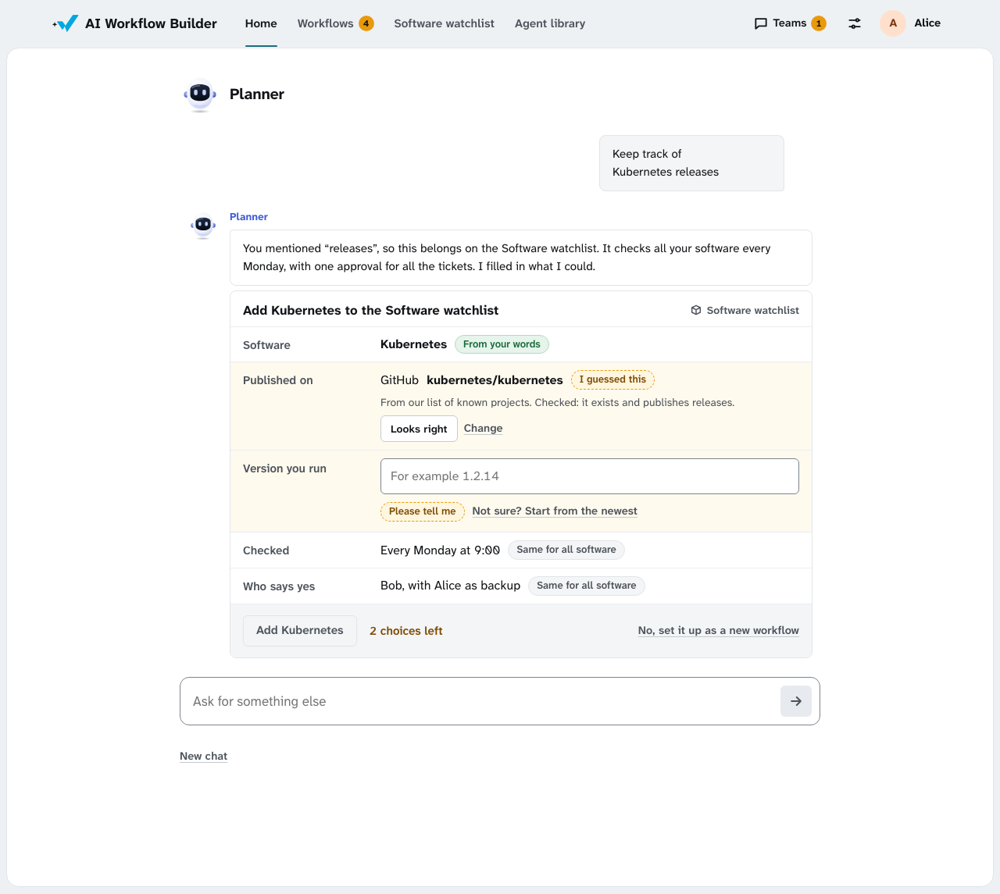

### 5. Watch and approve

The run page is the live activity view: the run line with each agent's face, then the run as a group chat. The Planner speaks first, and the agents it brings in join the chat. Each agent says what it did. The last message comes from whoever needs you: the approval gate with the buttons, or the AI troubleshooter with the fix. While a run replays, the next agent shows as working. It shows exactly what will be written. You reach it from Workflows, Software watchlist or the Teams message, not from the menu. When you open a run to decide or to fix it, the page lands on the decision with the run already drawn, and **Replay the run** plays it again. A run you just started plays live: the line reaches each step before that agent speaks, and the page follows the newest message until you scroll. Nobody approves their own work. If you started the run, you see a lock.

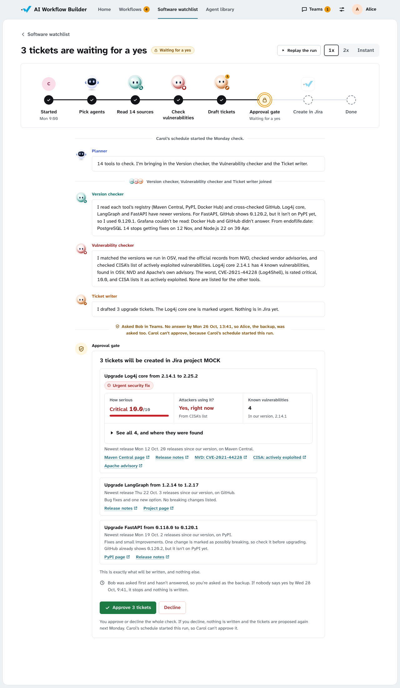

### 6. Who is asked, and what if nobody answers

Each workflow names who is asked first and a backup. Only they can decide. If the first person hasn't answered after a set wait, the backup gets a message too. If nobody answers by a second deadline, the request stops and nothing is written. A request never says yes by itself. The proposed defaults are 4 working hours and 2 working days. This changes the approval gate, so it is proposed in [ADR 0024](../adr/0024-each-use-case-names-its-approvers-and-unanswered-requests-go-to-a-backup-then-expire.md).

- Workflows, the run page and Teams say who has been asked, and when the next step happens.
- The workflow's owner can't be named, and nobody is named twice in one workflow.
- A workflow that needs 2 Approvers names a first person and a backup for each step.
- Changing who approves starts with the next run. A request that is already waiting keeps the people it was sent to.

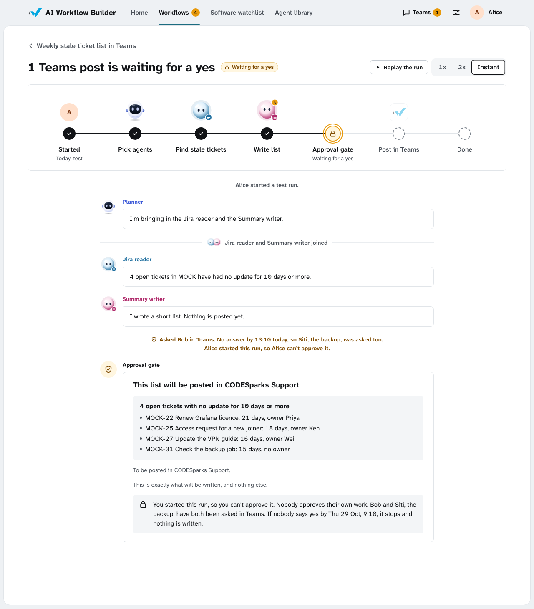

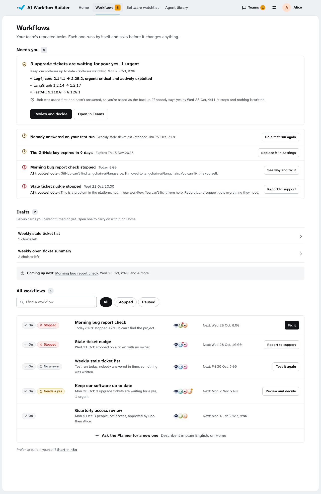

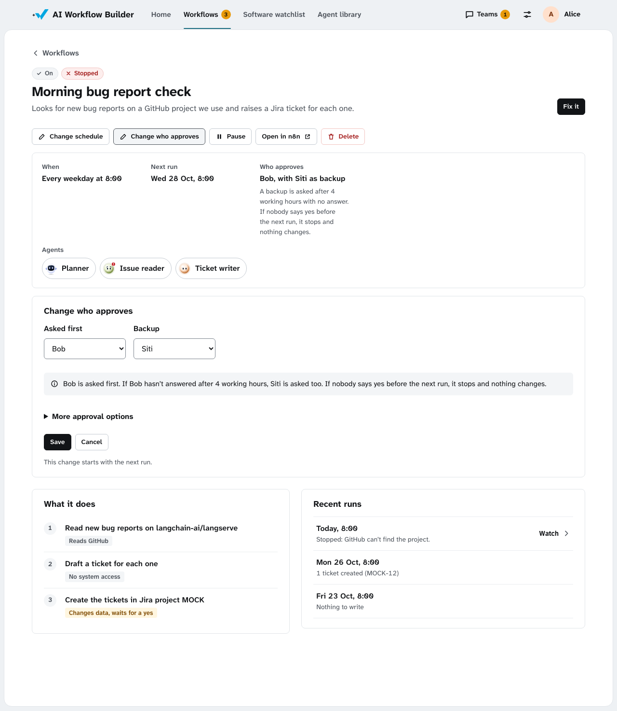

### 7. When something stops

The AI troubleshooter's reason shows under Needs you on Workflows. It says which kind of problem it is:

- **You can fix it,** for example a GitHub project that moved. One click fixes it and retries the run.
- **Only support can fix it,** for example a bug in the platform. "Report to support" sends the run and the troubleshooter's notes. The dialog turns straight into a confirmation with the case reference, and you follow the report on Workflows.

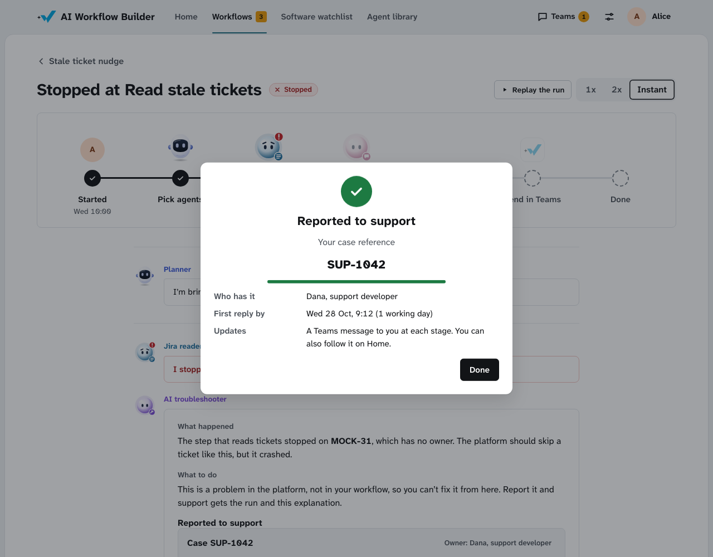

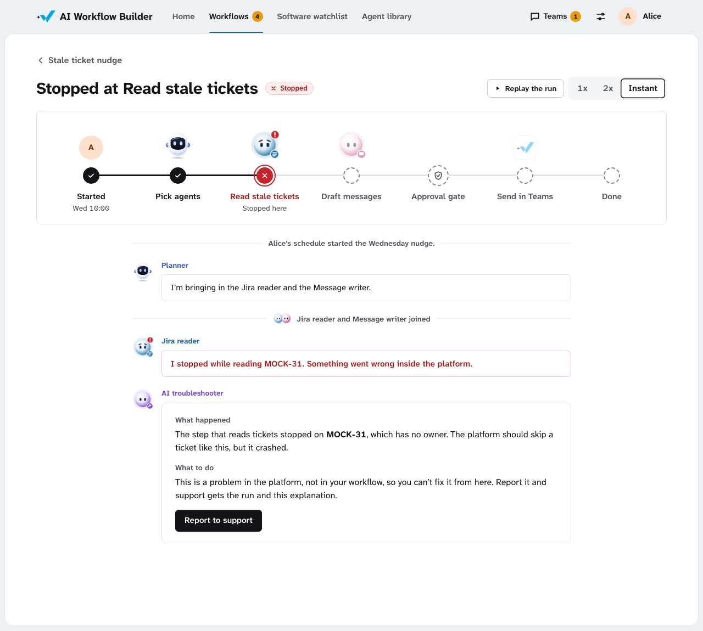

### 8. Keep track

Workflows opens with what needs you, counted on the tab. The most urgent item is a full card. Everything else that needs you is a one-line row with one button, and a stopped workflow's row carries the AI troubleshooter's reason. Then come what you are waiting on, any report you are following up, and one line saying what runs next. When nothing needs you, the page says so in one line.

Below that, every workflow is one row in a list, with the columns lined up. Rows that need you come first, with the button at the end of the row. The last row, **Ask the Planner for a new one**, goes to Home. Under it, a quiet link offers "Prefer to build it yourself? Start in n8n".

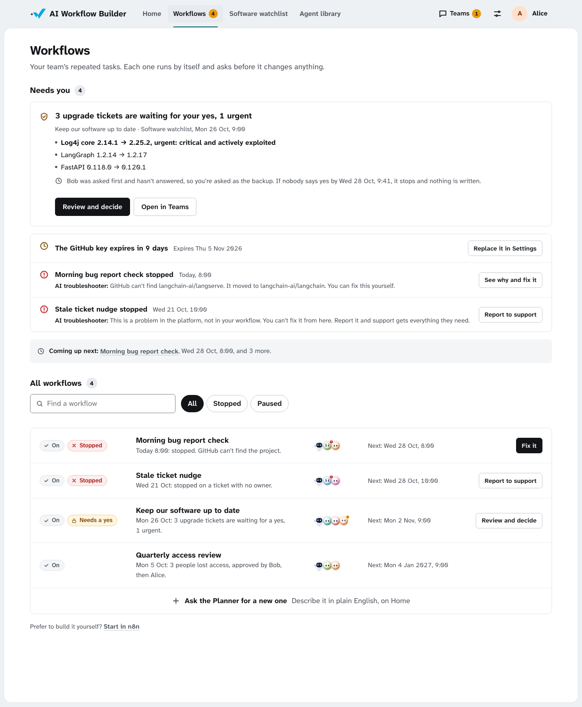

### 9. Change how an agent works, in plain English

Each card in the Agent library says whether the agent only reads or can change data after a yes, and which workflows use it. Opening one shows:

- **How it works:** its steps, numbered.
- **Tools it may use**, and **rules it always follows**, such as "anything that changes data waits for a yes".
- **Where it's used**, and what it did on its last run.
- **Version history**, with "Go back to this version".

To change an agent, an Operator says what should be different, such as "Only flag support that ends within 3 months". Each agent offers 2 or 3 example requests to tap. The Planner redrafts the agent's steps and marks the changed step. The platform then checks the draft: it uses only the tools already on the card, it doesn't change what needs a yes or who approves, and it doesn't reach anything new. The draft also says what would have been different on the agent's last run. Nothing changes until the Operator saves it as a new version. Workflows that use the agent pick up the new version on their next run. A run that's already going keeps the version it started with, as ADR 0023 already says.

Some requests can't be done this way, and the Planner says why instead of guessing:

- **Skipping a yes** ("create the tickets without asking anyone") is refused. It's a platform rule.
- **Needing a new tool** ("put tickets in the Platform component"): the Planner offers to draft the tool, and an Approver must OK it first (see 10).
- **Needing a new system or source** ("also check Go modules") is the team's decision. There's a button to send the request to the team.
- **Reaching somewhere new** ("also read the OPS project") belongs to the workflow, not the agent.

Only Operators can change agents. The Planner and the AI troubleshooter are part of the platform and can't be changed here.

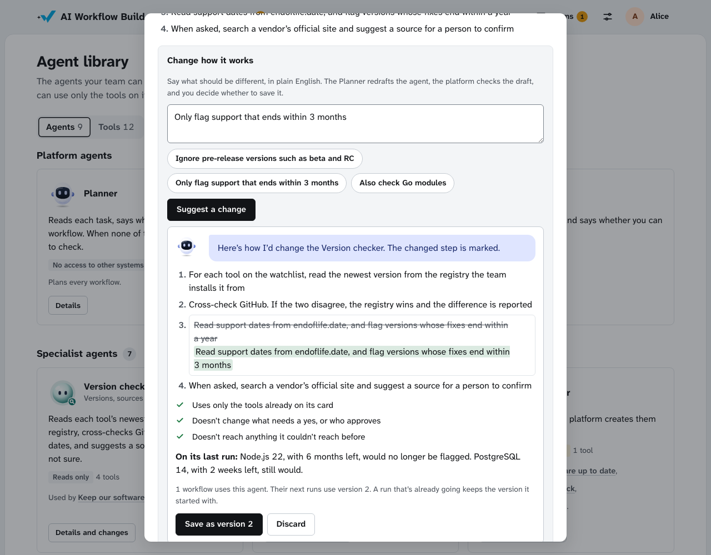

### 10. The tools the agents use

The Agent library has a second tab, **Tools**. A tool is how an agent reaches another system, and an agent can only use the tools on its card. Tools are listed in two groups: those that change data, each with how many Approvers it needs every time, and those that only read. Each row says which agents use it and whether it's working.

Opening a tool shows:

- **Whether it's working.** If it had a problem, it says what happened and what happens next, such as "Docker Hub didn't answer, so Grafana wasn't checked". **Check it works** tries the connection without changing anything. It tells a connection problem apart from a platform bug: Read a Jira ticket still fails on a ticket with no owner, and only support can fix that.
- **What it can change or reach, and what it can't do,** such as "Can't edit, move or delete tickets".
- **Agents that use it**, which open the agent, and the workflows they're in. An agent's tools open the tool, and **Back** returns to where you were.
- **Recent changes, and who said yes,** for tools that change data. For example: "Created MOCK-9 for Keep our software up to date. Alice said yes." This is the log of every agent action with who approved it, shown where people look.

**Need a tool that isn't here?** An Operator says what an agent should be able to do. The Planner checks the tools you already have first. If it's new and the system is already connected, it drafts a tool from that system's published API, and an Approver who isn't the person asking must OK it once, as with the Confluence tool in the Planner's set-up card. A new system, such as ServiceNow, or anything that deletes data, goes to the team as a request, listed under "Asked the team". Requests to skip a yes are refused.

The whole path connects: the Ticket writer can't set a component, so the Planner drafts the tool. Alice asks for an OK, and Bob OKs it from Home or Teams. Alice is told, and gives the tool to the Ticket writer as a new version, which shows what it adds.

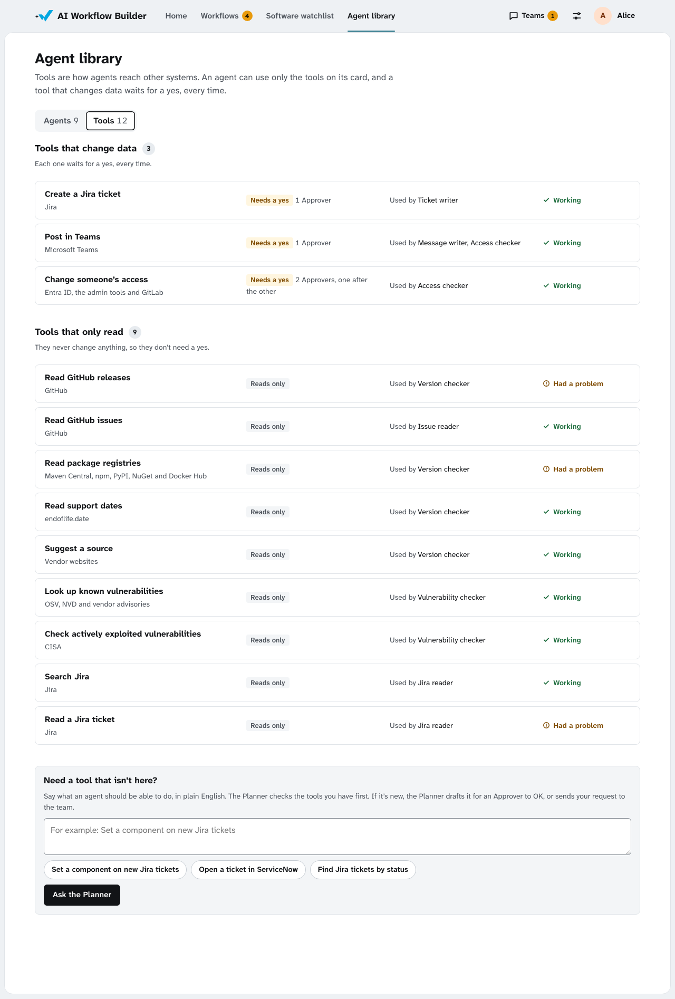

## Changes after usability testing

Version 1 was tested by an independent evaluator (ChatGPT) and in an internal walkthrough on 27 Oct 2026. Version 2 answers their findings. The report is in [`docs/evidence/usability/2026-10-27-chatgpt-v1-evaluation.md`](../evidence/usability/2026-10-27-chatgpt-v1-evaluation.md), and the changes are listed in [`docs/evidence/usability/2026-10-27-v2-changes.md`](../evidence/usability/2026-10-27-v2-changes.md). Version 1 is kept in [`portal-routines/v1/`](portal-routines/v1/). Version 2, the one the 27 and 28 Oct reviews describe, is kept in [`portal-routines/v2/`](portal-routines/v2/). Version 3 is the 6 Nov front door.

On 28 Oct 2026, four published design skills reviewed the prototype: UX heuristics, interaction design, accessibility (WCAG 2.2 AA) and n8n workflow patterns. What they found, what changed and how it was checked is in [`docs/evidence/usability/2026-10-28-design-skill-audits.md`](../evidence/usability/2026-10-28-design-skill-audits.md). It also lists the n8n audit's design proposals, which need a team decision.

## Where the built app differs from the prototype

- **Practice Jira page.** The prototype only has a read-only ticket dialog, opened from the ticket pills. The app also has a Practice Jira page at `/jira`, and `/jira/KEY` opens one ticket. An Operator can mark a ticket Done there, which the demo needs ("check, approve, ticket created, mark done, up to date"). It is not in the main menu, so the menu does not look like a copy of Jira. A header button labelled "Jira", next to Teams, leads to it.
- **Why a page.** Its address maps one to one onto a real Jira browse address. Every ticket key in the app links through one function. When the Portal's `/config.json` has a `jira_browse_url` (set from `JIRA_BROWSE_URL`), the keys go to the real Jira instead, and the header button is hidden, so switching to the real Jira needs no Portal change.
- **The Teams panel has no Approve or Decline.** The prototype's Teams messages have them. The app's practice copy draws the Adaptive Card a real Teams channel gets ([ADR 0036](../adr/0036-the-approval-request-goes-to-teams-as-an-adaptive-card-that-opens-our-approval-page.md)): what would be written, what the agents found, who can decide, and one button, Open in AI Workflow Builder. The Approver decides on the approval page, as they will from real Teams. Once decided, the card says who approved or declined. Buttons inside Teams wait for a Teams bot.

## Motion and the agents' faces

Animation should first make it clear what is happening and what changed. Only then is it allowed to be friendly. Nothing waits for an animation: a press, a page change or a save happens at once, and the motion only shows it.

**Timing.** Every animation uses one of five durations:

| What | How long |
|---|---|
| A control answers a press, hover or focus | 120 ms |
| Something small appears, moves or changes | 200 ms |
| A dialog, the Teams drawer or a section opens | 260 ms. Closing is quicker, 140 to 220 ms |
| Something needs a look: a new error, a request waiting | 380 ms |
| A one-off success reaction | 560 ms, never more than 600 |

Only opacity and transform move, with no bounce.

**Where things move.**
- **A new page.** Its cards arrive one after another, 40 ms apart. This happens once and never loops.
- **Lists.** In Workflows, the Software watchlist, the Planner's chat and a plan's steps, an item that moves glides to its new place. A new item fades in. A removed item fades out before the rest close the gap, so the list never jumps.
- **Changed values.** A changed version, status or count gets a short highlight. That includes a change made since you last looked, for example the ticket statuses on the Software watchlist after an approval.
- **Panels.** The approval panel, the AI troubleshooter's panel, an editor and a history row unfold from the top. A "Done" panel shows its check once.
- **Report to support.** The dialog turns into a confirmation at once, with the case reference. A short bar and a check confirm it.
- **Layers.** Dialogs, the Teams drawer and toasts open and close with short transitions. Going from one dialog to another swaps its content. Expandable sections unfold when opened and fold before closing, and an update never closes one you opened.

**The agents' faces.** The Planner is the **Visor bot**: a white egg-shaped robot with a dark visor, glowing eyes and two ear lights. It is 128 px on Home, 96 px on a phone and 40 px beside its replies. Every other agent, the AI troubleshooter included, is a flat **Orb**: a glowing ball in the agent's colour, with a small badge for its job, such as a magnifier for the Version checker or a wrench for the AI troubleshooter. Below 32 px, as in the Workflows list, the badge is left off, because it shrinks to a dot and the colour already tells the agents apart. The two shapes say who leads without words.

Each face shows the real state of the work, never a random one. Only the agent working now, or one that needs attention, moves. The others stay still. Text and the usual status icons always say the same thing, so the face never carries a status alone.

| State | How it looks | When |
|---|---|---|
| Idle | Still. Where one agent is the focus, it breathes once when it appears, then holds still | Most of the time. Breathing only for the Planner on Home, and an agent in its own dialog |
| Listening | The Visor bot leans in, its eyes follow the text, and its ear lights pulse on each key | While you type in the Planner's box. Planner only |
| Thinking | 3 dots. On the Visor bot they replace the mouth, and an Orb's light swirls | The Planner reading your request, or choosing agents in a run |
| Speaking | A sound-wave mouth on the visor | While the Planner's reply on Home is written word by word. Planner only |
| Working | Eyes scan, and an Orb's light circles | The step running now in a run, and the "is working" line in the chat |
| Waiting | Eyes up, still, with an amber clock badge | The agent whose work waits for a yes, in the run and on Workflows |
| Success | Happy eyes, one quick lift and a green check, then idle again | The last agent of a run that finished, and the Planner after you turn a workflow on or add software. Not after a decline |
| Sorry | Slanted eyes for a moment, then idle | The Planner when it can't do a request. Planner only |
| Error | One worried flinch, then a red "!" badge that stays | The step that stopped, in the run, the chat and on Workflows |
| Stopped | Eyes closed, grey | A paused workflow, a step that wasn't needed, or a request nobody answered |
| Hover or focus | A small lift | An agent card or button under the pointer or with keyboard focus |

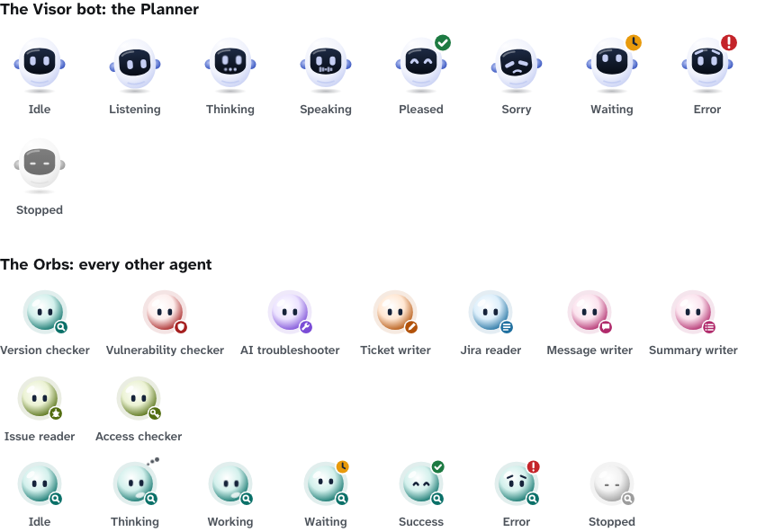

**Accessibility.**
- With "reduce motion" switched on, nothing moves. New things fade in for a moment, and agents hold their pose with their badges.
- Nothing flashes or repeats quickly. Nothing moves for more than 5 seconds at rest. Loops while an agent works pause when they scroll off screen or the tab is hidden.
- Keyboard focus stays visible, and after any action it stays on the control or the nearest one. It never jumps back to the top of the page.
- A message with Undo has no time limit. It stays until you do something else, leave the page or press Escape.
- Browser Back and Forward move between pages.
- No animation causes sideways scrolling on a phone.

**In the real Portal.** The prototype is one HTML file with no framework, so it uses CSS animations and a little plain JavaScript. The Portal is React 19 with Vite, and there:
- **Motion** (`motion/react`) should do the transitions: entry and exit for dialogs, the drawer and toasts, layout animation for lists, and presence for panels.
- **Rive** (`@rive-app/react-canvas`) should draw the Planner, as a state machine with its states above as inputs. That needs a designer to make the Visor bot in Rive. Until then, keep the SVG face. The Orbs stay SVG and CSS, because they are simple and mostly small.
- Both are new external dependencies, so each needs an ADR first, as `AGENTS.md` says.

## Safety rules the design keeps

There is one proposed change to the approval gate: named Approvers, a backup and a stop time ([ADR 0024](../adr/0024-each-use-case-names-its-approvers-and-unanswered-requests-go-to-a-backup-then-expire.md)). It narrows who can decide, and it never lets a request approve itself. There is no change to the safety checker. The design makes the rules visible where they apply:

- Nothing is written without a yes, and the approval shows the exact change.
- Nobody approves their own work, including runs started by their own schedule.
- Only the people named on a workflow can decide its requests.
- A request nobody answers stops, and nothing is written.
- A tool can only touch the target saved on the workflow, such as one Jira project.
- Changing an agent in plain English can only add a tool that's already on the tool list. It never changes what needs a yes, or who approves. A run keeps the agent version it started with.

## Goals

- A new Operator can say what the Portal is for, and set up a workflow, without help.
- Every screen has one obvious next step. On Home it is the box.
- A release check never creates a new workflow. It adds a row to the Software watchlist.
- The Planner never offers something the platform can't do.

## Non-goals

- No new service, data store or external dependency.
- No change to how runs or the watchlist work underneath. Approvals change only as ADR 0024 proposes.
- No general chat assistant. The Planner sets up workflows and watchlist rows, and answers what it can do. It doesn't answer other questions.
- No new brand. The prototype keeps the Portal's font (Atkinson Hyperlegible Next) and status colours, in a light theme. The agents' faces are redrawn as the Visor bot and the Orbs, in the same agent colours. The look is a "framed sheet": a pale blue-grey header and frame around a white page, flat cards, and one teal accent for the current tab, links and data. Body text is at least 4.5:1 against its background, and secondary text is about 7:1.

## What changes in each context

| Context | Change |
|---|---|
| Use case builder | Home becomes the Planner's box, and its replies are set-up cards that reuse the read-back rows, the plan panel and the card editor. The New workflow screens go. Release-check use cases and the Release checker starter card stop showing to users. The Agent library becomes its own tab, showing each agent card with its tools and the workflows that use it. |
| Agent runtime | The Planner's answer says which of the five answers it is, and returns the filled-in card. For a release check it proposes the watchlist row, with the GitHub project. It asks at most two questions. The Portal reads what the Planner can do from the abilities list. The release checker becomes the Version checker, and a Vulnerability checker card joins it, with read-only tools for the registries, support dates, source suggestions, vulnerability lookups and CISA's list (ADR 0025). |
| Orchestration | None for the first slice. Named Approvers and the timer (ADR 0024) come once the team and the sponsor agree. |
| Run monitoring | Needs you and the troubleshooter's reason at the top of Workflows, and the run page reached from where you are instead of the menu. The Approvals page folds into Workflows, and into Home for an Approver who can't set up workflows. |

The Software page already exists, and the backend already records where each version came from (`Given`, `FromFirstCheck` and `FromTicketDone` in `platform-api/src/platform_api/orchestration/watch.py`). The history view mostly lists what is already stored.

## First slice, for the presentation (27 Nov to 5 Dec)

1. **The menu.** Home, Workflows, Software watchlist and Agent library. Teams and Jira move to Settings.
2. **Home is the Planner's box,** with the set-up card, the watchlist row and the five answers.
3. **Workflows,** with Needs you at the top, failures with the troubleshooter's reason, and Fix it where the platform allows a retry.
4. **Software watchlist.** History for each tool, and the rows the Planner fills in.

Rough size: 1.5 to 2 sprints, mostly Portal work.

## Later, each needs its own decision

- **Named Approvers and a stop time.** Proposed in ADR 0024. The rule that checks a decision already allows a list of people for each step, so the decision rules don't change. The sponsor needs to agree the default waits and the working hours.
- **Report to support.** Filing an issue is small. Having coding agents write the fix, with a developer reviewing and merging, needs NCS's agreement. Agents never merge or deploy.
- **Settings beyond the AI model.** Connections reuse ADR 0022's pattern for the GitHub, Jira and Teams keys, as that ADR already suggests. Changing roles in the app decides who can approve, so it needs its own ADR, and it has to fit sign-in with NCS accounts (ADR 0018). The usage limit needs the provider's usage numbers, and a decision on what stops when it's reached.
- **Tool cards.** A tool described as data, which the AI drafts from a system's published API and an Approver OKs once. One runner we build and test runs every tool card, so no code the AI wrote ever runs. This changes ADR 0023 ("tools are code we build"), so it needs a new ADR first. The prototype shows it in two places: the Planner's set-up card (the Confluence tool) and "Need a tool that isn't here?" on Tools.
- **More sources for the Software watchlist.** ADR 0025 proposes a fixed list: the main package registries, GitHub, endoflife.date, OSV, NVD, vendor advisories and CISA's list. Any source beyond that list is another external dependency with its own ADR, as the [watchlist PR/FAQ](software-watchlist-prfaq.md) says.

## Risks

| Risk | What we do |
|---|---|
| It takes time from the weeks before the presentation. | Keep the first slice to Portal changes, and reuse the screens we have. |
| "Workflow" also means n8n workflows and Jira workflows. | In the app it always means the user's task. In code and docs, write "n8n workflow" or "Jira workflow" for the others. The glossary records the rule. |
| It is our judgement, not tested with users. | Give 2 or 3 people who haven't seen it two tasks each, on today's Portal and on the prototype, and note where they stop. Use "keep track of the React version" and "every Friday, list bug tickets with no update for 10 days". |
| A chat box invites requests the platform can't do. | The "Not yet" list, the five answers and Ask the team. Every guess is marked, and nothing runs before the card's yes. |
| The front door depends on the AI model answering well. | The evals' golden set covers the five answers. |
| Tool cards and coding agents look like they weaken safety. | Neither is in the first slice. Each gets an ADR first. |

## Open questions

1. Is the first slice right for the presentation, or should it be smaller?
2. Should we show the sponsor the prototype before we build?
3. After handover, can someone at CODESparks or NCS review a pull request now and then? This decides whether coding agents can help with fixes later.
4. Are 4 working hours (ask the backup) and 2 working days (stop waiting) the right defaults? Should public holidays count?
5. An agent can be used by other people's workflows. Should any Operator be able to change it, as in the prototype, or only the people whose workflows use it? The prototype shows which workflows use it before saving, and keeps every version.
6. May the logo use NCS strokes and NCS blue? The sponsor would need to check with the NCS brand team before it goes beyond the prototype.

Decided on 27 Oct: users see **workflow** (not "routine" or "use case"), the app is called **AI Workflow Builder**, the software page is **Software watchlist**, and the Room lead is now the **Planner**. If the team agrees with the rest, we open one issue per item in the first slice.

Decided on 6 Nov: Home is the Planner's box every day, and the New workflow tab goes. Needs you moves to the top of Workflows, with a count on its tab. The Planner is the Visor bot, and the other agents are Orbs.
