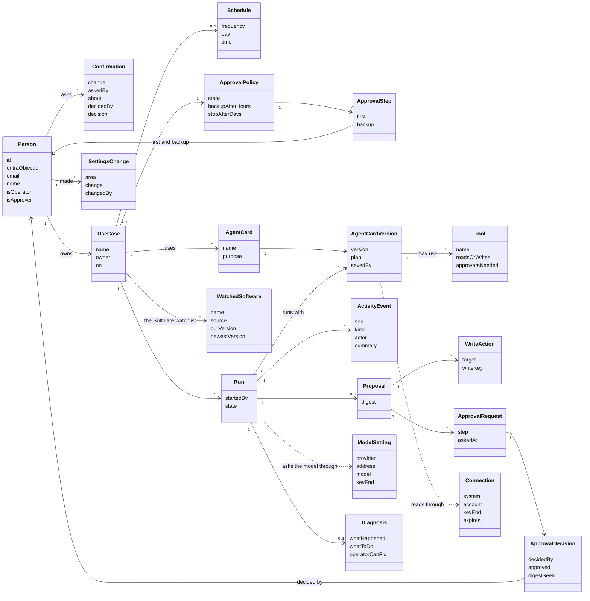

# Domain model for the rebuild

This is the domain model that the rebuilt app implements. It is read from the workflow builder prototype, [`portal-routines/prototype.html`](portal-routines/prototype.html) at commit `a55fb84`, and checked against today's code. `prototype.html:N` points at a line of the prototype. Names follow [`GLOSSARY.md`](../../GLOSSARY.md). "Use case" is the code's name for what users see as a workflow.

[ADR 0028](../adr/0028-rebuild-the-portal-from-the-prototype-and-reshape-the-backend-in-place.md) says how the rebuild reuses today's code. [The rebuild plan](rebuild-plan.md) lists the PRs.

## Things the app keeps

The "Today" column says what exists in code on 29 Oct 2026. **Keep** means the module moves as it is. **Port** means its logic and tests move under the prototype's names. **New** means nothing exists yet.

### People and setup

| Thing | What it holds | Context | Today |
|---|---|---|---|
| Person | Our id, which every other record stores, Entra `oid`, email, display name, Operator flag, Approver flag (ADR 0029) | Orchestration | New. Dev users are hard-coded in `platform-api/src/platform_api/auth.py` |
| Confirmation | What would change, who asked, the person it is about, who confirmed or said not now, and when (ADR 0030) | Orchestration | New. ADR 0022's model address check is the first case |
| AI model setting | Provider, address, model, the key's last two characters, last test, and the change history (ADR 0022) | Orchestration | Keep. `orchestration/model_settings.py` |
| Connection | GitHub, Jira or Teams. The account it signs in as, practice copy or real, the key's last two characters, expiry, last test (prototype.html:2605-2609) | Orchestration | New. Today these are deploy settings |
| Settings change | When, which tab, what changed and who changed it. Never a key (prototype.html:2597) | Orchestration | Keep for the model. New for the other tabs |

### Building

| Thing | What it holds | Context | Today |
|---|---|---|---|
| Use case (workflow) | Name, what it does, owner, on or paused, schedule, approval policy, its agents (prototype.html:1241-1247) | Builder | Port. `builder/` tables `use_cases` and `use_case_versions` |
| Schedule | Every day, every weekday, a weekday each week or a day each month, at a time in Singapore time (prototype.html:1155-1161) | Orchestration | Keep. `orchestration/schedule.py` |
| Approval policy | One or two steps. Each step names a first Approver and an optional backup. Wait before the backup is asked, and wait before it stops (ADR 0024, prototype.html:1259-1260) | Orchestration | Keep the rules in `orchestration/approvals.py`. Names, waits and timers are Phase 2 |
| Agent card | Name, what it does, its plan, its tools, its rules, and who made it (prototype.html:2758-2789) | Builder | Port. `builder/cards.py` |
| Agent card version | Version number, plan, tools, who saved it, when, and the plain-English request that made it. A run keeps the version it started with (prototype.html:2792, 3050) | Builder | Port. Table `card_versions` |
| Tool | Name, reads or writes, the system it reaches, and how many Approvers a write needs (prototype.html:2704-2719) | Agent runtime | Keep. `agent-runtime/src/agent_runtime/tools.py` has 4 of the prototype's 14 |
| Watched software | Name, source, reference at the source, our version and where it came from, newest version, status (prototype.html:2097-2102) | Builder and orchestration | Keep the rules in `orchestration/watch.py`. Port the store |

### Running

| Thing | What it holds | Context | Today |
|---|---|---|---|
| Run | The use case, who started it and how (by hand, on a schedule, as a test run), anyone who retried it, its state, and the agent card versions it uses | Orchestration | Port. `orchestration/runs.py` |
| Activity event | Run id, sequence number, time, actor, kind, summary, data and a dedupe key | Run monitoring | Keep. Moves to Cosmos DB under ADR 0031 |
| Proposal | The write actions agents propose for one run, and their digest | Orchestration | Keep. `orchestration/write_actions.py` |
| Write action | One change to another system, with the key that stops it running twice | Orchestration | Keep. `WriteKey` in `orchestration/write_actions.py` |
| Approval request | The proposal it covers, its step, who was asked, when, and who may decide (prototype.html:1607-1628) | Orchestration | Keep the request and decision tables. The backup and expiry times are Phase 2 |
| Approval decision | Who decided, yes or no, when, and the digest they saw | Orchestration | Keep |
| Diagnosis | What happened, what to do, and whether the Operator can fix it or must report it (prototype.html:2332-2346) | Run monitoring | Port. Today it is a rule table in `monitoring/troubleshooter.py` |

### Shown, not stored

| Thing | Worked out from | Context |
|---|---|---|
| Home item | Approval requests waiting for the person, their failed runs, their drafts, confirmations they may decide, keys about to expire (prototype.html:1903-1924) | Run monitoring reads, each context answers for its own part |
| The workflow's latest status | The latest run and whether the workflow is on. The prototype keeps the two as separate facts (prototype.html:1598-1600) | Builder and orchestration |

## Class diagram



## States

### Run

| State | Event | Next state |
|---|---|---|
| Started | The Planner brings in the agents | Working |
| Working | A step fails | Stopped, with a diagnosis |
| Working | Nothing to write | Done, nothing written |
| Working | The proposal is ready | Waiting for a yes |
| Waiting for a yes | The last yes it needs | Writing, then Done |
| Waiting for a yes | A person allowed to decide says no | Done, nothing written |
| Waiting for a yes | Nobody answers in time (Phase 2) | No answer, nothing written |
| Stopped | The Operator fixes the input and retries | A new run starts |

Source: prototype.html:1669-1763 and `orchestration/runs.py`. The write step is always the platform's, never an agent's (prototype.html:1702).

### Approval request

| State | Event | Next state |
|---|---|---|
| Asked | The first Approver or the backup says yes, and it is the last step | Approved |
| Asked, step 1 of 2 | The first Approver or the backup says yes | Step 2 asked |
| Asked | A person allowed to decide says no | Declined |
| Asked | The wait for the backup passes (Phase 2) | Backup asked too |
| Asked | The stop time passes (Phase 2) | Expired |

For the first demo, a person may decide when they hold the Approver role and are not a party to the run. The parties are the person who started it, the workflow's owner and anyone who retried it (`orchestration/service.py`, `parties`). With ADR 0024 in Phase 2, they must also be named on the current step, and the request must not have expired (prototype.html:1631-1634).

### Confirmation

| State | Event | Next state |
|---|---|---|
| Asked | An Approver who is neither the asker nor the person it is about confirms | Confirmed, and the change takes effect |
| Asked | That Approver says not now | Not confirmed, and nothing changes |

### Watched software

| State | Event | Next state |
|---|---|---|
| Not checked yet | A check finds our version is the newest | Up to date |
| Not checked yet, or up to date | A check finds a newer version | Upgrade ticket waiting for a yes |
| Any | The source does not answer | Can't check, tried again at the next check |
| Ticket waiting for a yes | Approved | Ticket created |
| Ticket waiting for a yes | Declined | Proposed again at the next check |
| Ticket created | The Jira ticket is marked Done | Our version becomes the new version |

Source: prototype.html:2096-2134 and `orchestration/watch.py`.

## NoSQL design

[ADR 0031](../adr/0031-keep-the-activity-log-in-azure-cosmos-db-for-nosql.md) keeps the activity log in Azure Cosmos DB for NoSQL.

| Part | Value |
|---|---|
| Database | `activity` |
| Container | `run_events` |
| Partition key | `/runId` |
| Item id | The event's sequence number in its run, as text |
| Main query | One run's events with `seq` above a number, sorted by `seq`, inside one partition |
| Time to live | None. The log keeps every event |
| Consistency | Strong, in one region |
| Written by | The copier in run monitoring, from `monitoring.run_events` in PostgreSQL, which keeps every event too |

An example item:

```json
{
	"id": "7",
	"runId": "run_01JB8Q2W6N",
	"seq": 7,
	"ts": "2026-11-23T09:41:12+08:00",
	"actor": { "kind": "person", "id": "per_bob", "name": "Bob" },
	"kind": "approval_decided",
	"summary": "Bob said yes. The platform will create 3 tickets.",
	"data": { "approvalId": "apr_01JB8Q3", "approved": true, "digest": "sha256:5f1c..." },
	"dedupeKey": "decision:apr_01JB8Q3:per_bob"
}
```

## What a real backend adds to the prototype

The prototype simulates these. Each row names who provides the real thing, and when.

| The prototype fakes | The real app needs | When |
|---|---|---|
| "Act as" Alice or Bob | Sign-in with NCS accounts, and roles from our People list (ADRs 0018 and 0029) | First demo |
| Roles set from the start | The first Operator and two Approvers from the deploy (ADR 0030) | First demo |
| Runs replayed with timers | n8n carrying each run, agents sending activity events, and the live stream | First demo |
| The write after a yes is a toast | The write gateway with its own keys, refusing anything not approved (ADR 0008) | First demo |
| Teams as a side panel | The practice Teams panel on the Teams stub. A real Teams app comes later | First demo, then Phase 2 |
| Word rules that "understand" a task | The Planner asking the AI model, with the starter workflows as a fallback (ADR 0032) | First demo |
| A fixed troubleshooter answer | The rule table first, then a model (ADR 0032) | First demo, then Phase 2 |
| A fixed clock | Real time in Singapore time, and a scheduler that starts runs | First demo |
| Working hours, backup and expiry | Durable timers on a working-hours calendar (ADR 0024) | Phase 2 |
| Keys stored as two characters | Write-only keys, encrypted, with expiry dates and a real Test button | Phase 2 for Connections |
| AI usage numbers | Token counts from each answer, a price list, and a limit that stops model calls | Phase 2 |
| Version and vulnerability checks on sample data | Tools for the package registries, endoflife.date, OSV, NVD and CISA's list (ADR 0025) | Phase 2. GitHub releases work today |
| Drafted tools and "Asked the team" | Tool cards and a request queue, each needing its own ADR | Phase 2 |
| Open in n8n, hold, publish and undo | The node pack and n8n's API (ADRs 0026 and 0027) | Phase 2 |
| Report to support | A case system, and later coding agents | Phase 2 |

## Names to settle

The prototype and the glossary disagree in five places. Each needs a team decision before the screens that use it are built.

1. **"Tool" for watched software.** The prototype says "14 tools to check" (prototype.html:1697). The glossary says a tool is what an agent does in another system, and calls these watched software.
2. **Where the Approver count lives.** The glossary puts it on the agent card. The prototype puts it on the tool and on the workflow, where it can go up but never down (prototype.html:2488).
3. **Template.** The glossary means a ready-made agent card. The prototype's ready-made items are workflows (prototype.html:1319-1323).
4. **One card or several.** The glossary says a use case runs one agent card. Each prototype workflow uses three or four agents (prototype.html:1242-1245).
5. **Who picks the agents.** The glossary says the Planner decides for each run. The prototype stores the agents on the workflow when it is set up (prototype.html:2759) and has the Planner announce them in each run.
