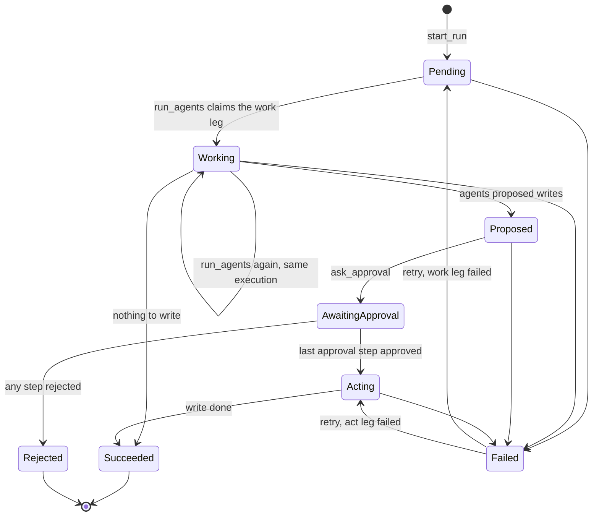
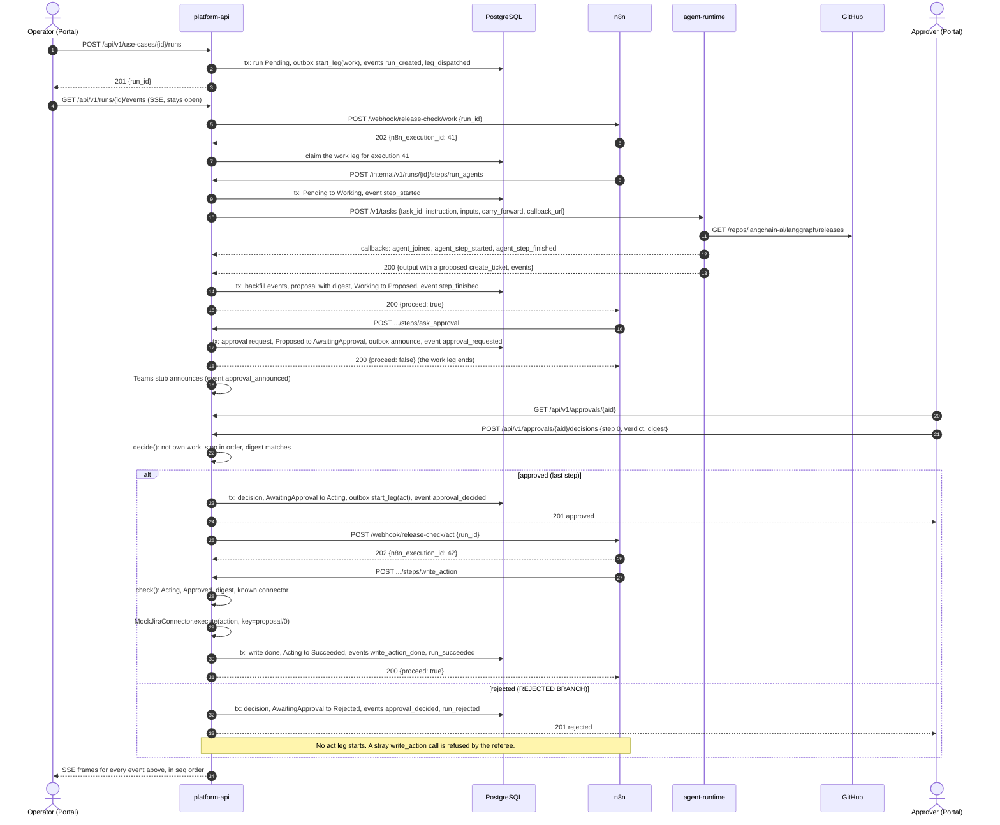

# Walking skeleton design

The walking skeleton is the thinnest version of the product that still runs end to end. An Operator starts a release check in the Portal. n8n carries the run. One LangGraph agent reads GitHub releases. The run stops for approval. A mock Jira ticket is written only after an Approver approves. The live activity view shows every step.

This document is for the team. It covers the shape we build in weeks 1 and 2, and the seams where later work plugs in. The decisions in it that are hard to reverse have ADRs, listed in [ADRs from this design](#adrs-from-this-design).

Each claim about n8n or LangGraph is tagged. **Verified** means one of our prototypes observed it on 20 Oct 2026 (n8n 2.42.6, LangGraph on Python 3.14, PostgreSQL 17 in Docker). **Assumed** means nobody has tested it, and the text names the fallback. The prototypes are [P1](../evidence/prototypes/p1-n8n-approval-pause/findings.md) (n8n approval and errors), [P2](../evidence/prototypes/p2-langgraph-events/findings.md) (LangGraph events), [P3](../evidence/prototypes/p3-n8n-docker-compose/findings.md) (n8n in Docker Compose) and [P4](../evidence/prototypes/p4-n8n-two-legs/findings.md) (n8n with two webhook legs). Their scripts and raw output are in [docs/evidence/prototypes](../evidence/prototypes/README.md).

## Problem

Three prototype findings make the shape less obvious than "put the workflow in n8n".

1. n8n checks nothing about who resumes a paused run. Its resume URL works as a password, and it accepts any approver name (verified). So the approval rules cannot live in n8n.
2. n8n sends no events of its own, and its error workflow does not receive our run ID (verified). So our API has to record every event and map n8n's errors back to our runs itself.
3. Anyone who can edit a workflow can delete the node that checks approval. No prototype deleted one, but an IF node is an ordinary node in n8n's editor. So the approval gate cannot be an n8n node.

The design must also keep these team rules from `AGENTS.md`. Agents must not depend on n8n or on our API, so they can go into NCS's agent hub. Every deployable unit is a Docker image with a pinned version (ADR 0006). The NoSQL store, the IaC tool, the AI model provider and code ownership stay open. There are two roles, Operator and Approver. The access review in Phase 2 needs two Approvers in order, so the approval model must hold an ordered list from day one.

## Usage (caller's view)

These calls came first. Everything in [Shape](#shape) is derived from them.

### The Operator saves a use case and starts a run

```http
POST /api/v1/use-cases
X-Dev-User: alice

{"template": "release_check",
 "name": "LangGraph releases",
 "instruction": "Check langchain-ai/langgraph for new releases and open a ticket for the team.",
 "params": {"repo": "langchain-ai/langgraph", "tag_pattern": "^\\d+\\.\\d+\\.\\d+$", "ticket_project": "MOCK"}}

201 {"use_case_id": "uc_01JB7", "version": 1}
```

```http
POST /api/v1/use-cases/uc_01JB7/runs
X-Dev-User: alice
Idempotency-Key: 3f0c9a6e-...

201 {"run_id": "run_01JB8", "state": "pending", "events_url": "/api/v1/runs/run_01JB8/events"}
```

A double click sends the same `Idempotency-Key` and gets the same run. `X-Dev-User` is the sign-in stub. Entra ID replaces it later behind the `Authenticator` port. With `AUTH_MODE=dev`, platform-api refuses to start unless its public base URL is `localhost` or `127.0.0.1`, so the stub cannot leak into a shared deployment.

### The live activity view subscribes

```js
const es = new EventSource(`/api/v1/runs/${runId}/events`);
es.addEventListener("activity", (m) => view.apply(JSON.parse(m.data)));
```

```
id: 7
event: activity
data: {"run_id":"run_01JB8","seq":7,"ts":"2026-11-03T02:14:09.412Z",
       "actor":{"kind":"agent","id":"release_checker","display":"Release checker"},
       "kind":"agent_step_finished",
       "data":{"step":"find_new","result":{"new_count":2,"tags":["1.2.16","1.2.15"]}}}
```

The browser sends `Last-Event-ID` when it reconnects, and the server replays from the next `seq`. `GET /api/v1/runs/{run_id}/events?after=6` returns the same events as JSON for tests and for the AI troubleshooter later.

### n8n asks our API to run a step

Every functional node in a run workflow makes this one call.

```http
POST http://platform-api:8000/internal/v1/runs/run_01JB8/steps/run_agents
X-Step-Key: <from an n8n credential>
X-N8N-Execution: 41

200 {"proceed": true,  "outcome": "proposed", "detail": "2 new releases: 1.2.16, 1.2.15"}
200 {"proceed": false, "outcome": "nothing_to_write", "detail": "No new releases since 1.2.16"}
200 {"proceed": false, "outcome": "superseded", "detail": "Execution 40 holds this leg"}
200 {"proceed": false, "outcome": "refused", "detail": "write_action is not allowed while the run is proposed"}
503 {"retryable": true, "detail": "GitHub timed out"}
```

n8n reads only `proceed`. The other fields are for whoever reads n8n's execution log. A 503 makes n8n retry after its wait (verified, tries 2 s apart). A refused step answers 200 with `proceed: false`, not 409. P4 showed that n8n's retry repeats a 409 three times, and the error workflow then gets a generic message without our reason. Our API records the refusal itself.

### Our API calls the agent runtime (the Agent API)

```http
POST http://agent-runtime:8100/v1/tasks

{"task_id": "run_01JB8/work/1/1",
 "instruction": "Check langchain-ai/langgraph for new releases ...",
 "inputs": {"repo": "langchain-ai/langgraph", "tag_pattern": "^\\d+\\.\\d+\\.\\d+$"},
 "carry_forward": {"last_known_tag": "1.2.14"},
 "callback_url": "http://platform-api:8000/internal/v1/runs/run_01JB8/agent-events?task=...&sig=..."}

200 {"task_id": "run_01JB8/work/1/1",
     "status": "succeeded",
     "output": {"summary": "2 new releases: 1.2.16, 1.2.15",
                "proposed": [{"kind": "create_ticket",
                              "fields": {"title": "New LangGraph releases: 1.2.16, 1.2.15", "body": "..."},
                              "reason": "New plain-version releases since 1.2.14"}],
                "carry_forward": {"last_known_tag": "1.2.16"}},
     "error": null,
     "events": [{"task_id": "...", "seq": 1, "ts": "...", "type": "task_started", "agent": "room_lead"}]}
```

The agent knows nothing about runs, n8n, Jira or approvals. It takes a task, posts events to the URL it was given, and returns proposed writes as data. That is the whole contract for NCS's agent hub.

### The Approver decides

The Teams stub posts a message with a link to the approval page in the Portal.

```http
GET /api/v1/approvals/apr_01JB8
X-Dev-User: bob

200 {"approval_id": "apr_01JB8", "run_id": "run_01JB8", "digest": "sha256:9f2c...",
     "actions": [{"connector": "jira", "operation": "create_ticket",
                  "target": {"project": "MOCK"},
                  "fields": {"title": "New LangGraph releases: 1.2.16, 1.2.15", "body": "..."}}],
     "steps": [{"index": 0, "label": "Team approver", "status": "open"}],
     "you_can_decide": true, "why_not": null}
```

```http
POST /api/v1/approvals/apr_01JB8/decisions
X-Dev-User: bob

{"step": 0, "verdict": "approve", "digest": "sha256:9f2c..."}

201 {"status": "approved", "decision": {"step": 0, "by": "bob", "verdict": "approve", "at": "..."}}
```

Bob sending the same decision again gets `200` and the same decision. Alice started the run, so she gets `403 {"refusal": "own_work", "message": "You started this run, so another Approver must decide."}`. The page shows `why_not` from a dry run of the same rule, so the button and the server never disagree.

### n8n reports a failure, and the Operator retries

```http
POST http://platform-api:8000/internal/v1/workflow-failures
X-Step-Key: <from an n8n credential>

{"execution_id": "41", "workflow": "release_check", "last_node": "Run agents",
 "message": "The service refused the connection", "execution_url": "http://n8n:5678/execution/41"}

202
```

```http
POST /api/v1/runs/run_01JB8/retry
X-Dev-User: alice

202 {"state": "pending"}
```

Retry lives in the Portal, not in n8n's editor. It is the one retry path for non-technical staff. A run whose write failed after approval retries as `acting`, so it does not ask for approval again.

### Python call sites inside platform-api

```python
# builder: the Operator's "Run now" button
spec = builder.run_spec_for(use_case_id)          # frozen snapshot of the use case version
run_id = await orchestrator.start_run(spec, principal, idempotency_key)

# orchestration: the only internal route n8n uses for run work
@internal.post("/runs/{run_id}/steps/{step}")
async def step(run_id: RunId, step: StepName, execution: N8nExecution) -> StepResponseOut:
    return StepResponseOut.of(await orchestrator.on_step(run_id, step, execution))

# tests: the whole lifecycle without n8n, driven by the same workflow file
engine = FakeWorkflowEngine(workflows.load_all(), orchestrator)
run_id = await orchestrator.start_run(spec, alice, None)
await engine.drain()
await orchestrator.decide(approval_id, bob, step_index=0, verdict=Verdict.APPROVE, seen_digest=d)
await engine.drain()
assert (await orchestrator.get_run(run_id)).state == "succeeded"
```

## Shape

### The idea in one paragraph

n8n carries a run, and our API decides. Every node in a run workflow calls one endpoint, `POST /internal/v1/runs/{run_id}/steps/{step}`, and gets back `{"proceed": bool}`. Our API checks the call against the run's state machine, does the work (call the agent runtime, open an approval, execute a write), records the events in the same database transaction, and tells n8n whether to go on. n8n never waits for an approval. The run's **work leg** ends once it opens the approval. When the last Approver approves, our API starts the **act leg** through a second webhook. So n8n holds no paused run, no resume URL, no approver name and no write credential. If n8n's database is lost, no run is lost. Runs waiting for approval carry on, and runs inside a leg time out to Failed and can be retried.

### Who owns what

| State | Owner | Table | Who changes it | n8n's copy |
|---|---|---|---|---|
| Templates | Use case builder | code (`builder/templates.py`) | a PR | none |
| Use cases and versions | Use case builder | `builder.use_cases` | the builder only | none |
| Run state, leg attempts, deadlines | Orchestration | `orchestration.runs`, `orchestration.leg_attempts` | `Orchestrator` only, compare-and-swap on `runs.version` | none |
| Proposals and write executions | Orchestration | `orchestration.proposals`, `orchestration.write_executions` | `Orchestrator` through `WriteGateway` | none |
| Approval requests and decisions | Orchestration | `orchestration.approval_requests`, `orchestration.approval_decisions` | `Orchestrator.decide` only | none |
| Outbox (calls to n8n and Teams) | Orchestration | `orchestration.outbox` | `Orchestrator`, `tick` | none |
| Activity log | Run monitoring | `monitoring.run_events` | `ActivityLog.append` only | none |
| Workflow definitions | Orchestration | git, `orchestration/workflows/*.n8n.json` | a PR, then bootstrap | a loaded copy, rebuilt by bootstrap |
| Execution history | n8n | n8n's own database | n8n | its own operational log |
| Agent working state | Agent runtime | memory, per task | the agent | none |

"Compare-and-swap" means an update that only succeeds if the row's `version` is still the one we read, so two callers cannot both move a run. The "outbox" is a table of calls we owe to n8n or Teams. A row is written in the same transaction as the state change that needs it, and the `tick` loop sends it afterwards, so a crash between the two loses nothing.

Each context has its own PostgreSQL schema and its own database role, and each context's code uses a connection under its own role. A role has grants on its own schema only, with one named exception. Orchestration's role may insert into `monitoring.run_events`, through `ActivityLog.append`, so a state change and its events commit in one transaction. Any other query across contexts fails with a permission error, so the boundary holds at the database too, not only in code review. Bootstrap runs migrations under a separate owner role. n8n has its own database and role, with no access to ours.

The "request ID" in `AGENTS.md` is our `RunId`. Approvals, proposals, events and write executions all key off it. n8n's execution ID is stored on a leg attempt, to map n8n's error reports back to a run, and shown in step events so maintainers can find the same run in n8n's log. It is never an identity and never a token.

### The run lifecycle



Each state is a frozen dataclass, and each transition is a method on the state it leaves.

```python
@dataclass(frozen=True)
class AwaitingApproval:
    proposal_id: ProposalId
    approval_id: ApprovalId

    def approve(self, now: datetime) -> Moved[Acting]: ...
    def reject(self, by: UserId, now: datetime) -> Moved[Rejected]: ...
```

Calling `approve()` on a `Working` run is a type error that pyright catches in CI, not a runtime branch (per type-system-discipline). `Acting` is built only by `AwaitingApproval.approve` and by `Failed.retry` from a `ResumeAct`. `ResumeAct` is made only by `Acting.fail`. So no path reaches the write leg without an approval.

Every transition returns `Moved(state, events)`, the new state together with the activity events that report it. The tuple is never empty, and its first event is the transition's own (for example `run_rejected`). A step may add more, such as `approval_decided` before `run_rejected`. The store only saves a `Moved`, so a state change cannot be committed without its events, and the run's status and the activity log cannot drift apart.

The active states carry a `deadline_at`. A deadline fails a run that n8n has lost, so it must never fire while n8n or our outbox is still legitimately retrying. Each deadline covers the outbox's dispatch schedule (2, 5, 15, 30 and 60 s, plus up to 5 s per `tick`, about 2.5 minutes) where a leg is being dispatched. It also covers n8n's full retry budget for the step, which is tries times the node timeout, plus the waits between tries.

| State | What it waits for | Budget | Deadline |
|---|---|---|---|
| Pending | the outbox dispatches the work leg, then `run_agents` arrives | about 2.5 min | 4 min |
| Working | `run_agents`, 3 tries of up to 120 s, 2 s apart | 364 s | 8 min |
| Proposed | `ask_approval`, 3 tries of up to 30 s, 2 s apart | 94 s | 3 min |
| Acting | the outbox dispatches the act leg, then `write_action`, 3 tries of up to 60 s, 2 s apart | about 5.5 min | 8 min |

The workflow lint computes each budget from the workflow file and fails when a deadline is too short. Failing a run also cancels its unsent outbox rows in the same transaction, so a late dispatch never starts a leg for a failed run. `AwaitingApproval` has no deadline in the skeleton.

n8n's step calls go through one pure function, `referee(state, step, execution, now)`. Its table is also the test table. The first matching row wins.

| Step | Run state | Caller | Verdict |
|---|---|---|---|
| any | Failed, Rejected | any | Replay `proceed: false` |
| run_agents | Pending | unclaimed, or the claimant | Begin. Claim the work leg, go to Working |
| run_agents | Pending | another execution | Supersede |
| run_agents | Working | the claimant | Begin again. Next try, event `step_retried` |
| run_agents | Proposed | the claimant | Replay `proceed: true`. The first try finished but n8n lost the answer |
| run_agents, ask_approval | Working, Proposed | another execution | Supersede |
| run_agents | AwaitingApproval, Acting, Succeeded | any | Replay `proceed: false` |
| ask_approval | Proposed | the claimant | Begin. Open the approval, go to AwaitingApproval |
| ask_approval | AwaitingApproval, Acting, Succeeded | any | Replay `proceed: false` |
| ask_approval | Pending, Working | any | Refuse, out of order |
| write_action | Acting | unclaimed, or the claimant | Begin. Claim the act leg, run the write gateway |
| write_action | Acting | another execution | Supersede |
| write_action | Succeeded after a write | any | Replay `proceed: false` |
| write_action | Pending, Working, Proposed, AwaitingApproval, Succeeded with nothing written | any | Refuse, plus a `write_action_denied` event |

Refuse answers `proceed: false` and records an event. When the refused call comes from the execution that holds the run's current leg, the run also fails with `OutOfOrderStep`, because its workflow has been edited out of order. `OutOfOrderStep` is not retryable, like `SafetyDenied` and `UnboundIntent`, because a retry would run the same edited workflow. The fix is to reload the workflow from git, then start a new run. A refused call from any other execution changes nothing, so a run waiting for approval stays waiting.

### The approval model

```python
@dataclass(frozen=True)
class ApprovalPolicy:
    steps: tuple[ApprovalStep, ...]          # ordered, never empty

@dataclass(frozen=True)
class ApprovalRequest:
    id: ApprovalId                           # ours, never an n8n ID or URL
    run_id: RunId
    proposal_id: ProposalId
    digest: Digest                           # of the proposal's actions
    policy: ApprovalPolicy                   # snapshot taken when the request opens
    parties: frozenset[UserId]               # whose work this is

def decide(request, decisions, principal, step_index, verdict, seen_digest, now) -> Recorded | AlreadyRecorded | Refused: ...
```

- Status is never stored. `approval_status(request, decisions)` folds the decisions into `Open(next_step)`, `Approved(approvers)` or `Declined(by, step)`. Decisions are append-only, with primary key `(approval_id, step_index)`, so the first decision on a step wins in the database.
- `decide()` is the one place the rules live. It checks, in order, whether this is a repeat of a recorded decision, that the request is still open, that the step is the next one, that the person holds the Approver role, that they are not one of the `parties` (own work), that they did not decide an earlier step (two Approvers means two people), that they are eligible for the step, and that the digest they saw matches.
- `parties` holds the run's starter, the use case's owner, and anyone who retried the run. See [Open questions](#open-questions-and-risks).
- The policy is copied from the use case when the request opens, so editing a use case cannot change an approval in flight.
- The skeleton's template has one step. The Phase 2 access review uses the same types with two steps, so it needs no schema change.
- There are no approval tokens and no resume URLs. A decision needs a signed-in Approver. Teams links to the approval page now, and a Teams bot can later call the same `Orchestrator.decide` with the identity Teams gives it (ADR 0009).

### The safety checker and the write gateway

Agents propose. Our API executes (ADR 0008).

- An agent returns proposed writes as data (`ProposedIntent(kind, fields, reason)`). The agent runtime has no write tools and no write credentials.
- Orchestration binds each intent to a connector and a target from the run's use case snapshot. `create_ticket` goes to `jira`, project `MOCK`. The agent never picks the target system. An intent with no binding fails the run with `UnboundIntent`.
- The bound actions form a `Proposal` with a `digest`, a SHA-256 hash of the actions written as JSON with sorted keys and no extra spaces, so the same actions always give the same hash. The approval request carries that digest, and the Approver's decision must quote it.
- `write_actions.check()` is the safety checker. It is pure and denies by default. It returns an `AuthorizedWrite` only when the run is `Acting` for this proposal and approval, the approval status folded fresh from the decisions is `Approved`, the digest of the stored actions equals the approval's digest, and every connector and operation is registered. Anything else returns `Deny(reason)`. It re-derives approval from the decisions rather than trusting the run state, so a bug in a transition still cannot execute an unapproved write.
- `WriteGateway.execute(AuthorizedWrite)` is the only code that holds write connectors. Only `check()` can construct an `AuthorizedWrite`. Import-linter, a CI tool that fails the build on forbidden Python imports, stops any other module from importing the connectors.
- The gateway records each action in `write_executions` as `started` (with the time) before it calls the connector, and as `done` after. The `done` record commits on its own, whatever has happened to the run meanwhile. A `done` row returns its stored reference. A `started` row younger than the connector timeout (30 s) means a call is still in flight, so the gateway holds the request and checks the row again until the call finishes or the timeout passes. Only a `started` row older than the timeout calls the connector again, with the same idempotency key. So two calls for one action never overlap, even when n8n retries while Jira is slow. The `write_action` node's timeout (60 s) is longer than the connector timeout, so a held request still answers in time, and the workflow lint checks this.
- If a run fails while its write is in flight, the write still finishes and records `done`. The Operator's retry moves the run back to `Acting`, the gateway finds the `done` row and returns it, and the run succeeds with the one ticket.

Editing n8n cannot get around this. n8n has no route to a connector and no write credential. The mock Jira runs inside platform-api, and real Jira credentials will be mounted only into platform-api from Key Vault. If someone rewires a workflow to call `write_action` early, the referee refuses it, the live view shows a red "write blocked" event, and nothing is written. Rebuilding a workflow from scratch changes nothing either, because the gate is in our code and our database.

### Activity events for the live view

One envelope, defined by us. Prototype P2 showed LangGraph's own `astream_events` stream is noisy (31 events for 3 steps) and exposes internals, while our own envelope stays clean (verified).

```
ActivityEvent  run_id, seq, ts, actor{kind, id, display}, kind, data
               seq: per run, gapless, from 1, assigned by the log on append
               dedupe_key: unique per run, so a repeated append does nothing (not sent to browsers)
```

| Kind | Actor | Data |
|---|---|---|
| run_created | user | use case, version, started by |
| leg_dispatched | platform | leg, attempt |
| step_started, step_finished, step_retried | workflow | step, n8n execution ID, try, short summary |
| agent_joined | agent (Room lead) | the specialist the Room lead brought in |
| agent_step_started, agent_step_finished | agent | agent, step, small result |
| agent_failed | agent | agent, step, error type, message, retryable |
| write_action_proposed | agent | proposal ID, digest, one line per action |
| approval_requested, approval_announced, approval_announce_failed | platform | approval ID, steps, link, channel |
| approval_decided | user | step, verdict, by |
| write_action_denied | safety checker | reason |
| write_action_done | platform | connector, external reference, approved by |
| run_succeeded, run_rejected | platform | outcome, or who rejected |
| run_failed | platform | stage, typed reason, retryable |
| run_retried | user | leg, attempt |

`run_failed` carries a typed reason (`AgentError`, `WorkflowNodeError`, `TimedOut`, `DispatchFailed`, `WriteFailed`, `SafetyDenied`, `UnboundIntent`, `OutOfOrderStep`). The AI troubleshooter reads these later, so it never has to parse a log line.

How events travel:

- Orchestration appends its events in the same transaction as the state change they report, through `ActivityLog.append(uow, event)`.
- The agent posts its events to the callback URL while it runs. Those posts are best effort and each one commits on its own, so the live view sees agent steps as they happen. The agent's final reply also carries its full event list, and orchestration feeds that list through the same ingest before it records `step_finished`. The dedupe key `agent:{task_id}:{agent_seq}` drops the ones that already arrived. So a lost callback costs nothing, and the agent needs no retry queue (P2 left callback retries untested).
- Each append runs `NOTIFY run_events`, which PostgreSQL delivers on commit. The SSE handler sends the backlog after `Last-Event-ID`, then waits for notifications and reads new rows. This works across replicas with no message broker.
- Order comes from our `seq`, never from n8n's timestamps. n8n guarantees no order of its own (verified).

### Contracts between contexts

| From, to | Contract | Transport |
|---|---|---|
| Builder to orchestration | `Orchestrator.start_run(RunSpec, Principal, idempotency_key) -> RunId`. `RunSpec` is a frozen snapshot of the use case version | in-process call |
| Orchestration to n8n | `WorkflowEngine.start_leg(workflow, leg, run_id) -> N8nExecutionId`, body `{run_id}` only | HTTP webhook, through the outbox |
| n8n to orchestration | `POST /internal/v1/runs/{run_id}/steps/{step}`, `POST /internal/v1/workflow-failures` | HTTP, `X-Step-Key` |
| Orchestration to agent runtime | Agent API `POST /v1/tasks` | HTTP, synchronous, 60 s timeout |
| Agent runtime to run monitoring | events posted to the `callback_url` it was given | HTTP, signed URL |
| Orchestration to run monitoring | `ActivityLog.append(uow, event)`, `callback_url_for`, `ingest_agent_events` | in-process |
| Approval page to orchestration | `POST /api/v1/approvals/{id}/decisions`, which calls `Orchestrator.decide` | HTTP from the Portal |
| Orchestration to Teams | `ApprovalChannel.announce(notice)` | outbox. The stub logs it and records an event. After the retry schedule it gives up and records `approval_announce_failed` |

Dependencies point one way, from builder to orchestration to monitoring. The agent runtime depends on nothing of ours. Import-linter in CI lets a context import another only through its package `__init__`.

### Failure behavior

| Situation | What happens | Where the live view settles |
|---|---|---|
| Double click on Run | `Idempotency-Key` is unique per use case | one run |
| The same Approver approves twice | primary key hit, `decide` returns `AlreadyRecorded` | one `approval_decided`, Acting |
| Two Approvers race on one step | one insert wins, the other gets 409 | one decision |
| The run's starter tries to approve | `Refused(OWN_WORK)`, 403 | AwaitingApproval, unchanged |
| A leg's webhook fires twice | the first execution to claim the leg wins, the other is superseded | one leg |
| n8n retries a step after a 503 or a timeout | same execution, so the referee begins again. Agent work only reads | `step_retried`, one result |
| n8n retries `write_action` while Jira is slow | the gateway sees a fresh `started` row and holds the request until the first call finishes | one ticket |
| The run fails while its write is in flight | the write still records `done`. The Operator's retry returns it without calling Jira again | one ticket, then Succeeded |
| An agent callback arrives twice | dedupe key | one event |
| An agent callback is lost | filled in from the agent's final reply | complete log |
| platform-api is down during a step | n8n retries with a 2 s wait. If still down, the error workflow fires, and if that fails too, the deadline does | Working again, or Failed(TimedOut) with Retry |
| n8n crashes mid-leg | no more step calls, so the deadline passes | Failed(TimedOut) with Retry |
| A node fails with the error workflow active | the error report is mapped by execution ID, and the run's last agent error is kept as the root cause | Failed(WorkflowNodeError) |
| The error workflow is inactive, which n8n skips silently (verified) | bootstrap refuses to finish, and health reports not ready. The deadline is the backstop | Failed(TimedOut) |
| Crash after the approval commits, before the act leg starts | the outbox row survives and `tick` sends it | Acting, then Succeeded |
| n8n is down when we dispatch a leg | the outbox retries at 2, 5, 15, 30 and 60 s, then fails the run. The run's deadline is longer than this schedule | "waiting for the workflow engine", then Failed(DispatchFailed) |
| The Teams announcement keeps failing | the outbox retries on the same schedule, then gives up. The run keeps waiting, because the approval page still works | `approval_announce_failed`, and the Operator shares the approval link by hand |
| Crash after the Jira write, before we record it | the retry calls the connector with the same idempotency key, which makes at most one ticket | one ticket, Succeeded |
| An edited workflow calls `write_action` early | refused with `proceed: false` and a `write_action_denied` event. If that execution holds the current leg, the run fails with `OutOfOrderStep`. A run that is waiting for approval stays waiting | red "write blocked" event, nothing written |
| A late result from a superseded attempt | compare-and-swap on `version` fails, and the result is dropped | unchanged |
| The Operator retries | a new leg attempt, sent at least 3 s later by the outbox | `run_retried`, then the normal flow |

"Wait a short delay before a retry" lives in one value, `RetryPolicy`, used by the outbox and by `retry()`. The workflow lint checks that every n8n step node waits at least 2000 ms between tries.

### What is mocked, and where the real thing plugs in

| Mocked | Seam | Real replacement |
|---|---|---|
| Jira | `WriteConnector` port, a registry keyed by connector name. At most one external change per idempotency key | a Jira adapter that searches for a `wab-<proposal>-<index>` label before it creates |
| Teams | `ApprovalChannel` port. The Portal's approval page is the decision UI | a Teams message linking to the page (needs no bot), later a bot calling `Orchestrator.decide` |
| Sign-in | `Authenticator` port. `DevAuthenticator` reads `X-Dev-User` | Entra ID |
| Room lead | `RoomLead` protocol in the agent runtime. `FixedRoomLead` always picks the release checker | an LLM planner that chooses specialists |
| GitHub in CI | `ReleaseSource` port. `FakeReleases` in CI | `GitHubReleases`, real in local dev |
| Chat model | `summarize` uses a template string or a fake model | the provider we pick after testing |
| n8n in unit and integration tests | `WorkflowEngine` port. `FakeWorkflowEngine` reads the same workflow file | `N8nWebhooks` |

### Interface depth

- n8n sees one call shape and reads one answer field. Behind it sit the state machine, leg claims, idempotency, the agent call, approvals, the safety checker and the events. A workflow author cannot get any of those wrong from n8n.
- The agent runtime sees one route in and one URL out.
- Run monitoring exposes `append`, `read_after`, `subscribe`, `callback_url_for` and `ingest_agent_events`. The table layout, `seq` assignment and LISTEN/NOTIFY stay private.
- `Orchestrator` has eight methods (`start_run`, `on_step`, `decide`, `on_workflow_failure`, `retry`, `tick`, `get_run`, `get_approval`). Each one loads, asks a pure policy (`referee`, `decide`, `check`), writes the state and its events in one transaction, then leaves outside calls to the outbox.
- One thing stays exposed on purpose. n8n's execution ID travels in one internal header, because that is how we map n8n's error reports back to a run.

A reader traces one run in three files: the workflow JSON, `orchestration/service.py` and `orchestration/runs.py`.

## Module map

| Context | Module | Public interface | Container |
|---|---|---|---|
| Shared kernel | `platform_api/shared.py` | branded IDs, `Principal`, `Role`, `Authenticator`, `UnitOfWork` | platform-api |
| Use case builder | `platform_api/builder/` | `Builder.create_use_case`, `Builder.run_spec_for`, `/api/v1/templates`, `/api/v1/use-cases` | platform-api |
| Orchestration | `platform_api/orchestration/runs.py` | run states, `StepName`, `Leg`, `referee` (pure) | platform-api |
| Orchestration | `.../approvals.py` | `ApprovalPolicy`, `approval_status`, `decide` (pure) | platform-api |
| Orchestration | `.../write_actions.py` | `Proposal`, `bind`, `check` (the safety checker), `WriteGateway`, `WriteConnector`, `MockJiraConnector` | platform-api |
| Orchestration | `.../agents.py` | Agent API client, parsed into `AgentOutput` or `AgentFailure` | platform-api |
| Orchestration | `.../dispatch.py` | outbox, `RetryPolicy`, `WorkflowEngine`, `ApprovalChannel` | platform-api |
| Orchestration | `.../workflows.py` | `WorkflowDefinition`, `lint`, `bootstrap` | platform-api (bootstrap command) |
| Orchestration | `.../service.py` | `Orchestrator`, the context's public interface | platform-api |
| Orchestration | `.../http.py` | `/api/v1/runs/*`, `/api/v1/approvals/*`, `/internal/v1/*` | platform-api |
| Run monitoring | `platform_api/monitoring/` | `ActivityLog`, event kinds, `callback_url_for`, `ingest_agent_events`, the SSE route | platform-api |
| Agent runtime | `agent_runtime/contract.py` | Agent API wire models, the agent hub contract | agent-runtime |
| Agent runtime | `agent_runtime/room.py` | `RoomLead`, `FixedRoomLead`, `run_task` | agent-runtime |
| Agent runtime | `agent_runtime/release_checker.py` | the specialist graph, `ReleaseSource` | agent-runtime |
| Agent runtime | `agent_runtime/api.py` | `POST /v1/tasks`, `GET /v1/agents`, `GET /healthz` | agent-runtime |
| Portal | `portal/` | builder form, run page (a plain event list), approval page, Teams stub inbox | nginx locally, Static Web Apps on Azure |

The agent runtime is a separate Python project with its own `pyproject.toml`, so platform-api cannot import it. Domain types are frozen dataclasses. Pydantic models live only in `http.py` and `contract.py`, where they parse the wire and generate the OpenAPI document. That way the domain does not change shape when the wire does (per boundary-discipline).

## The n8n workflow

One workflow per template, not per use case. Use case parameters stay in our database, so saving a use case never touches n8n. The skeleton has one template, so it has one run workflow. The files live in `orchestration/workflows/`. Bootstrap fills in the placeholders `${PLATFORM_INTERNAL_URL}` and `${ERROR_WORKFLOW_ID}`.

**`release_check.n8n.json`** holds both legs. One workflow with two Webhook triggers works as two independent legs. Each POST starts its own execution, and each runs only its own chain (verified in P4).

| # | Node | Type | Calls | Passes |
|---|---|---|---|---|
| 1 | Start work | Webhook, POST, path `release-check/work`, responds through node 2 | | receives `{run_id}` |
| 2 | Accepted | Respond to Webhook, 202 | | `{run_id, n8n_execution_id: {{$execution.id}}}`. The caller gets the real execution ID (verified in P4) |
| 3 | Run agents | HTTP Request | `POST ${PLATFORM_INTERNAL_URL}/internal/v1/runs/{{ $('Start work').first().json.body.run_id }}/steps/run_agents` | `X-Step-Key` from a Header Auth credential, `X-N8N-Execution: {{$execution.id}}`. Retry on fail, 3 tries, 2000 ms apart, timeout 120 s |
| 4 | Continue? | IF | | `{{$json.proceed}}`. False ends the leg, and n8n marks the execution a success (verified in P4) |
| 5 | Ask for approval | HTTP Request | `.../steps/ask_approval` | same headers and retry. Last node of the work leg |
| 6 | Start act | Webhook, POST, path `release-check/act`, responds through node 7 | | receives `{run_id}` |
| 7 | Accepted | Respond to Webhook, 202 | | `{run_id, n8n_execution_id}` |
| 8 | Do write action | HTTP Request | `.../steps/write_action`, with `run_id` read from `$('Start act')` | same headers and retry, timeout longer than the connector timeout |

Every step node reads `run_id` from its leg's Webhook node by name, not from `$json`. After an HTTP node, `$json` holds that node's response, and P4 sent an empty `run_id` when a node read it from there. The lint checks this.

n8n marks an execution a success whether the leg finished or stopped early on `proceed: false` (verified in P4). Our API owns that difference, and the live view shows it.

Settings: `errorWorkflow: ${ERROR_WORKFLOW_ID}`, `executionOrder: v1`.

**`run_failure_reporter.n8n.json`** is the error workflow.

| # | Node | Type | Calls | Passes |
|---|---|---|---|---|
| 1 | Error Trigger | Error Trigger | | `execution.{id, url, error, lastNodeExecuted}`, `workflow.{id, name}` (verified shape) |
| 2 | Report failure | HTTP Request | `POST ${PLATFORM_INTERNAL_URL}/internal/v1/workflow-failures` | `{execution_id, workflow, last_node, message, execution_url}`. Retry 5 tries, 3000 ms apart |

There are no event nodes. In the October sandbox and in P1, every step needed its own event node (verified), which made workflows long. Here every node already calls our API, so the event is a side effect of the step.

The workflow lint (`workflows.lint`) runs in CI, in bootstrap, and again on the live workflows that bootstrap reads back from n8n. It fails when any of these is not true.

1. Every webhook path is `<workflow key>/<leg>`, and every leg in `Leg` has one.
2. Every HTTP Request node calls `${PLATFORM_INTERNAL_URL}/internal/v1/`. No node calls an agent, a connector or the internet.
3. Every step URL names a `StepName` whose leg matches the leg the node sits in, in the referee's order, and reads `run_id` from that leg's Webhook node.
4. Every step node retries with at least 2000 ms between tries.
5. Each step's retry budget (tries times timeout, plus waits), plus the outbox schedule where a leg is dispatched, fits inside the deadline of the run state that step runs in. The `write_action` node's timeout is longer than the connector timeout.
6. `settings.errorWorkflow` points at the error workflow, and on read-back the error workflow is active.
7. Only these node types appear: Webhook, Respond to Webhook, HTTP Request, IF, Error Trigger.

The same parser feeds the lint, bootstrap and `FakeWorkflowEngine`, so there is one reading of the file.

## Sequence: an approved run, with the rejected branch



## Containers and the local dev story

We build two images, both on a pinned `python:3.14-slim-bookworm@sha256:<pin>` base. 3.14 is the version the LangGraph prototype ran on. One command starts everything, `docker compose -f deploy/compose.yaml up --build`.

| Compose service | Image | Depends on | Job | On Azure |
|---|---|---|---|---|
| postgres | `postgres:17@sha256:<pin>` | | two databases, `platform` and `n8n`, each with its own role. Inside `platform`, one schema and one role per context | Azure Database for PostgreSQL Flexible Server |
| n8n | `n8nio/n8n:2.42.6@sha256:526daa38b68e923cc00c5280d18b4da5d489f115a73bdbf3b8e452b184197a9a` (verified pull) | postgres healthy | `DB_TYPE=postgresdb`, a fixed `N8N_ENCRYPTION_KEY`, `WEBHOOK_URL=http://n8n:5678/`, telemetry off. The editor on 5678 is for maintainers | a Container App, exactly 1 replica, internal ingress |
| agent-runtime | ours | | the Agent API on 8100. `RELEASE_SOURCE=github` locally, `fake` in CI. LangSmith is off unless its variables are set | a Container App, internal ingress |
| bootstrap | the platform-api image, command `bootstrap` | postgres healthy, n8n healthy | runs once. Migrations, the n8n owner and API key, the workflow lint, the error workflow first, then the run workflows, then a read-back check. Exits non-zero on any failure | a Container Apps Job that CI runs after each deploy, before traffic moves |
| platform-api | ours, command `serve` | bootstrap completed, agent-runtime healthy | builder, orchestration and monitoring on 8000, plus the `tick` loop every 5 s for the outbox and deadlines | a Container App, minimum 1 replica so `tick` keeps running |
| portal | `node:22-alpine@sha256:<pin>` to build, `nginx:1.27-alpine@sha256:<pin>` to serve | platform-api | serves the built Portal on 8080 and proxies `/api` to platform-api, so there is no CORS setup in dev | Static Web Apps |

How things load at startup:

- **Database migrations.** Alembic, run by `bootstrap` before anything else, one version table per context schema. platform-api never migrates on its own start, so two replicas cannot race.
- **n8n workflows.** Through n8n's REST API, because `n8n import:workflow --activeState=fromJson` is refused in regular mode (verified). A new workflow is created with `POST /api/v1/workflows` and then activated with `POST /api/v1/workflows/{id}/activate` (verified). An existing workflow is updated in place with `PUT /api/v1/workflows/{id}` while it stays active. The new version took over in under a second, and its webhooks never returned 404 (verified in P4). Bootstrap never deactivates and reactivates to update, because that leaves the webhooks answering 404 for a moment, about 0.6 s in P4 (verified). n8n assigns its own IDs (verified), so we look workflows up by name and address them by webhook path.
- **The n8n owner and API key.** `POST /rest/owner/setup` and `POST /rest/api-keys` (verified on 2.42.6). These are internal endpoints, so the pinned n8n version matters. The key needs the workflow scopes plus `credential:create`, `credential:list` and `credential:read`. Bootstrap makes a fresh key on each run and deletes older ones, so a rerun converges (assumed, since no prototype called the delete endpoint. If it does not work, bootstrap reuses one stored key instead). platform-api never holds an n8n API key, so a compromised platform-api cannot rewrite workflows.
- **The step key in n8n.** Bootstrap creates a Header Auth credential with `POST /api/v1/credentials`, and the step nodes send it as `X-Step-Key` (verified in P4). The key can ask for steps but cannot approve or force a write.
- **Health.** Bootstrap writes what it loaded (names, IDs, active flags, content hash) to `orchestration.engine_status`. `GET /healthz/ready` on platform-api reads that row and reports not ready when the error workflow is inactive or a workflow fails the lint.

Waiting n8n runs survive `docker compose restart` and `down` then `up` with volumes kept (verified in P3), but this design keeps no waiting runs in n8n anyway. `N8N_ENCRYPTION_KEY` must never change, or n8n can no longer read its saved credentials.

What stays outside Docker, and why:

- The Portal's hot-reload dev server (`npm run dev`), for fast UI work. Compose still serves the built Portal for everyone else.
- Pure unit tests (`runs`, `approvals`, `write_actions`, `workflows.lint`) may run on the host with `uv` for speed. CI runs them inside the built image.
- Hosted services we call but do not run, such as GitHub's API, and LangSmith when tracing is on.
- On Azure, PostgreSQL, Key Vault and App Insights are managed services. Secrets reach containers as environment variables through Container Apps secrets backed by Key Vault, so our code never calls a Key Vault SDK and an AWS move needs no code change.

The Compose service list is also the resource list for the IaC tool, whichever the team picks: three Container Apps (n8n, agent-runtime, platform-api), one Container Apps Job (bootstrap), one PostgreSQL server, one Static Web App, Key Vault and App Insights.

## Synthesis decision

Four designs were written in parallel, one per model (opus, fable, sonnet and haiku), against the same brief and a six-point rubric. They were scored twice, once by the session that ran the comparison and once by an independent judge on a different model. Both picked the opus design as the base, and both gave it 27 out of 30. It is the only design where n8n holds no run, approval or paused state, its run states make illegal transitions a type error, and its failure table covers the most cases. The sonnet design came second (26 from the judge, 24 from the session), and it had the best grounding in the prototype results.

What changed from the opus base:

- **The judge found two defects, both fixed here.** First, n8n could retry `write_action` while a slow Jira call was still running, and the gateway would call Jira again. With real Jira's "search, then create" that can make two tickets. The gateway now treats a fresh `started` row as in flight and holds the retry until the first call finishes. Second, a 5 minute deadline on `Working` was shorter than n8n's own retry budget (3 tries of up to 120 s), so a run could fail while n8n was still retrying. Deadlines now have set values, and the lint checks each one against the retry budget and the outbox schedule.
- **A review of the merged design found more, also fixed here.** The referee table had lost the row for a second execution calling `ask_approval`, and two of its rows overlapped, so the first matching row now wins. One activity event per transition was too few, so `Moved` now carries a list of events. Per-context database roles conflicted with writing a state change and its events in one transaction, so orchestration's role now has one named grant on the activity log. Anyone who retries a run now counts as a party to its approval.
- **From sonnet.** One PostgreSQL schema and role per context. The lint runs again on the live workflows read back from n8n, and health reports not ready when the error workflow is inactive. The dev sign-in stub refuses to start on a non-local host.
- **From fable.** A transition cannot be saved without its events (`Moved(state, events)`). The idea that the Portal's approval page is the permanent fallback if a Teams bot is never allowed (ADR 0009).
- **Corrected.** The opus design rejected n8n's Wait node partly because a paused run might not survive a restart. P3 has since shown that it does. The remaining reasons still hold, and are listed under [Alternatives considered](#alternatives-considered).
- **Tested.** The opus design rested on three n8n behaviors nobody had tested: two webhook legs in one workflow, the execution ID in the 202 reply, and creating the step key credential through the API. P4 observed all three on n8n 2.42.6. P4 also showed that n8n retries a 409 three times, so a refused step now answers 200 with `proceed: false`. It also showed that bootstrap must update a workflow in place rather than deactivate and reactivate it.

What was left out of the other designs, and why:

- The fable design keeps the run's database row locked while the agent runs and writes agent events inside that transaction. The live view could not see those events until the agent finished, so the "live" view would show every agent step at once. It also used PostgreSQL 16, which n8n 2.42.6 warns about.
- The sonnet and haiku designs pass the agent's proposed writes through n8n. An n8n edit could change what the Approver is asked to approve. In this design the proposal never leaves our API.
- The haiku design uses the link in the approval message as the Approver's identity, so anyone holding the link acts as that Approver. Its live view shows step boundaries only, with no agent activity.
- Approval expiry (from haiku) is left out of the skeleton and listed as a seam.

## Tradeoffs accepted

- We accept that n8n's execution list shows one run as two short executions instead of one long waiting one. In exchange, n8n holds no business state and no resume URL.
- We accept an extra hop (n8n to platform-api to agent-runtime). In exchange, state, proposals and events are recorded in one place, and n8n needs no event nodes.
- We accept that n8n's own "retry execution" button does nothing useful, because its new execution is superseded. In exchange, there is one retry path, the Portal, and it is always safe. The error alert text points staff there.
- We accept three contexts in one container for the skeleton (ADR 0010). In exchange, a state change and its events commit in one transaction, and the stack has two images of ours. Import-linter rules and per-context database roles keep the boundaries, so a later split is mechanical.
- We accept the activity log in PostgreSQL instead of a NoSQL store for now (ADR 0011). In exchange, there is no extra infrastructure and the NoSQL choice stays open. `ActivityLog` is the swap point. Moving the log out will need an outbox in orchestration, because today the append shares orchestration's transaction.
- We accept rare duplicate agent work in races. Agent work only reads, and compare-and-swap keeps one result. In exchange, there are no locks held during agent calls.
- We accept platform-api at a minimum of one replica, which costs more than scaling to zero. In exchange, the outbox and deadline loop always runs.
- We accept that n8n maintainers can read the step key. That key cannot approve or force a write.
- We accept that edits made in n8n's editor are overwritten by the next bootstrap (ADR 0012). In exchange, git is the one source of truth for workflows, and the lint checks every version that runs.

## Alternatives considered

- **n8n holds the pause, with a Wait node and its resume URL.** It is the shortest path, and P1 and P3 verified it works and survives restarts. It lost on four counts. n8n would hold a paused run and a resume URL that works like a password. Two Approvers in order need our logic in front of a single pause anyway, so the approval rules would be split between our API and the workflow. Parallel resumes return noisy 500s (verified). And a write that fails after approval has no clean retry that keeps the approval, because the paused execution is already gone.
- **n8n calls the agent and the connectors directly, and the connector checks approval.** Fewest hops. It lost because proposals would pass through n8n, where an edit can change them, every step would need an extra event node, and the write connector would have to ask our API about approval, so two places would know the rule.
- **Our own Python run engine, with n8n only for triggers and alerts.** The cleanest code. It contradicts ADR 0002 and the sponsor's wish for maintenance without code. This design keeps that move cheap if the team ever revisits it.
- **Run state rebuilt from the event log (event sourcing).** One table and a complete history. It lost because orchestration's rules would then live in monitoring's store, every read becomes a replay, and the NoSQL decision would move our system of record.
- **One service per context.** It matches "microservices" most literally. For the skeleton it needs an outbox between every pair of services and gives up the single transaction between a decision and its state change.

## ADRs from this design

| ADR | Decision |
|---|---|
| [0007](../adr/0007-n8n-carries-runs-our-api-decides.md) | n8n carries runs in legs and calls only our step API. Our API owns every pause, so n8n holds no business state |
| [0008](../adr/0008-agents-propose-writes-the-platform-executes.md) | Agents propose write actions as data. Only the write gateway executes them, after an approval bound to the proposal's digest |
| [0009](../adr/0009-approvers-decide-under-their-own-sign-in.md) | Approvers decide under their own sign-in. Teams carries the request and links to our approval page. No approval tokens |
| [0010](../adr/0010-one-container-for-three-contexts-in-the-skeleton.md) | Builder, orchestration and run monitoring ship as one container for now, with enforced boundaries. The agent runtime ships alone |
| [0011](../adr/0011-keep-the-activity-log-in-postgresql-behind-a-port.md) | The activity log lives in PostgreSQL behind a port until the team picks the NoSQL store |
| [0012](../adr/0012-workflow-files-live-in-git.md) | n8n workflow files live in git, and a bootstrap job lints and loads them |

## Deliberately left out

| Not built yet | Where it plugs in |
|---|---|
| Room lead planning with an LLM | `RoomLead.plan(task)` in the agent runtime. `FixedRoomLead` always picks the release checker |
| Agents talking to each other in the view | a new `agent_message` event kind. Agent API events already carry the agent's name |
| Real Teams | `ApprovalChannel`. Decisions still go through `Orchestrator.decide` |
| Real Jira | the `WriteConnector` registry, with its idempotency-key contract |
| Two-Approver access review | `ApprovalPolicy` with two steps. `decide()` already enforces order and distinct Approvers |
| Composing blocks into new templates | `workflows.publish(definition)`, the same upsert bootstrap uses. The lint rules stay |
| Matching a plain-English task to a template | `Builder.suggest_template(text)` |
| Schedules | anything that starts a run calls `Orchestrator.start_run`. A schedule is one more caller |
| Approval expiry | a deadline on `AwaitingApproval`, swept by `tick` |
| AI troubleshooter | reads `ActivityLog` and `RunView`. Failure reasons are already typed |
| Long agent tasks | the step returns early, and our API starts the next leg when the agent finishes, the same way approvals work. LangGraph's PostgreSQL checkpointer comes in then |
| Entra ID | `Authenticator` |
| NoSQL store | an `ActivityLog` adapter plus an orchestration outbox |
| IaC | the Compose service list is the resource list |
| Live view animation | events already carry `actor` and `step` for avatars and hand-offs |

## Implementation reconciliation

The build followed this design except where the table below says otherwise. Each row was accepted in review by the session that ran the build, and each is still open for the team to accept or reject in the PR named in the row. A row that weakens a safety rule would need an ADR. None of them does.

| Change from the design | Why | PR |
|---|---|---|
| `approval_status` has a fourth outcome, `Invalid(fault)`, for a stale digest, two decisions on one step, an approver who is a party, or one person on two steps. `decide()` refuses it and `check()` denies it | The fold reads stored rows, and `check()` must not trust that only `decide()` wrote them. Found by a security review | #5 |
| `UnboundIntent` names every unbound kind, not only the first | A failure message can name them all | #5 |
| Every activity event carries a plain-English `summary`. A new kind, `agent_message`, shows agents talking | The live view never builds English from data, and the agent room needs speech | #6 |
| `step_finished` adds the outcomes `approval_opened`, `written`, `failed` and `replayed`. `write_action_denied` adds `out_of_order` | The live view and the troubleshooter need to tell these apart | #6 |
| The run view is one shape per state, not one shape with optional fields | Each state shows only what exists in it | #6 |
| Agent event models live in run monitoring, and shared wire types in `wire.py` | The callback route belongs to monitoring, and the import rules forbid monitoring importing orchestration | #6 |
| `AUTH_MODE` must be set, and dev mode refuses to start unless the public base URL is local | The dev sign-in must never reach a shared deployment. Found by a security review | #6 |
| The Agent API needs `X-Agent-Key`, takes the callback as `{url, token}`, sends the token in a header, accepts callbacks only at allowed origins, binds a `task_id` to its request body (409 on a different body), validates the repo name and accepts only vetted tag patterns | The agent holds a GitHub token, so it must not act for an unknown caller or post anywhere. Found by security reviews | #6, #7 |
| The task id is `{run_id}/work/{attempt}`, and the callback token is derived per task and stored | A retry after a failure must really rerun, while an n8n retry of the same step reuses the stored result | #8 |
| `last_seen_tag` is a template parameter. The watermark is read from the newest succeeded run, falling back to that parameter | It moves only on success, with no write across contexts | #8 |
| Retry needs the Operator role, and so do saving a use case and starting a run. Any Operator may run any team use case | A teammate covering a shift is the normal case. Found by a security review | #8 |
| Use cases and runs are visible to the whole team | The Portal is one team's tool. Scoping per team comes with Entra ID | #8 |
| A superseded step call records no event | The design lists none, and the live view has nothing to show for it | #8 |
| Bootstrap waits on n8n's `/healthz/readiness`, deletes older API keys by label before creating one, and recreates the step key credential on every run | n8n 2.42.6 makes API key labels unique and never returns a credential's value. `/healthz` answered before n8n could take requests | #8 |
| Refusals (403) and retry-later answers (503) return the declared body at the top level, not inside `detail` | The contract promised it, and the end-to-end run found the gap | #10 |
| The test client uses `httpx`, not its successor `httpx2` | A security bot flagged `httpx2` as a possible typosquat. Adopting it is the team's dependency decision | #6 |
| An approval decision's summary names the step in words: "Bob approved the request (Team approver).", or "step 1 of 2 (label)" for two steps | The live view showed "step 0", which means nothing to support staff | #10 |
| The run page is the Tracker, not a plain event list: one line of stops from the use case's blocks, the work as the only moving thing, a barrier at the approval stop, and a 1x, 2x and Instant speed control. The plain list stays underneath as the minutes | The team lead picked it from four templates for a non-technical Operator. It replaced the floor-plan room built in #12 | #14 |
| An Approver can decide from the run view, with the same request and checks as the approval page. The approval page stays as the Teams card's link target | One click instead of a page change. The gate's rules do not change (ADR 0015) | #14 |
| The Portal opens on the latest run, live. A fresh install opens on the release check's line with nothing done, and a one-click run of the template's own example | The first screen is the first impression, and an empty page explained nothing | #12, #14 |
| The Portal has a demo mode, `PORTAL_MODE=demo`, that runs an in-memory platform behind the same typed client and says "Demo data" on every page | The UI can be built, tested and shown without the stack, and 52 browser specs run against it | #12 |
| Speech in the room is only `agent_message` text, word for word. Every other event's `summary` plays as a caption | Agents' words come from the backend, so approved wording lives in one place | #12 |
| The Teams stub card shows its run and where its approval stands, read from existing routes | Several runs produced identical cards | #12 |
| nginx does not forward the browser's `Host` header to platform-api | Host-header injection risk, found by Semgrep. platform-api builds links from `PUBLIC_BASE_URL` | #12 |
| `PUBLIC_BASE_URL` follows `PORTAL_HOST_PORT`, and `scripts/e2e.sh` runs as its own compose project, `wab-e2e` | A test teardown must never delete a dev stack's volumes | #13 |
| The AI troubleshooter is a rule table, one piece of advice per typed failure reason, reading only the activity log. No model runs in it yet | The AI model provider is an open decision, so nothing may require an LLM. A model can sit behind the same route once a provider is chosen | #6, #8 |
| No LLM and no LangSmith tracing run in the stack. `AGENT_SUMMARY_MODEL` and the `LANGSMITH_*` variables are optional and unset, so agent summaries come from templates | Same open decision. Tracing switches on by setting the variables | #7 |
| Orchestration's role has SELECT as well as INSERT on `monitoring.run_events` | Appending an event reads the run's last `seq` under an advisory lock, inside orchestration's own transaction, to keep `seq` gapless | #8 |
| The dev sign-in adapter is named `DevAuth`, not `DevAuthenticator` | Naming only | #6 |
| There is no `RELEASE_SOURCE` variable. The real agent reads `GITHUB_API_BASE`, the e2e stack points it at mock GitHub, and CI's checks swap the whole agent runtime for `deploy/fake-agent` | A fake at the HTTP edge tests the real agent code; a whole fake agent keeps the per-PR checks fast | #8, #9 |
| platform-api starts with the image's default `uvicorn` command, and bootstrap runs `python -m platform_api.bootstrap` | No separate `serve` or `bootstrap` entry points were needed | #8 |

## Open questions and risks

- Every n8n node now calls our API. What n8n still gives us is triggers, sequencing, retries, error alerts and an execution history that maintainers can read. Is that enough for the sponsor's "maintainable without code" goal, or does he expect to change run behavior in n8n's editor? The team should agree on the answer before the sponsor asks.
- Edits in n8n's editor are overwritten by the next bootstrap. Is that acceptable to the sponsor, or do we need an "export from n8n to git" path for his staff?
- Does "their own work" mean only the run's starter, or also the use case's owner and anyone who retried the run? The skeleton refuses all three. Is that too strict for a small team?
- Should a rejected ticket proposal move the release watermark forward? The skeleton says no, so the next run proposes the same ticket again.
- The glossary says the safety checker checks "every agent action". Here it checks every write, and reads are safe because agents have no write tools or credentials. Does the sponsor read the term the same way?
- `/internal/v1` shares platform-api's ingress on Azure and is protected only by the step key. Is a second, internal-only Container App from the same image worth it before DevNet?
- Is one platform-api container acceptable to the professor as "microservices with DDD"? If not, run monitoring is the cheapest context to split first, because agents already reach it over HTTP.
- Teams approval cards need a tenant that allows custom apps, and Microsoft 365 developer sandboxes are hard to get in 2026. The Portal's approval page stays the decision UI if that never happens. Can the sponsor give us a Teams test tenant?
- Do long SSE connections survive Azure Container Apps ingress? Keep-alive comments every 15 s should help. Check on Azure, not only locally.
- What do one n8n replica and one platform-api replica cost against the free grant? A 1 GB n8n image starting cold could outlast the outbox's first retry delays.
- Does Azure Database for PostgreSQL Flexible Server offer version 17 on our subscription? n8n 2.42.6 warns on 16.
- P4 did not test updating a workflow while one of its executions is running, or an update that changes a webhook path. Bootstrap runs before traffic moves, so neither should happen in a normal deploy. The first end-to-end test should confirm the first case.

## Next implementation step

Write `orchestration/runs.py` and `orchestration/approvals.py` as pure code, with a table test for every row of the referee table and every `decide()` refusal, before any HTTP or n8n wiring.
