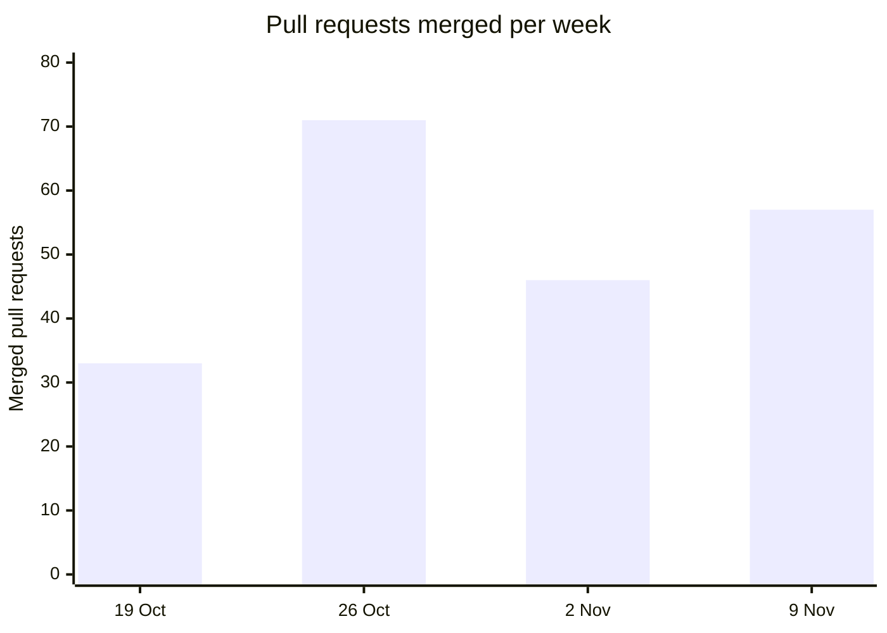
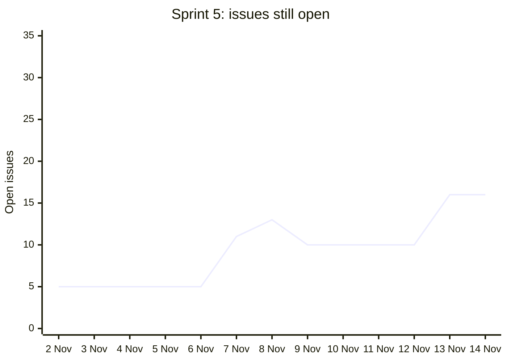

# Sprint data, rebuilt from GitHub

Generated by `python3 scripts/sprint-stats.py --as-of 2026-11-14`. Do not edit it by hand. Run the script again instead.
It counts the pull requests and issues of [qj1e7/ai-agent-workflow-builder](https://github.com/qj1e7/ai-agent-workflow-builder) up to the end of 14 Nov 2026, Singapore time.
Sprints are 14-day blocks from Monday 7 Sep 2026. Sprint 5 is still running on that day, so its numbers are partial.

## Per sprint

| Sprint | Dates | PRs merged | builder | runtime | orchestration | monitoring | infra | ci | docs | other | Issues opened | Issues closed | Issues open at the end |
|---|---|---|---|---|---|---|---|---|---|---|---|---|---|
| 1 | 7 Sep to 20 Sep | 0 | 0 | 0 | 0 | 0 | 0 | 0 | 0 | 0 | 0 | 0 | 0 |
| 2 | 21 Sep to 4 Oct | 0 | 0 | 0 | 0 | 0 | 0 | 0 | 0 | 0 | 0 | 0 | 0 |
| 3 | 5 Oct to 18 Oct | 0 | 0 | 0 | 0 | 0 | 0 | 0 | 0 | 0 | 0 | 0 | 0 |
| 4 | 19 Oct to 1 Nov | 104 | 24 | 9 | 24 | 8 | 7 | 7 | 25 | 0 | 26 | 21 | 5 |
| 5 | 2 Nov to 15 Nov | 103 | 50 | 18 | 21 | 7 | 4 | 1 | 0 | 2 | 27 | 16 | 16 |

Merged pull requests by author: `qj1e7` 206, `sanghuish-wq` 1.
Pull requests still open: 3. Issues still open: 16.

## Pull requests merged per week

Weeks start on Monday. A chart with one series, so it needs no legend.

| Week starting | Merged |
|---|---|
| 19 Oct | 33 |
| 26 Oct | 71 |
| 2 Nov | 46 |
| 9 Nov | 57 |

## Burndown of sprint 5: open issues at the end of each day

The sprint backlog is the issues open when sprint 5 began (5) plus the issues opened during it, 32 in all so far.
The line is the issues still open at the end of each day. A new issue lifts the line, a closed one lowers it.

| Day | Opened that day | Closed that day | Open at the end of the day |
|---|---|---|---|
| 2 Nov | 0 | 0 | 5 |
| 3 Nov | 0 | 0 | 5 |
| 4 Nov | 0 | 0 | 5 |
| 5 Nov | 0 | 0 | 5 |
| 6 Nov | 0 | 0 | 5 |
| 7 Nov | 11 | 5 | 11 |
| 8 Nov | 7 | 5 | 13 |
| 9 Nov | 2 | 5 | 10 |
| 10 Nov | 0 | 0 | 10 |
| 11 Nov | 0 | 0 | 10 |
| 12 Nov | 0 | 0 | 10 |
| 13 Nov | 6 | 0 | 16 |
| 14 Nov | 1 | 1 | 16 |

## What each sprint merged

Each list is the sprint's merged pull requests, oldest first. This is the closest record of each sprint backlog that git holds.

Sprint 4, 19 Oct to 1 Nov: 104 pull requests

- 23 Oct, [#1](https://github.com/qj1e7/ai-agent-workflow-builder/pull/1) docs(docs): record the stack decisions in ADRs 0002 to 0006
- 23 Oct, [#2](https://github.com/qj1e7/ai-agent-workflow-builder/pull/2) docs(docs): add the walking skeleton design and ADRs 0007 to 0012
- 23 Oct, [#4](https://github.com/qj1e7/ai-agent-workflow-builder/pull/4) docs(docs): propose Terraform for infrastructure as code in ADR 0013
- 23 Oct, [#11](https://github.com/qj1e7/ai-agent-workflow-builder/pull/11) docs(docs): record where the build departed from the design
- 23 Oct, [#3](https://github.com/qj1e7/ai-agent-workflow-builder/pull/3) ci(ci): add the CI skeleton with lint, tests, Semgrep and image builds
- 23 Oct, [#5](https://github.com/qj1e7/ai-agent-workflow-builder/pull/5) feat(orchestration): add the approval rules and the safety checker
- 23 Oct, [#6](https://github.com/qj1e7/ai-agent-workflow-builder/pull/6) feat(monitoring): define the shared contracts and recorded runs
- 23 Oct, [#7](https://github.com/qj1e7/ai-agent-workflow-builder/pull/7) feat(runtime): add the Release checker agent and the Agent API
- 23 Oct, [#8](https://github.com/qj1e7/ai-agent-workflow-builder/pull/8) feat(orchestration): make runs, approvals, events and the n8n workflow real
- 23 Oct, [#9](https://github.com/qj1e7/ai-agent-workflow-builder/pull/9) ci(ci): add the end-to-end harness and a mock GitHub
- 23 Oct, [#10](https://github.com/qj1e7/ai-agent-workflow-builder/pull/10) fix(orchestration): integrate the full stack and pass the end-to-end harness
- 23 Oct, [#12](https://github.com/qj1e7/ai-agent-workflow-builder/pull/12) feat(monitoring): add the Portal with the live agent room
- 23 Oct, [#13](https://github.com/qj1e7/ai-agent-workflow-builder/pull/13) feat(infra): run the Portal in the stack and test the product in a real browser
- 23 Oct, [#14](https://github.com/qj1e7/ai-agent-workflow-builder/pull/14) feat(monitoring): replace the agent room with the Tracker
- 23 Oct, [#15](https://github.com/qj1e7/ai-agent-workflow-builder/pull/15) ci(ci): add a ZAP DAST scan and a k6 load test against the stack
- 23 Oct, [#16](https://github.com/qj1e7/ai-agent-workflow-builder/pull/16) docs(docs): draw the design diagrams the rubric asks for
- 23 Oct, [#17](https://github.com/qj1e7/ai-agent-workflow-builder/pull/17) fix(orchestration): declare every status the API really answers
- 23 Oct, [#18](https://github.com/qj1e7/ai-agent-workflow-builder/pull/18) feat(orchestration): sign in with OpenID Connect
- 23 Oct, [#19](https://github.com/qj1e7/ai-agent-workflow-builder/pull/19) feat(infra): add Terraform for the Azure dev environment
- 23 Oct, [#20](https://github.com/qj1e7/ai-agent-workflow-builder/pull/20) feat(runtime): score model providers with a golden set
- 23 Oct, [#21](https://github.com/qj1e7/ai-agent-workflow-builder/pull/21) perf(orchestration): list runs with one query per table, however many runs
- 24 Oct, [#24](https://github.com/qj1e7/ai-agent-workflow-builder/pull/24) docs(docs): let Operators connect any AI model from the Portal in ADR 0022
- 24 Oct, [#23](https://github.com/qj1e7/ai-agent-workflow-builder/pull/23) feat(runtime): reach the summary model through a gateway in the runtime's own settings
- 24 Oct, [#25](https://github.com/qj1e7/ai-agent-workflow-builder/pull/25) feat(orchestration): let Operators connect an AI model from a Settings page
- 25 Oct, [#22](https://github.com/qj1e7/ai-agent-workflow-builder/pull/22) docs(docs): propose the software watchlist in ADRs 0019 and 0020
- 25 Oct, [#26](https://github.com/qj1e7/ai-agent-workflow-builder/pull/26) feat(runtime): check every watched software in one task
- 25 Oct, [#27](https://github.com/qj1e7/ai-agent-workflow-builder/pull/27) feat(orchestration): keep a software watchlist and check it with one approval
- 25 Oct, [#28](https://github.com/qj1e7/ai-agent-workflow-builder/pull/28) feat(orchestration): check the watchlist on a schedule from one n8n workflow
- 25 Oct, [#29](https://github.com/qj1e7/ai-agent-workflow-builder/pull/29) feat(builder): show the software watchlist on a Software page in the Portal
- 25 Oct, [#30](https://github.com/qj1e7/ai-agent-workflow-builder/pull/30) docs(docs): propose agent cards for the AI workflow builder in ADR 0023
- 25 Oct, [#31](https://github.com/qj1e7/ai-agent-workflow-builder/pull/31) feat(runtime): run agent cards with only their own tools
- 25 Oct, [#32](https://github.com/qj1e7/ai-agent-workflow-builder/pull/32) feat(builder): save, plan and run agent cards with the platform's own safety rules
- 25 Oct, [#33](https://github.com/qj1e7/ai-agent-workflow-builder/pull/33) feat(builder): plan, write and run agent cards from the Builder page
- 26 Oct, [#34](https://github.com/qj1e7/ai-agent-workflow-builder/pull/34) feat(builder): add an in-app tour that walks a newcomer through every part of the Portal
- 28 Oct, [#35](https://github.com/qj1e7/ai-agent-workflow-builder/pull/35) docs(docs): propose the Portal redesign with a clickable prototype
- 28 Oct, [#36](https://github.com/qj1e7/ai-agent-workflow-builder/pull/36) docs(docs): propose letting staff maintain workflows in n8n
- 28 Oct, [#37](https://github.com/qj1e7/ai-agent-workflow-builder/pull/37) docs(docs): add motion, agent states, more Open in n8n places and a new logo to the prototype
- 28 Oct, [#38](https://github.com/qj1e7/ai-agent-workflow-builder/pull/38) docs(docs): fix the prototype's usability, motion and accessibility issues from four design skill audits
- 28 Oct, [#39](https://github.com/qj1e7/ai-agent-workflow-builder/pull/39) docs(orchestration): add the n8n patterns review's 11 proposals to ADRs 0026 and 0027
- 29 Oct, [#40](https://github.com/qj1e7/ai-agent-workflow-builder/pull/40) docs(orchestration): settle the version and overlapping-run conflicts between ADRs 0024, 0026 and 0027
- 29 Oct, [#41](https://github.com/qj1e7/ai-agent-workflow-builder/pull/41) docs(docs): add the rebuild plan, its domain model and ADRs 0028 to 0032
- 29 Oct, [#43](https://github.com/qj1e7/ai-agent-workflow-builder/pull/43) docs(docs): add the team checkpoints page at the repo root
- 29 Oct, [#42](https://github.com/qj1e7/ai-agent-workflow-builder/pull/42) docs(docs): plan the move into DevNet and keep the rebuild plan ready for it
- 29 Oct, [#44](https://github.com/qj1e7/ai-agent-workflow-builder/pull/44) docs(docs): drop the teammate approval rule and check rebuild PRs with two agents
- 30 Oct, [#46](https://github.com/qj1e7/ai-agent-workflow-builder/pull/46) docs(docs): add what the P2 survey found to the rebuild plan
- 30 Oct, [#45](https://github.com/qj1e7/ai-agent-workflow-builder/pull/45) feat(builder): replace the old Portal with the prototype's shell
- 30 Oct, [#47](https://github.com/qj1e7/ai-agent-workflow-builder/pull/47) refactor(runtime): retire the release-check template and rename the Room lead to the Planner
- 30 Oct, [#48](https://github.com/qj1e7/ai-agent-workflow-builder/pull/48) docs(docs): let P2's name check also match the check scripts
- 30 Oct, [#50](https://github.com/qj1e7/ai-agent-workflow-builder/pull/50) feat(monitoring): build the run page with the approval gate and the practice Teams panel
- 30 Oct, [#51](https://github.com/qj1e7/ai-agent-workflow-builder/pull/51) feat(orchestration): keep people and their roles in the platform
- 30 Oct, [#53](https://github.com/qj1e7/ai-agent-workflow-builder/pull/53) feat(builder): add pause, resume, delete with Undo, and drafts to workflows
- 30 Oct, [#54](https://github.com/qj1e7/ai-agent-workflow-builder/pull/54) feat(builder): show the Agent library, read only
- 30 Oct, [#57](https://github.com/qj1e7/ai-agent-workflow-builder/pull/57) feat(builder): build Settings with the AI model and People and roles
- 30 Oct, [#66](https://github.com/qj1e7/ai-agent-workflow-builder/pull/66) docs(docs): add the P7 and P10 review screenshots
- 30 Oct, [#65](https://github.com/qj1e7/ai-agent-workflow-builder/pull/65) test(ci): expect "not built yet" only on the menu pages still not built
- 30 Oct, [#55](https://github.com/qj1e7/ai-agent-workflow-builder/pull/55) feat(builder): build the Software watchlist page
- 30 Oct, [#69](https://github.com/qj1e7/ai-agent-workflow-builder/pull/69) docs(docs): add the P6 review screenshots
- 30 Oct, [#52](https://github.com/qj1e7/ai-agent-workflow-builder/pull/52) feat(runtime): teach the Planner to say what it understood
- 31 Oct, [#63](https://github.com/qj1e7/ai-agent-workflow-builder/pull/63) feat(builder): build the Workflows list and the workflow page
- 31 Oct, [#71](https://github.com/qj1e7/ai-agent-workflow-builder/pull/71) feat(builder): build Home with what needs you
- 31 Oct, [#75](https://github.com/qj1e7/ai-agent-workflow-builder/pull/75) feat(builder): build New workflow in four steps
- 31 Oct, [#73](https://github.com/qj1e7/ai-agent-workflow-builder/pull/73) fix(orchestration): put focus on Close when Teams opens before the person is known
- 31 Oct, [#80](https://github.com/qj1e7/ai-agent-workflow-builder/pull/80) docs(docs): add the P9, P11 and P13 review screenshots
- 31 Oct, [#77](https://github.com/qj1e7/ai-agent-workflow-builder/pull/77) fix(orchestration): start a scheduled run only while its owner can still run it
- 31 Oct, [#62](https://github.com/qj1e7/ai-agent-workflow-builder/pull/62) feat(monitoring): copy the activity log to Cosmos DB for its readers
- 31 Oct, [#82](https://github.com/qj1e7/ai-agent-workflow-builder/pull/82) feat(infra): deploy the rebuilt app to Azure
- 31 Oct, [#84](https://github.com/qj1e7/ai-agent-workflow-builder/pull/84) ci(ci): read the deploy's sign-in IDs, emails and state names from secrets
- 31 Oct, [#85](https://github.com/qj1e7/ai-agent-workflow-builder/pull/85) docs(docs): rerun the scans and draw the rubric diagrams on the new app
- 31 Oct, [#87](https://github.com/qj1e7/ai-agent-workflow-builder/pull/87) fix(infra): ask Azure for a standard Container Apps environment, not an express one
- 31 Oct, [#89](https://github.com/qj1e7/ai-agent-workflow-builder/pull/89) fix(ci): create PostgreSQL's firewall rule and databases before the db-init job runs
- 31 Oct, [#88](https://github.com/qj1e7/ai-agent-workflow-builder/pull/88) fix(infra): set the Container Apps environment to workload profiles mode
- 31 Oct, [#90](https://github.com/qj1e7/ai-agent-workflow-builder/pull/90) fix(infra): let n8n create its tables in its database's public schema on Azure
- 31 Oct, [#92](https://github.com/qj1e7/ai-agent-workflow-builder/pull/92) docs(docs): record the first deploy to Azure and the lanes that ran without sign-in
- 31 Oct, [#93](https://github.com/qj1e7/ai-agent-workflow-builder/pull/93) fix(runtime): read release tags that start with v, such as v2.14.2
- 31 Oct, [#94](https://github.com/qj1e7/ai-agent-workflow-builder/pull/94) fix(monitoring): stop a dropped events stream leaving an uncaught error on the run page
- 31 Oct, [#95](https://github.com/qj1e7/ai-agent-workflow-builder/pull/95) docs(docs): save the evidence of all ten P14 lanes on Azure
- 1 Nov, [#99](https://github.com/qj1e7/ai-agent-workflow-builder/pull/99) fix(orchestration): count on the Teams badge only the runs the person can decide
- 1 Nov, [#96](https://github.com/qj1e7/ai-agent-workflow-builder/pull/96) fix(builder): send HSTS from the Portal on https requests only
- 1 Nov, [#106](https://github.com/qj1e7/ai-agent-workflow-builder/pull/106) fix(monitoring): let P4's cleanup find untagged images and make lane 11's behind check able to fail
- 1 Nov, [#97](https://github.com/qj1e7/ai-agent-workflow-builder/pull/97) refactor(builder): finish the workflow page follow-ups
- 1 Nov, [#101](https://github.com/qj1e7/ai-agent-workflow-builder/pull/101) fix(orchestration): stop n8n's MCP server list call and keep its health check off any proxy
- 1 Nov, [#109](https://github.com/qj1e7/ai-agent-workflow-builder/pull/109) fix(builder): hold one lock from a run's state read to its insert, so a pause can't land between
- 1 Nov, [#98](https://github.com/qj1e7/ai-agent-workflow-builder/pull/98) fix(builder): stop the header polling for someone not on the People list
- 1 Nov, [#103](https://github.com/qj1e7/ai-agent-workflow-builder/pull/103) fix(builder): keep People messages when someone leaves, and say the truth with no model
- 1 Nov, [#105](https://github.com/qj1e7/ai-agent-workflow-builder/pull/105) fix(builder): clear the Software notice on Escape anywhere, and focus it after an already-removed row
- 1 Nov, [#110](https://github.com/qj1e7/ai-agent-workflow-builder/pull/110) fix(builder): offer to decide a run only when the platform says the person can
- 1 Nov, [#100](https://github.com/qj1e7/ai-agent-workflow-builder/pull/100) fix(orchestration): answer 422, not 500, for a lone surrogate or a very deep body
- 1 Nov, [#107](https://github.com/qj1e7/ai-agent-workflow-builder/pull/107) fix(orchestration): close a waiting model address when its asker leaves
- 1 Nov, [#102](https://github.com/qj1e7/ai-agent-workflow-builder/pull/102) fix(builder): check every changed part of a new workflow, say when it reuses a saved agent, and fix the tool check's words
- 1 Nov, [#111](https://github.com/qj1e7/ai-agent-workflow-builder/pull/111) feat(builder): let an Operator change a workflow's schedule and take over a held one
- 1 Nov, [#115](https://github.com/qj1e7/ai-agent-workflow-builder/pull/115) docs(docs): record the ZAP rerun after the follow-ups and list MAX_BODY_BYTES
- 1 Nov, [#116](https://github.com/qj1e7/ai-agent-workflow-builder/pull/116) fix(ci): stop test and check containers leaving anonymous volumes behind
- 1 Nov, [#117](https://github.com/qj1e7/ai-agent-workflow-builder/pull/117) fix(builder): give a next run the same hour and zone on every page
- 1 Nov, [#119](https://github.com/qj1e7/ai-agent-workflow-builder/pull/119) test(builder): add the check lanes that needed a running stack
- 1 Nov, [#118](https://github.com/qj1e7/ai-agent-workflow-builder/pull/118) fix(runtime): stop the tool check saying "can't" for places it reaches, and fix its odd words
- 1 Nov, [#122](https://github.com/qj1e7/ai-agent-workflow-builder/pull/122) feat(builder): add a Practice Jira page and one place that decides where ticket keys link
- 1 Nov, [#121](https://github.com/qj1e7/ai-agent-workflow-builder/pull/121) feat(infra): let n8n's editor open on Azure, with an optional address list
- 1 Nov, [#123](https://github.com/qj1e7/ai-agent-workflow-builder/pull/123) feat(orchestration): propose ADR 0035 and make Jira's settings and key shapes real
- 1 Nov, [#124](https://github.com/qj1e7/ai-agent-workflow-builder/pull/124) feat(orchestration): post the approval request as a real Teams Adaptive Card
- 1 Nov, [#125](https://github.com/qj1e7/ai-agent-workflow-builder/pull/125) feat(orchestration): draw the Teams approval card in the practice panel, with no Approve or Decline
- 1 Nov, [#126](https://github.com/qj1e7/ai-agent-workflow-builder/pull/126) feat(orchestration): reach Jira through one REST adapter, and let the practice Jira speak Jira's API
- 1 Nov, [#127](https://github.com/qj1e7/ai-agent-workflow-builder/pull/127) feat(monitoring): link each written ticket to where it lives, and tidy Jira's key shapes
- 1 Nov, [#130](https://github.com/qj1e7/ai-agent-workflow-builder/pull/130) fix(orchestration): treat a claim that meets the other unique key as held, and bound the race tests
- 1 Nov, [#128](https://github.com/qj1e7/ai-agent-workflow-builder/pull/128) fix(orchestration): make Teams card text inert, keep the webhook address out of logs, and lease outbox rows

Sprint 5, 2 Nov to 15 Nov: 103 pull requests

- 7 Nov, [#133](https://github.com/qj1e7/ai-agent-workflow-builder/pull/133) docs(builder): AI-native redesign, with prototype version 4 as the build target
- 7 Nov, [#134](https://github.com/qj1e7/ai-agent-workflow-builder/pull/134) docs: put the build target and the AI-native design principles in AGENTS.md
- 7 Nov, [#135](https://github.com/qj1e7/ai-agent-workflow-builder/pull/135) docs(builder): keep Ask the team and Report to support as team requests (ADR 0038)
- 7 Nov, [#142](https://github.com/qj1e7/ai-agent-workflow-builder/pull/142) fix(runtime): stop the abilities check passing vulnerability checks that no tool serves
- 7 Nov, [#139](https://github.com/qj1e7/ai-agent-workflow-builder/pull/139) feat(builder): save set-up card drafts without a step number
- 7 Nov, [#143](https://github.com/qj1e7/ai-agent-workflow-builder/pull/143) feat(orchestration): show who asked and what the agents found on the approval page
- 7 Nov, [#137](https://github.com/qj1e7/ai-agent-workflow-builder/pull/137) feat(runtime): check the GitHub connection
- 7 Nov, [#141](https://github.com/qj1e7/ai-agent-workflow-builder/pull/141) feat(builder): one Needs you list for Home, Workflows and the tab count
- 7 Nov, [#140](https://github.com/qj1e7/ai-agent-workflow-builder/pull/140) feat(orchestration): read each Jira ticket's last update, type and assignee, filter by created date, and say when a search was cut at the limit
- 7 Nov, [#136](https://github.com/qj1e7/ai-agent-workflow-builder/pull/136) feat(runtime): find a software's GitHub project from its name
- 7 Nov, [#138](https://github.com/qj1e7/ai-agent-workflow-builder/pull/138) feat(monitoring): give the AI troubleshooter's four answers
- 7 Nov, [#149](https://github.com/qj1e7/ai-agent-workflow-builder/pull/149) feat(runtime): let agents find Jira tickets by last update, type and assignee
- 7 Nov, [#147](https://github.com/qj1e7/ai-agent-workflow-builder/pull/147) feat(builder): keep Ask the team and Report to support requests
- 7 Nov, [#150](https://github.com/qj1e7/ai-agent-workflow-builder/pull/150) feat(builder): order the workflow page by decision, with a More actions menu
- 7 Nov, [#152](https://github.com/qj1e7/ai-agent-workflow-builder/pull/152) feat(builder): add software by name and order the watchlist
- 7 Nov, [#148](https://github.com/qj1e7/ai-agent-workflow-builder/pull/148) feat(orchestration): check each connection and keep its last result
- 7 Nov, [#156](https://github.com/qj1e7/ai-agent-workflow-builder/pull/156) feat(builder): add Drafts, Waiting on others and Following up to Workflows
- 7 Nov, [#157](https://github.com/qj1e7/ai-agent-workflow-builder/pull/157) feat(monitoring): show the run page in two levels, with Retry and Report to support on it
- 7 Nov, [#162](https://github.com/qj1e7/ai-agent-workflow-builder/pull/162) fix(orchestration): read each Jira day filter in the account's zone
- 7 Nov, [#163](https://github.com/qj1e7/ai-agent-workflow-builder/pull/163) fix(orchestration): post an approval's outcome card only to the channel that got its approval card
- 7 Nov, [#164](https://github.com/qj1e7/ai-agent-workflow-builder/pull/164) feat(builder): offer the new address when GitHub moved a watched repository
- 7 Nov, [#155](https://github.com/qj1e7/ai-agent-workflow-builder/pull/155) feat(runtime): serve the capability registry
- 7 Nov, [#168](https://github.com/qj1e7/ai-agent-workflow-builder/pull/168) fix(runtime): never propose a release the check could not read
- 7 Nov, [#151](https://github.com/qj1e7/ai-agent-workflow-builder/pull/151) feat(runtime): return one Planner answer for each request, with the golden set
- 7 Nov, [#169](https://github.com/qj1e7/ai-agent-workflow-builder/pull/169) feat(builder): answer the Planner on Home, check one part, and list capabilities
- 7 Nov, [#170](https://github.com/qj1e7/ai-agent-workflow-builder/pull/170) feat(builder): make Home the Planner's box, with the old New workflow behind a flag
- 7 Nov, [#171](https://github.com/qj1e7/ai-agent-workflow-builder/pull/171) feat(builder): show what the platform can do in the Agent library and Settings
- 7 Nov, [#172](https://github.com/qj1e7/ai-agent-workflow-builder/pull/172) feat(builder): set up a workflow from the Planner's card
- 8 Nov, [#173](https://github.com/qj1e7/ai-agent-workflow-builder/pull/173) fix(infra): name the resources the deploy guard refuses to destroy or replace
- 8 Nov, [#174](https://github.com/qj1e7/ai-agent-workflow-builder/pull/174) test(e2e): make the I6 new-agent test independent of the agent library
- 8 Nov, [#175](https://github.com/qj1e7/ai-agent-workflow-builder/pull/175) feat(monitoring): draw every agent as its Orb and the Planner as the Visor bot
- 8 Nov, [#167](https://github.com/qj1e7/ai-agent-workflow-builder/pull/167) docs(orchestration): accept ADR 0041, an approved Jira write is made only in the Jira it was approved for
- 8 Nov, [#179](https://github.com/qj1e7/ai-agent-workflow-builder/pull/179) refactor(builder): remove New workflow and the understand route
- 8 Nov, [#178](https://github.com/qj1e7/ai-agent-workflow-builder/pull/178) fix(orchestration): make an approved Jira write only in the Jira it was approved for
- 8 Nov, [#180](https://github.com/qj1e7/ai-agent-workflow-builder/pull/180) fix(runtime): let a rate-limited GitHub read stop with Retry allowed
- 8 Nov, [#182](https://github.com/qj1e7/ai-agent-workflow-builder/pull/182) fix(runtime): stop an agent card when its Jira read did not happen
- 8 Nov, [#181](https://github.com/qj1e7/ai-agent-workflow-builder/pull/181) fix(orchestration): make done_tickets ask again when Jira's answer is cut off
- 8 Nov, [#187](https://github.com/qj1e7/ai-agent-workflow-builder/pull/187) fix(infra): migrate the database before the deploy changes the apps
- 8 Nov, [#188](https://github.com/qj1e7/ai-agent-workflow-builder/pull/188) feat(runtime): answer questions about the person's own data on Home
- 8 Nov, [#189](https://github.com/qj1e7/ai-agent-workflow-builder/pull/189) feat(builder): show the Planner's answer to a question on Home
- 8 Nov, [#191](https://github.com/qj1e7/ai-agent-workflow-builder/pull/191) feat(builder): point Home at software versioning and freeze the general builder
- 8 Nov, [#193](https://github.com/qj1e7/ai-agent-workflow-builder/pull/193) fix(infra): keep LF line endings so the stack starts on Windows
- 8 Nov, [#192](https://github.com/qj1e7/ai-agent-workflow-builder/pull/192) fix(runtime): keep the first answer when the question lane's model call fails
- 8 Nov, [#194](https://github.com/qj1e7/ai-agent-workflow-builder/pull/194) feat(runtime): let the Planner answer about checks, tickets and follow-ups on the watchlist
- 8 Nov, [#195](https://github.com/qj1e7/ai-agent-workflow-builder/pull/195) feat(builder): word the product for software versioning only
- 8 Nov, [#196](https://github.com/qj1e7/ai-agent-workflow-builder/pull/196) fix(infra): retry a job status check when Azure answers with an error
- 9 Nov, [#197](https://github.com/qj1e7/ai-agent-workflow-builder/pull/197) feat(builder): let the Planner act on the watchlist and follow up safely
- 9 Nov, [#200](https://github.com/qj1e7/ai-agent-workflow-builder/pull/200) fix(runtime): close the word-rule, can't, stop-note, advice and Jira-refusal gaps
- 9 Nov, [#201](https://github.com/qj1e7/ai-agent-workflow-builder/pull/201) fix(runtime): understand watch requests like "add nodejs" and name GitHub as the only release source
- 11 Nov, [#203](https://github.com/qj1e7/ai-agent-workflow-builder/pull/203) docs(builder): make Home a chat with a rail that leads to full pages (ADR 0043)
- 11 Nov, [#204](https://github.com/qj1e7/ai-agent-workflow-builder/pull/204) docs(builder): redraw the shell of prototype v4 as a chat with a rail (ADR 0043 step 1)
- 11 Nov, [#205](https://github.com/qj1e7/ai-agent-workflow-builder/pull/205) docs(builder): redraw the Planner's answers in prototype v4 (ADR 0043 step 2)
- 11 Nov, [#206](https://github.com/qj1e7/ai-agent-workflow-builder/pull/206) docs(builder): redraw runs and approvals in prototype v4 (ADR 0043 step 3)
- 12 Nov, [#207](https://github.com/qj1e7/ai-agent-workflow-builder/pull/207) docs(builder): redraw roles in prototype v4 (ADR 0043 step 4)
- 12 Nov, [#209](https://github.com/qj1e7/ai-agent-workflow-builder/pull/209) feat(monitoring): give the AI troubleshooter's three answers, ending in Safe to retry
- 12 Nov, [#208](https://github.com/qj1e7/ai-agent-workflow-builder/pull/208) docs(builder): answer Bob clause by clause and open Ask the team to Approvers in prototype v4
- 12 Nov, [#210](https://github.com/qj1e7/ai-agent-workflow-builder/pull/210) docs(builder): bring the spec and build plan in line with the redrawn prototype (ADR 0043)
- 12 Nov, [#211](https://github.com/qj1e7/ai-agent-workflow-builder/pull/211) feat(builder): replace the menu with a rail and move the Agent library into Settings
- 12 Nov, [#213](https://github.com/qj1e7/ai-agent-workflow-builder/pull/213) fix(builder): give the workflow link in the chat's check card a full target
- 12 Nov, [#212](https://github.com/qj1e7/ai-agent-workflow-builder/pull/212) feat(builder): give each workflow its last run
- 12 Nov, [#214](https://github.com/qj1e7/ai-agent-workflow-builder/pull/214) feat(builder): keep the chat after the first message, with the pinned Needs you line and grouped Needs you
- 12 Nov, [#215](https://github.com/qj1e7/ai-agent-workflow-builder/pull/215) feat(builder): make every change an Operator's on the server, and the Approver's pages read only
- 12 Nov, [#216](https://github.com/qj1e7/ai-agent-workflow-builder/pull/216) feat(builder): open items from the chat in a side panel, with Back to the chat
- 12 Nov, [#217](https://github.com/qj1e7/ai-agent-workflow-builder/pull/217) feat(monitoring): draw the run line as flow
- 12 Nov, [#218](https://github.com/qj1e7/ai-agent-workflow-builder/pull/218) docs(builder): accept ADR 0043 and record its changes to ADR 0037
- 12 Nov, [#219](https://github.com/qj1e7/ai-agent-workflow-builder/pull/219) feat(builder): publish each schedule change as a new version, with Undo
- 12 Nov, [#220](https://github.com/qj1e7/ai-agent-workflow-builder/pull/220) feat(runtime): account for every clause of a request, negations included
- 12 Nov, [#221](https://github.com/qj1e7/ai-agent-workflow-builder/pull/221) feat(orchestration): keep a decline reason, and show one declined record everywhere
- 13 Nov, [#222](https://github.com/qj1e7/ai-agent-workflow-builder/pull/222) feat(builder): mark every part on the Planner's cards, and set up the part it can
- 13 Nov, [#223](https://github.com/qj1e7/ai-agent-workflow-builder/pull/223) feat(orchestration): let an Approver ask the requester a question on a waiting request
- 13 Nov, [#224](https://github.com/qj1e7/ai-agent-workflow-builder/pull/224) feat(runtime): answer a schedule change with an edit answer that fails closed
- 13 Nov, [#226](https://github.com/qj1e7/ai-agent-workflow-builder/pull/226) feat(builder): give the watchlist a count line, what checks each row, and the declined record's History
- 13 Nov, [#228](https://github.com/qj1e7/ai-agent-workflow-builder/pull/228) fix(builder): give See all on Workflows a full target
- 13 Nov, [#229](https://github.com/qj1e7/ai-agent-workflow-builder/pull/229) feat(builder): open the Planner's box to Approvers, for questions only
- 13 Nov, [#234](https://github.com/qj1e7/ai-agent-workflow-builder/pull/234) ci(ci): give the e2e job an hour
- 13 Nov, [#232](https://github.com/qj1e7/ai-agent-workflow-builder/pull/232) feat(orchestration): name what a run didn't check on its approval
- 13 Nov, [#235](https://github.com/qj1e7/ai-agent-workflow-builder/pull/235) feat(builder): change a workflow's schedule by asking, with the edit card
- 13 Nov, [#236](https://github.com/qj1e7/ai-agent-workflow-builder/pull/236) docs(builder): make the chat-first sketch the design target
- 13 Nov, [#237](https://github.com/qj1e7/ai-agent-workflow-builder/pull/237) fix(builder): let the top bar span the window, and bring a new answer into view
- 13 Nov, [#238](https://github.com/qj1e7/ai-agent-workflow-builder/pull/238) docs(orchestration): make n8n the engine behind every workflow (accept ADRs 0026 and 0027)
- 13 Nov, [#239](https://github.com/qj1e7/ai-agent-workflow-builder/pull/239) feat(builder): set up as a draft, test it, then turn it on
- 13 Nov, [#240](https://github.com/qj1e7/ai-agent-workflow-builder/pull/240) docs(orchestration): spike P7, the engine's facts on n8n 2.42.6
- 13 Nov, [#241](https://github.com/qj1e7/ai-agent-workflow-builder/pull/241) feat(orchestration): add the n8n node pack, and run n8n from our own image
- 13 Nov, [#242](https://github.com/qj1e7/ai-agent-workflow-builder/pull/242) feat(monitoring): draw the run as the workflow's blocks, with every state and the motion
- 13 Nov, [#243](https://github.com/qj1e7/ai-agent-workflow-builder/pull/243) feat(runtime): the Planner's short answers: can'ts, capabilities, troubleshooter, pause and resume
- 13 Nov, [#244](https://github.com/qj1e7/ai-agent-workflow-builder/pull/244) feat(orchestration): node calls for Read, Agent and Propose, and the execution link
- 13 Nov, [#245](https://github.com/qj1e7/ai-agent-workflow-builder/pull/245) feat(builder): make the chat look and read like the sketch
- 13 Nov, [#246](https://github.com/qj1e7/ai-agent-workflow-builder/pull/246) feat(orchestration): Ask for a yes held in n8n, the wake with its mac, expiry and lost
- 13 Nov, [#247](https://github.com/qj1e7/ai-agent-workflow-builder/pull/247) feat(orchestration): the write at the moment it is made: expiry, test runs, the subject key across runs, and part-done proposals
- 13 Nov, [#249](https://github.com/qj1e7/ai-agent-workflow-builder/pull/249) feat(orchestration): Tell, and failures reported through Report a failure or found by the sweep
- 14 Nov, [#250](https://github.com/qj1e7/ai-agent-workflow-builder/pull/250) feat(builder): Workflows, Watchlist, workflow and software pages in the sketch's shape
- 14 Nov, [#251](https://github.com/qj1e7/ai-agent-workflow-builder/pull/251) feat(builder): put the run in the chat card and the panel, with the troubleshooter's three answers
- 14 Nov, [#254](https://github.com/qj1e7/ai-agent-workflow-builder/pull/254) test(monitoring): wait for the Cosmos copy instead of reading it once
- 14 Nov, [#252](https://github.com/qj1e7/ai-agent-workflow-builder/pull/252) feat(orchestration): Tell to Teams and email through one Power Automate flow
- 14 Nov, [#256](https://github.com/qj1e7/ai-agent-workflow-builder/pull/256) docs(orchestration): let n8n's own nodes read and post notices, with writes still checked by our API (ADR 0045)
- 14 Nov, [#257](https://github.com/qj1e7/ai-agent-workflow-builder/pull/257) test(orchestration): look for the HTTP status only in the Teams card's words
- 14 Nov, [#253](https://github.com/qj1e7/ai-agent-workflow-builder/pull/253) feat(builder): the Planner lays out each use case as its own n8n workflow, saved as a draft and graded
- 14 Nov, [#258](https://github.com/qj1e7/ai-agent-workflow-builder/pull/258) feat(builder): give the side panel the sketch's views, with history and auto-open
- 14 Nov, [#259](https://github.com/qj1e7/ai-agent-workflow-builder/pull/259) feat(runtime): a read-only Confluence reader for workflows
- 14 Nov, [#260](https://github.com/qj1e7/ai-agent-workflow-builder/pull/260) feat(builder): the approval in the sketch's shape: what will be written, not checked, ask, decline with a reason
- 14 Nov, [#261](https://github.com/qj1e7/ai-agent-workflow-builder/pull/261) feat(builder): test run, Turn it on, Run now and retry on the new engine
- 14 Nov, [#262](https://github.com/qj1e7/ai-agent-workflow-builder/pull/262) feat(builder): the set-up card builds, tests and turns on, with the build panel
- 14 Nov, [#263](https://github.com/qj1e7/ai-agent-workflow-builder/pull/263) feat(builder): scale Home and the chat up on big screens

## Issues still open on 14 Nov

- [#67](https://github.com/qj1e7/ai-agent-workflow-builder/issues/67) Hold the Planner to the tools by ability, not by words
- [#86](https://github.com/qj1e7/ai-agent-workflow-builder/issues/86) Lock-down follow-ups: model address guard behind a proxy, n8n's own calls, n8n health check
- [#120](https://github.com/qj1e7/ai-agent-workflow-builder/issues/120) Tool check: the rare destination wordings and Phase 2 "upgrade ticket" phrasing left after #118
- [#129](https://github.com/qj1e7/ai-agent-workflow-builder/issues/129) Record a settings-history row when WATCHLIST_JIRA_PROJECT moves the watchlist
- [#146](https://github.com/qj1e7/ai-agent-workflow-builder/issues/146) feat(builder): Needs you shows only the newest 10 requests of each kind
- [#158](https://github.com/qj1e7/ai-agent-workflow-builder/issues/158) Retry press that loses a race (409) shows no message and drops focus
- [#161](https://github.com/qj1e7/ai-agent-workflow-builder/issues/161) Workflows lists stop at the newest 50 (Following up, Waiting on others)
- [#165](https://github.com/qj1e7/ai-agent-workflow-builder/issues/165) Make every time-zone setting read TEAM_TIME_ZONE before exposing it
- [#186](https://github.com/qj1e7/ai-agent-workflow-builder/issues/186) Flaky test: "500" can appear inside a timestamp in test_connections.py
- [#190](https://github.com/qj1e7/ai-agent-workflow-builder/issues/190) Flaky e2e: Home scenario A at 390 px sometimes sees a leftover draft
- [#225](https://github.com/qj1e7/ai-agent-workflow-builder/issues/225) test(builder): a schedule save sometimes answers without a schedule in the delete-waits test
- [#227](https://github.com/qj1e7/ai-agent-workflow-builder/issues/227) docs(builder): the spec and prototype say a ticket's update date, type and owner are planned, but the registry has them Ready
- [#230](https://github.com/qj1e7/ai-agent-workflow-builder/issues/230) fix(builder): a schedule save from an old read overwrites a teammate's change
- [#231](https://github.com/qj1e7/ai-agent-workflow-builder/issues/231) feat(builder): a change to how often a workflow runs doesn't change which tickets it reads
- [#233](https://github.com/qj1e7/ai-agent-workflow-builder/issues/233) fix(builder): with more than 50 workflows the Planner knows no workflow names
- [#255](https://github.com/qj1e7/ai-agent-workflow-builder/issues/255) fix(orchestration): an Approver with more than 10 waiting requests can't reach the rest
