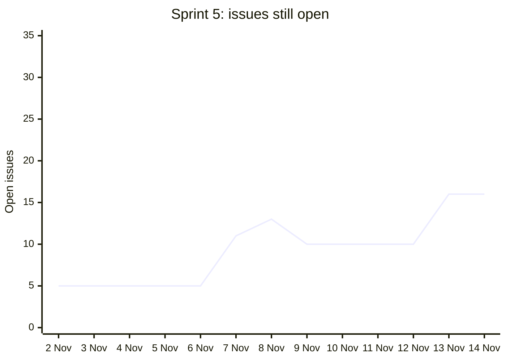

# Sprints, rebuilt from the repository

**Status.** A draft for the team to confirm. Written on 14 Nov 2026.
**Covers.** Rubric items 6 (sprint plan and sprint backlog), 7 (burndown chart) and 8 (sprint review and retrospective), as far as git and GitHub can show them.

We did not keep sprint records while we worked. This page rebuilds them from what the repository does hold: merged pull requests, issues, and the plan documents we wrote before each block of work. Each part says whether it is **from the record** (a count, a date or a document you can open) or **proposed** (our reading of the record, which the team must confirm or correct). Hours are not in the record at all. They go in [the hours log](hours-log.md).

The counts come from a script, so anyone can check them and run them again before the submission:

```
python3 scripts/sprint-stats.py --as-of 2026-11-14
```

It writes [sprint-data.md](sprint-data.md): every count on this page, the merged pull requests of each sprint, and the issues still open.

## The sprint calendar

**Proposed.** The school's schedule starts project conduct on Monday 7 Sep 2026 and says Phase 0 is about 4 weeks, then Phase 1 about 14 weeks. We use 2-week sprints from 7 Sep, so Phase 0 is sprints 1 and 2. If the team ran Phase 0 as one 4-week sprint, call it Sprint 0 and keep the later dates as they are.

| Sprint | Dates | Phase | Milestone in the sprint |
|---|---|---|---|
| 1 | 7 Sep to 20 Sep | 0 | Project conduct starts, 7 Sep |
| 2 | 21 Sep to 4 Oct | 0 | |
| 3 | 5 Oct to 18 Oct | 1 | First monthly progress report due, 10 Oct |
| 4 | 19 Oct to 1 Nov | 1 | Repository created, 20 Oct. First deploy to Azure, 31 Oct |
| 5 | 2 Nov to 15 Nov | 1 | Second monthly progress report due, 10 Nov |
| 6 | 16 Nov to 29 Nov | 1 | First presentation, from 27 Nov |
| 7 | 30 Nov to 13 Dec | 1 | Presentation days until 5 Dec. Third progress report due, 10 Dec |
| 8 | 14 Dec to 27 Dec | 1 | First submission, 15 Dec |

The milestone dates come from the school's brief, "Project Requirements SE33+Admin v3", slides 6 and 15. The report due on 10 Nov and 10 Dec follows from "monthly, first due 10 Oct". The repository's first commit is on 20 Oct 2026.

## What the record shows

**From the record.** These are the counts in [sprint-data.md](sprint-data.md), up to 14 Nov.

| Sprint | Pull requests merged | Most of them in | Issues opened | Issues closed | Issues open at the end |
|---|---|---|---|---|---|
| 1 to 3 | 0 | No repository yet | 0 | 0 | 0 |
| 4 | 104 | docs 25, builder 24, orchestration 24 | 26 | 21 | 5 |
| 5, to 14 Nov | 103 | builder 50, orchestration 21, runtime 18 | 27 | 16 | 16 |

206 of the 207 merged pull requests were opened from the team lead's GitHub account. One was a teammate's ([#193](https://github.com/qj1e7/ai-agent-workflow-builder/pull/193)). Two more by teammates are open ([#132](https://github.com/qj1e7/ai-agent-workflow-builder/pull/132) and [#202](https://github.com/qj1e7/ai-agent-workflow-builder/pull/202)), and a teammate added the `n8n-project/` folder in a commit on 12 Nov. Work that happens outside GitHub, such as research, testing, review in meetings, the proposal and the reports, does not show here. The hours log is where it shows.

## Each sprint

### Sprints 1 to 3, 7 Sep to 18 Oct

**From the record.** Nothing in git. The repository holds the reviewed proposal (`docs/proposal/MTech_SE_Project_Proposal_v0.2_reviewed (1).docx`) and the first architecture sketch (`docs/proposal/Architecture_Diagram_and_MVP_v0.1 (1).png`). Their dates are not in git.

**The team must supply.** For each of the three sprints, fill in the [sprint review and retro template](sprint-review-template.md): the goal, the backlog (for example the proposal changes after the 1 Sep review, the sponsor meetings, the first progress report, and the October sandbox test of n8n and LangGraph), who did what, and the hours.

### Sprint 4, 19 Oct to 1 Nov: walking skeleton, then the rebuild

**From the record.** The plans for this sprint were written in it: the walking skeleton design ([`walking-skeleton.md`](../../design/walking-skeleton.md), 23 Oct) and the 15-step rebuild plan ([`rebuild-plan.md`](../../design/rebuild-plan.md), 29 Oct, steps P1 to P15). What landed, by pull request:

- 20 to 23 Oct. ADRs 0002 to 0013 for the stack, the CI skeleton with Semgrep, the walking skeleton end to end, sign-in with OpenID Connect, Terraform for Azure, ZAP and k6 in CI, and the first design diagrams (#1 to #21).
- 24 to 26 Oct. Connect any AI model from Settings, the Software watchlist, agent cards and the first in-app tour (#22 to #34).
- 28 Oct. The clickable Portal prototype and the proposal to let staff maintain workflows in n8n (#35 to #39).
- 29 to 31 Oct. The rebuild plan, then steps P1 to P15: the new Portal shell, roles, the activity log copied to Cosmos DB, the run page with the approval gate, the watchlist, Workflows, Settings, Home and New workflow (#40 to #80).
- 31 Oct. The first deploy to Azure, all ten P14 lanes on Azure, and the scans and diagrams run again on the new app (#82 to #95).
- 1 Nov. Fixes from the deploy and review, the real Teams Adaptive Card, and one REST adapter for Jira (#96 to #130).

Sprint review evidence: [`docs/evidence/deploy/`](../deploy/README.md) (the P14 lanes), [`docs/evidence/rebuild/`](../rebuild/) (review screenshots of P1 to P13), [`docs/evidence/dast/2026-11-rebuild/`](../dast/2026-11-rebuild/README.md), [`docs/evidence/load-test/2026-11-rebuild/`](../load-test/) and [`docs/evidence/unit-tests/2026-11-rebuild/`](../unit-tests/).

**Proposed sprint goal.** "Prove the whole path once, from a request to an approved Jira ticket, then rebuild the Portal from the prototype and deploy it to Azure."

**The team must supply.** Who worked on what, the hours, and the retro.

### Sprint 5, 2 Nov to 15 Nov: the AI-native redesign, chat first, and n8n as the engine

**From the record.** Three plans, each written before its work:

- 7 Nov. The AI-native redesign, with its build plan ([`IMPLEMENTATION-PLAN.md`](../../design/ai-native-redesign/IMPLEMENTATION-PLAN.md)) and the twelve design principles (#133, #134).
- 8 Nov. Phase 1 narrowed to software versioning, and the general builder frozen (#191, #195).
- 11 to 13 Nov. Home became a chat with a rail (ADR 0043, #203 to #218), then the chat-first sketch became the design target (#236), with [`BUILD-PLAN.md`](../../design/chat-first/BUILD-PLAN.md) for the Portal and [`ENGINE-PLAN.md`](../../design/chat-first/ENGINE-PLAN.md) for n8n as the engine (#238).

What landed, by pull request:

- 7 to 9 Nov. Team requests, connection checks, the capability registry, the Planner's answers on Home, set-up from the Planner's card, approvals made only in the approved Jira (ADR 0041), and answers about the person's own data (#135 to #201).
- 11 to 13 Nov. The chat with a rail and a side panel, schedule changes as versions with Undo, decline reasons, questions to the requester, and the edit card (#203 to #237).
- 13 and 14 Nov. The engine: the n8n node pack in our own n8n image, node calls, Ask for a yes held in n8n, the write checked at the moment it is made, Tell through one Power Automate flow, the Planner laying out each workflow as its own n8n workflow, the Confluence reader, test run and Turn it on on the new engine, and the Portal pages in the sketch's shape (#238 to #263).

Sprint review evidence: [`docs/evidence/fyp/security.md`](security.md) (the security review on each engine PR), [`docs/evidence/sast/`](../sast/README.md), [`docs/evidence/prototypes/p7-n8n-engine-facts/`](../prototypes/p7-n8n-engine-facts/findings.md), and the green CI run on `a7ba7673`, [43590669307](https://github.com/qj1e7/ai-agent-workflow-builder/actions/runs/43590669307).

**Proposed sprint goal.** "Make the chat the way in, and make every workflow its own n8n workflow, with every write still checked by our API."

**The team must supply.** Who worked on what, the hours, the retro, and the sprint's end on 15 Nov.

### Sprint 6, 16 Nov to 29 Nov: proposed plan

**Proposed.** Not started when this was written. A plan to discuss at sprint planning:

1. Finish the engine steps that matter for the demo, in ENGINE-PLAN's order: E6, then E9, E10 and E11. E11 switches the node allow list on.
2. Freeze features a few days before 27 Nov, as the readiness audit suggests.
3. Render the diagrams again (`scripts/render-diagrams.sh` needs Docker), rerun the scans, and save fresh test, load and DAST results.
4. Build the slides from [`slide-outline.md`](slide-outline.md), rehearse [`demo-script.md`](demo-script.md), and record the backup video.
5. Fill the hours log and the reviews and retros for sprints 1 to 5.

## Burndown

**From the record.** The burndown for sprint 5, from GitHub issues. The sprint backlog is the 5 issues open on 2 Nov plus the 27 opened during the sprint, 32 in all. The line is the issues still open at the end of each day. A new issue lifts the line, and a closed one lowers it. The script draws the same chart in [sprint-data.md](sprint-data.md) and can draw it again for any day.



**How to read it.** The line goes up, not down. That is because we opened issues for gaps we found during the sprint, mostly on 7, 8 and 13 Nov, faster than we closed them. Most of the sprint's work went in through pull requests without an issue: 103 merged in the sprint, against 16 issues closed. So the issue count understates the work done. The chart of merged pull requests per week, in [sprint-data.md](sprint-data.md), shows the work done.

**Proposed for the next sprints.** For a burndown that means what the rubric expects, open one issue per planned item at sprint planning, close it with the pull request that does it (`Closes #n` in the PR description, which AGENTS.md already asks for), and run the script at the end of each sprint.

## What the team must confirm or supply

- The sprint calendar above, or a different one.
- Sprints 1 to 3: goal, backlog, review and retro, from memory, meeting notes, chats and the progress reports.
- For every sprint: who did what, estimated and actual hours ([hours log](hours-log.md)), and the review and retro ([template](sprint-review-template.md)).
- The proposed sprint goals for sprints 4 and 5.
